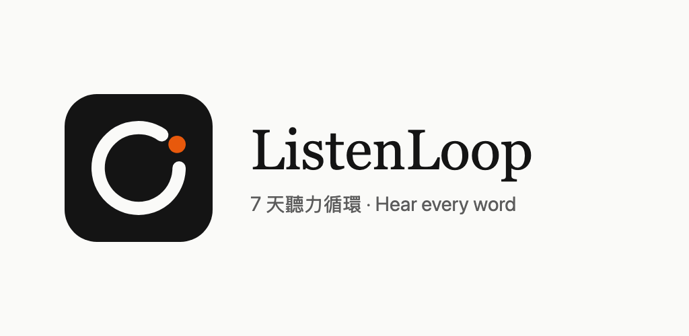

<p align="center">
  
</p>

# ListenLoop

**A 7-day English listening course, not a tool.** Pick one video or audio lesson and work through it for a week: dictate it on Day 1, shadow it on Days 2–6, dictate it again on Day 7, and see how much more you now hear. Built for Taiwanese students, including those studying abroad.

**Live:** https://listenloop-three.vercel.app · Interface in 繁體中文 and English · Works without an account

## What it does

|                         |                                                                                                                                                 |
| ----------------------- | ----------------------------------------------------------------------------------------------------------------------------------------------- |
| **Day 1: dictation**    | Sentence-by-sentence playback (YouTube IFrame API or generated audio); type what you hear; word-level alignment shows what you missed.          |
| **Bilingual handout**   | English–Chinese side by side, vocabulary, grammar, and highlights; printable to PDF. Locked until Day 1 is done, so you listen before you read. |
| **Days 2–6: shadowing** | Say each sentence after the audio; the Web Speech API marks the words you skipped.                                                              |
| **Day 7: re-dictation** | The same dictation again, compared sentence by sentence with Day 1. 80% passes the week; otherwise the loop repeats.                            |
| **Library**             | Official materials by category, scenario, level, accent, and length, plus "How many minutes do I have today?". Every title is bilingual.        |
| **Create your own**     | Paste text or let AI write it for a scenario; the app splits, translates, annotates, and voices it (Azure OpenAI + Azure Speech).               |
| **Share**               | Public practices, reporting, and admin takedowns.                                                                                               |
| **Plans**               | A central plan config. Payments use a provider interface with a fake provider for now, plus signed webhooks (see `docs/payments.md`).           |

## Engineering

| Area            | How                                                                                                                                                                                                                                                                  |
| --------------- | -------------------------------------------------------------------------------------------------------------------------------------------------------------------------------------------------------------------------------------------------------------------- |
| Stack           | Next.js 16 (App Router, Server Actions), React 19, TypeScript (strict), Tailwind CSS 4, next-intl, Supabase (Postgres, Auth, Storage)                                                                                                                                |
| Testing         | 1,300+ Vitest unit and component tests; 59 Playwright end-to-end tests against the production build, with a stand-in Supabase; axe WCAG 2.1 AA scans in light and dark mode                                                                                          |
| Quality gates   | ESLint, Prettier, `tsc`, tests, and build on every commit (husky) and PR (GitHub Actions); `main` is protected and squash-merged only on green CI                                                                                                                    |
| Security        | Row level security on every table, checked statically and live (`npm run rls:check`); per-request CSP nonces; rate limits on every write; HMAC-signed, replay-protected, idempotent payment webhooks; secrets only in environment variables                          |
| AI cost control | Every paid call reserves its worst case first against daily, batch, and monthly caps, and is logged with tokens and cost; results are cached by content hash. Tests only use fake providers or recorded fixtures, and the network to AI vendors is blocked in tests. |
| Performance     | Lighthouse mobile ≥ 90 on home, library, and practice pages; Chinese uses system fonts instead of 1.4 MB of web fonts                                                                                                                                                |
| Accessibility   | Keyboard-first practice, `lang` on every bilingual string, reduced motion, 44 px touch targets, AI-simulated usability rounds with seven personas (`docs/usability-ai-test.md`)                                                                                      |
| Decisions       | 85+ recorded decisions with date, reason, and where to change them (`docs/decisions.md`)                                                                                                                                                                             |

## Project structure

```
app/          routes (pages, Server Actions, route handlers)
components/   UI components (design system in docs/design-system.md)
lib/          pure logic: scoring, the 7-day cycle, plans, payments, AI
auth/         server-only code that reads cookies or uses the secret key
supabase/     migrations (tables, RLS, functions)
messages/     zh-Hant and en translations (no UI text in components)
data/videos/  built-in video lessons (validated at build time)
e2e/          Playwright tests and the stand-in Supabase
usability/    the AI usability test
docs/         specs, decisions, roadmap, design system
```

## Getting started

Requires Node.js 24 or later.

```bash
npm install
cp .env.example .env.local   # AI_PROVIDERS=fake works without any keys
npm run dev
```

Open http://localhost:3000.

| Command                                       | What it does                                      |
| --------------------------------------------- | ------------------------------------------------- |
| `npm run dev`                                 | Development server                                |
| `npm run build`                               | Production build                                  |
| `npm run lint` / `format:check` / `typecheck` | Static checks                                     |
| `npm test`                                    | Unit and component tests (Vitest)                 |
| `npm run build:e2e && npm run test:e2e`       | End-to-end tests (Playwright)                     |
| `npm run usability`                           | The AI usability test (after `build:e2e`)         |
| `npm run rls:check`                           | Live row level security check with the public key |

## How it was built

Developed by Joe (product owner) with Claude Code as the engineer: the specs, product decisions, and acceptance are Joe's; the code, tests, and docs are Claude's. The process and numbers are in `docs/ai-dev-log.md`.

## Content and licenses

The built-in videos are Blender Foundation open movies under CC BY. Every lesson credits its source, license, and changes. See the in-app Credits page and `docs/video-candidates.md`.
