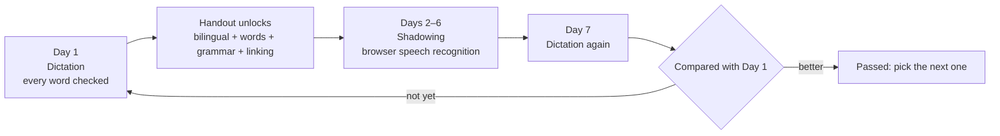
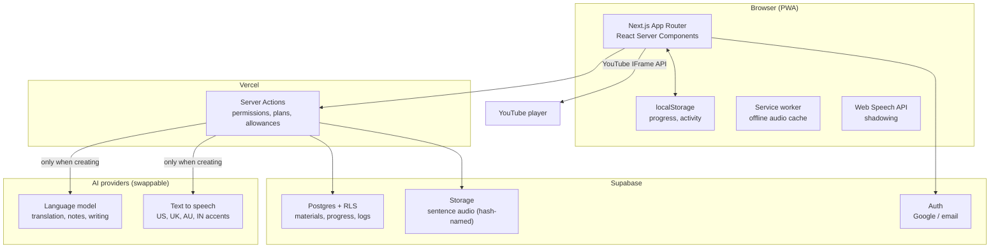

# ListenLoop case study: turning "I sort of understood it" into progress you can see

> An English listening course for students in Taiwan: one short clip, a 7-day loop, every word checked.
> The product owner led requirements, design, and acceptance; Claude Code was the AI engineering partner. From zero to production in 20 days.
>
> Live: <https://listenloop-three.vercel.app> · Code: <https://github.com/YA-CIAO-LIANG/listenloop>
>
> (Before sharing, replace "Joe" with the name and role you want to show.)

## Contents

1. [In one sentence](#1-in-one-sentence)
2. [The problem](#2-the-problem)
3. [Who it's for](#3-who-its-for)
4. [The solution: a 7-day loop](#4-the-solution-a-7-day-loop)
5. [Product decisions and trade-offs](#5-product-decisions-and-trade-offs)
6. [Architecture](#6-architecture)
7. [Keeping AI costs under control](#7-keeping-ai-costs-under-control)
8. [Quality and testing](#8-quality-and-testing)
9. [Numbers](#9-numbers)
10. [My role and the AI's](#10-my-role-and-the-ais)
11. [What I learned](#11-what-i-learned)
12. [What's next](#12-whats-next)

---

## 1. In one sentence

ListenLoop has learners master a 1–3 minute English clip in a week: dictate it sentence by sentence on Day 1, shadow it on Days 2–6, and dictate it again on Day 7, compared word by word with Day 1, so "is my listening getting better?" finally has a number.

## 2. The problem

The standard advice for English listening in Taiwan is "listen more": shows, podcasts. Most learners then hit the same wall:

- **They get the gist but aren't sure of every word.** In an exam or a real conversation, one missed _not_ or tense changes the meaning.
- **They practice a lot but can't see progress.** "Listen more" gives no feedback, so it's hard to keep going.
- **Missed words stay missed.** Linking and weak forms (_want to_ sounding like _wanna_) hide the same kinds of words again and again, and nobody says which ones.

The method that works is old-fashioned: take a short clip, write down every word, repeat it, and test again a few days later. It's also tedious: finding material, checking answers, keeping scores. Few people last a week. ListenLoop makes that "boring but effective" routine easy.

## 3. Who it's for

| Learner                             | Situation                                 | Cares most about                            |
| ----------------------------------- | ----------------------------------------- | ------------------------------------------- |
| High school and university students | GSAT, TOEIC, TOEFL, IELTS                 | Free, scores that go up                     |
| Students abroad (or about to be)    | Classes, renting, doctors, part-time jobs | Real situations; US, UK, Australian accents |
| Working professionals               | Meetings, calls, clients                  | Done in 10 minutes a day                    |
| Teachers and cram schools           | Assigning materials, tracking students    | Class tools, each student's gain            |

Ten personas (a junior-high student, a high-school student, a student abroad, a professional, an older learner, an assistive-technology user, an English-interface user, a senior preparing for the college entrance exam, a Taiwanese graduate student in the US, a cram-school teacher) drive an AI usability test whose problems are fixed by Nielsen severity (`docs/personas.md`, `docs/usability-ai-test.md`).

## 4. The solution: a 7-day loop

- **Day 1 dictation**: each sentence plays, the learner types, and every word is compared (numbers, contractions, and percentages normalized). Missed words get a highlighter, with the sentence's notes: key words, why it's hard to hear (linking, weak forms), and a hard sentence broken into meaning groups.
- **Days 2–6 shadowing**: the browser's speech recognition shows which words were said; no recording leaves the device.
- **Day 7**: the same clip dictated again, side by side with Day 1, and the week is scored.
- **My misheard words**: each missed word comes back 1, 3, and 7 days later as a 30-second fill-in review, with no AI.

Materials come from the official library (free), Creative Commons films such as Blender's open movies, and learners' own (pasted text, an AI-written scenario, or a Creative Commons YouTube video).

## 5. Product decisions and trade-offs

Every detail the spec left open is in `docs/decisions.md` (D1–D118): date, decision, why, and where to change it. A few that shaped the product:

| Decision           | Chosen                                                    | Given up, and why                                                                                                                         |
| ------------------ | --------------------------------------------------------- | ----------------------------------------------------------------------------------------------------------------------------------------- |
| Motivation         | **Visible progress** (Day 1 vs Day 7, learning analytics) | A full aquarium game was built, then switched off on 2026-10-28: the product is a paced course, not a game. The code stays behind a flag. |
| Video playback     | YouTube's embedded player, sentence by sentence           | No downloading audio: YouTube's terms (at least 200×200, no overlays, no undocumented APIs).                                              |
| Content licenses   | Public domain, CC BY, CC BY-SA only; no wire services     | VOA's old transcripts didn't match its videos, so the whole set was paused rather than shipped.                                           |
| Speech recognition | The browser's (Web Speech API)                            | No uploaded recordings: privacy and cost. Trade-off: Chrome works best; other browsers get an "I've said it" fallback.                    |
| Where AI runs      | **Only when a material is created**                       | Never during practice: costs stay predictable; each sentence's translation, notes, and audio are made once and shared.                    |
| Plan limits        | One permission file, `lib/plans.ts`                       | Features only ask "may I?"; changing a plan never touches feature code.                                                                   |
| Payments           | A fake door first                                         | Measures pricing page → plan → subscribe before wiring real payments.                                                                     |
| Shared materials   | Preview the first 3 sentences; full practice is paid      | Enforced by row-level security and the server, not just hidden in the UI.                                                                 |
| Quality fixes      | AI and rules only suggest                                 | Published content changes only when an admin accepts, with an audit trail.                                                                |

## 6. Architecture

- **Front end**: Next.js (App Router), strict TypeScript, Tailwind; next-intl for Traditional Chinese and English. A design system (`docs/design-system.md`) defines tokens and components, with dark mode and `prefers-reduced-motion`.
- **Progress**: written locally first (practice works signed out), synced to the cloud once signed in, with defined merge rules across devices (e.g. telling "removed on another device" from "just started here").
- **Security**: row-level security on every table; `npm run rls:check` proves with the public key that private data is unreadable; a nonce-based CSP with `strict-dynamic`.
- **AI provider layer**: Azure OpenAI, Gemini, Google TTS, and Azure Speech behind one interface; development and tests always use fakes.

## 7. Keeping AI costs under control

AI is the product's main variable cost, so cost control is part of the architecture:

1. **Zero calls during practice**: AI runs only when a material is created; more practice costs nothing more.
2. **Content-hash caching**: a sentence's translation and notes, and its audio in a given voice, are made once and reused across materials.
3. **Limits and a log on every call**: output-token caps in `lib/ai/budgets.ts`; each call is logged in `api_calls` (tokens, characters, estimated cost) and visible to admins.
4. **Layered allowances**: daily caps by role and kind of work (admin manual / batch, paid, free), and a site-wide monthly cap of US$8 that pauses learners' creation.
5. **Batch scripts estimate first**: they print the worst case and run only with an explicit flag, checking the remaining budget before every call.
6. **Tests never spend**: unit tests, E2E, and CI block real API hosts; the first real answers are recorded as fixtures and reused.

Result: about **US$2** of real API spend over the whole build (2,360 logged calls), including 51 official materials, news lessons, a quality audit, and 4 film lessons.

## 8. Quality and testing

| Layer              | Tool            | What                                                                                                                                                     |
| ------------------ | --------------- | -------------------------------------------------------------------------------------------------------------------------------------------------------- |
| Unit and component | Vitest          | ~2,030 tests: scoring normalization and alignment, the 7-day rules, sync merging, plans and allowances, column-level permissions                         |
| End to end         | Playwright      | 179 tests against the **production build**, with a stand-in Supabase and a fixed clock                                                                   |
| Page sweep         | Custom qa-sweep | Every page at 5 widths × light/dark × Chinese/English: overlaps, clipping, overflow, touch targets, axe WCAG 2.1 AA, broken links, slow loads; 60 rounds |
| Simulated users    | Custom skill    | 10 personas, 4 roles, 12 whole flows on emulated iPhone and Android and a laptop; fixes by severity; simulated SUS 73.5 → 77.5                           |
| AI eval            | Custom          | 54-case golden set, a merge gate for prompt or model changes; now 96.31                                                                                  |
| Security           | CI              | gitleaks (0 real secrets in full history), Semgrep (0), OWASP ZAP (no High), Dependabot; daily encrypted backups and a restore drill                     |
| Content quality    | Audit script    | Rules on every official material plus an AI sample of translations (report only); fixes go through review                                                |
| After deploy       | verify-prod     | Deployment, security headers, CSP, YouTube playback, RLS                                                                                                 |

Process: every change is a PR (the repo is private without branch protection; CI must still pass before merging); local checks (lint, format, typecheck, test, build) and E2E pass before pushing; green CI before a squash merge.

## 9. Numbers

(2026-11-13)

| Item                            | Number                                                                             |
| ------------------------------- | ---------------------------------------------------------------------------------- |
| Build time                      | 2026-10-24 to 2026-11-13 (21 days)                                                 |
| Merged PRs                      | ~220                                                                               |
| Unit and component tests        | ~2,030                                                                             |
| E2E tests                       | 179 (incl. accessibility, emulated phones, emergency switches)                     |
| Page-sweep rounds               | 60                                                                                 |
| AI eval                         | 54-case golden set, 92.06 → 96.31                                                  |
| AI simulated usability test     | 10 personas, all 39 flows completed; simulated SUS 77.5 (not real users)           |
| Security scans                  | gitleaks 0 real secrets in full history; Semgrep 0; ZAP no High (2 headers fixed)  |
| Restore drill                   | All 50 tables and 43 RLS policies matched in ~3 s; ~30 min estimated in production |
| Recorded decisions              | 172 (D1–D172)                                                                      |
| Database migrations             | 64                                                                                 |
| Lighthouse (production, mobile) | 10 main pages at performance 96–100; home 100 on all four categories               |
| Total real AI API spend         | ~US$2.08 (logged since 2026-11-05)                                                 |
| Official materials              | 51 published audio lessons + the Sintel film                                       |
| Languages                       | Traditional Chinese and English UI; 3 system manuals in each                       |

## 10. My role and the AI's

I'm the **product owner**, new to coding, holding the work to a commercial standard.

**What I did:**

- **Requirements**: the product direction (a 7-day loop, "hear every word", students in Taiwan), each night's task list and priorities.
- **Design**: the design system's character (calm, professional, black, white, and orange) and UI acceptance (voice menu, navigation, progress only when signed in).
- **Decisions**: no gamification, only Creative Commons content, which services may cost money, the budget for every real API run (e.g. US$0.50 a night), plans and pricing direction.
- **Acceptance**: testing each release on the live site from its "what to check" list and asking for fixes.
- **What only I could do**: accounts and keys for Supabase, Google OAuth, Azure, and Vercel.

**What Claude Code did:**

- All code, tests, migrations, and documentation, and each PR's write-up in Traditional Chinese.
- Industry-default choices where the spec was silent, each recorded (D1–D118).
- Debugging on production: a setup diagnosis page, layout shifts found by Lighthouse, contrast issues found by axe, CSP host testing.
- Research: verifying content licenses, comparing payment providers (research and a fake door only).

**How we worked**: CLAUDE.md holds the working rules ("pick an industry default and record it; don't stop to ask", "estimate and get approval before any real API call") and the roadmap holds the order. That let the AI work through a night on its own; in the morning I read a report and a test list.

## 11. What I learned

1. **Write judgment down as rules, and the AI can work on its own.** What helped most wasn't longer prompts but stating when to stop and ask, what to decide alone, and that every decision gets recorded.
2. **Design cost control on day one.** "No AI during practice" and content-hash caching decoupled cost from usage.
3. **Tests are the safety net for AI collaboration.** When changes come fast, E2E and the page sweep are more reliable than checking by hand, and turning checks into re-runnable skills keeps them equally strict every time.
4. **Cutting a feature is a product decision.** The aquarium game was complete, but it didn't fit the positioning, so it went behind a flag that keeps the decision reversible.
5. **AI output needs a human checkpoint.** The audit found one name translated two ways, and a one-word line, "Emo?", translated as the music genre. The fix wasn't trusting the AI more; it was a review queue plus automatic checks.
6. **Licensing and privacy are product features.** Every source, license, and change is stored with the material; recordings never leave the browser; private data is closed and tested with RLS.

## 12. What's next

- Before paid plans open: Google sign-in in production, an email service, push-notification keys.
- Set prices from the fake-door data; package the PWA for Google Play.
- More film lessons (Cosmos Laundromat and others) and class-plan pilots with teachers and cram schools.

---

Last updated: 2026-11-12
