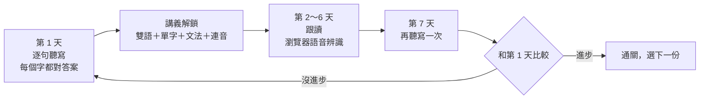
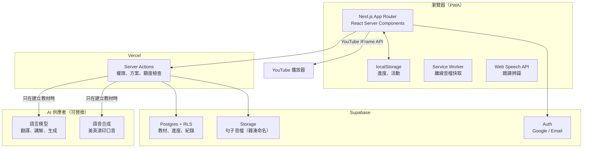

# ListenLoop 專案個案研究：把「聽得懂但不確定」變成看得見的進步

> 一個為台灣學生設計的英文聽力練習網站：一份教材、7 天循環、每個字都檢查。
> 由產品負責人主導需求、設計與驗收，Claude Code 擔任工程實作的 AI 夥伴，20 天內從零到正式上線。
>
> 線上網址：<https://listenloop-three.vercel.app>　·　程式碼：<https://github.com/YA-CIAO-LIANG/listenloop>
>
> （分享前請把文中的「Joe」換成你想公開的姓名與身分。）

## 目錄

1. [一句話總結](#1-一句話總結)
2. [問題與動機](#2-問題與動機)
3. [目標使用者](#3-目標使用者)
4. [解法：7 天循環](#4-解法7-天循環)
5. [產品決策與取捨](#5-產品決策與取捨)
6. [架構](#6-架構)
7. [AI 成本控制](#7-ai-成本控制)
8. [品質與測試](#8-品質與測試)
9. [數據](#9-數據)
10. [我的角色與 AI 的分工](#10-我的角色與-ai-的分工)
11. [學到的事](#11-學到的事)
12. [下一步](#12-下一步)

---

## 1. 一句話總結

ListenLoop 讓學習者用一週練熟一段 1～3 分鐘的英文：第 1 天逐句聽寫、第 2～6 天跟讀、第 7 天再聽寫一次，並和第 1 天逐字比較，讓「聽力有沒有進步」第一次變成一個數字。

## 2. 問題與動機

台灣學生學英文聽力，最常聽到的建議是「多聽」：看影集、聽 Podcast。但多數人遇到的是同一個卡關：

- **聽得懂大意，卻不確定每個字**。考試或真實對話裡，漏掉一個否定詞、一個時態，意思就錯了。
- **練了很多，卻看不到進步**。「多聽」沒有回饋，不知道自己是不是比上週聽得更清楚，很難持續。
- **錯過的字一直錯過**。連音、弱讀（例如 _want to_ 聽起來像 _wanna_）讓同一類字反覆漏聽，但沒有人告訴你漏的是哪一個。

真正有效的方法其實很老派：拿一小段素材，逐字聽寫、反覆跟讀、過幾天再測一次。問題是這套方法很麻煩——要找素材、對答案、記錄成績，多數人做不到一週。ListenLoop 的目標，就是把這套「無聊但有效」的流程變得容易。

## 3. 目標使用者

| 使用者           | 情境                               | 最在意                         |
| ---------------- | ---------------------------------- | ------------------------------ |
| 高中、大學生     | 準備學測、多益、托福、雅思         | 免費、能看到分數進步           |
| 留學生與準留學生 | 上課、租屋、看醫生、打工的生活英文 | 實用情境、英國／美國／澳洲口音 |
| 上班族           | 會議、電話、客戶溝通               | 每天 10 分鐘也能完成           |
| 老師與補習班     | 指派教材、追蹤學生                 | 班級管理、看到每個學生的進步   |

我們用 10 個人物誌（國中生、高中生、留學生、上班族、長輩、使用輔助科技的人、英文介面使用者、準備學測的高三生、在美國的台灣研究生、補習班老師）做 AI 模擬使用者測試，每輪依 Nielsen 嚴重度修正問題（`docs/personas.md`、`docs/usability-ai-test.md`）。

## 4. 解法：7 天循環

- **第 1 天聽寫**：逐句播放、打字，逐字比對（數字、縮寫、百分比都會正規化）。錯的字用螢光筆標出來，並顯示這句的講解：重點字、為什麼難聽（連音、弱讀）、困難句的意群拆解。
- **第 2～6 天跟讀**：瀏覽器的語音辨識判斷念完、念對哪些字；錄音不會上傳。
- **第 7 天**：同一份再聽寫一次，和第 1 天逐句對比，結算是否通關。
- **我的錯字**：每個聽錯的字在 1、3、7 天後回來做 30 秒的挖空複習，不需要 AI。

教材來源有三種：官方教材庫（免費）、Blender 開放電影等 CC 授權影片、使用者自建（貼文字、AI 生成情境、或 CC 授權的 YouTube 影片）。

## 5. 產品決策與取捨

每個規格沒寫到的細節都記錄在 `docs/decisions.md`（D1～D118），包括日期、決定、理由，以及之後要改時看哪裡。幾個代表性的取捨：

| 決策      | 選擇                                             | 放棄的選項與理由                                                                                               |
| --------- | ------------------------------------------------ | -------------------------------------------------------------------------------------------------------------- |
| 激勵方式  | **看得見的進步**（第 1 天 vs 第 7 天、學習分析） | 魚缸遊戲化已經做完，但 2026-10-28 用功能開關關閉：產品定位是「有節奏的課程」，不是遊戲。程式保留，隨時能打開。 |
| 影片播放  | YouTube 嵌入播放器逐句播放                       | 不下載影片聲音：遵守 YouTube 條款（播放器至少 200×200、不加遮罩、不用未公開的 API）。                          |
| 內容授權  | 只用公有領域、CC BY、CC BY-SA，排除通訊社        | VOA 舊版逐字稿和影片對不上，整批暫停，而不是勉強上架。                                                         |
| 語音辨識  | 瀏覽器內建（Web Speech API）                     | 不上傳錄音：隱私與成本；代價是 Chrome 最穩，其他瀏覽器有「我念完了」的備案。                                   |
| AI 用在哪 | 只在**建立教材時**呼叫                           | 練習時從不呼叫 AI：成本可預測，同一句的翻譯、講解、音檔只產生一次並共用。                                      |
| 方案限制  | 集中在 `lib/plans.ts`                            | 功能程式只問「能不能做」，改方案不用改功能。                                                                   |
| 收費      | 先做「假門測試」                                 | 記錄定價頁 → 選方案 → 按訂閱的漏斗，驗證付費意願後才接真正金流。                                               |
| 公開教材  | 預覽前 3 句，完整練習是付費功能                  | 由資料庫權限（RLS）與伺服器把關，不只藏在畫面上。                                                              |
| 品質修正  | AI 與規則只產生「待審修正」                      | 已發布內容一律由管理員按「接受」才寫入，並記錄稽核。                                                           |

## 6. 架構

- **前端**：Next.js（App Router）＋ TypeScript strict ＋ Tailwind，next-intl 繁中／英文介面。設計系統（`docs/design-system.md`）定義 tokens 與元件，深色模式、`prefers-reduced-motion` 都支援。
- **進度**：先寫本機（未登入也能練），登入後同步到雲端；多台裝置的合併規則有明確定義（例如「別台裝置移除的練習」和「這台新開始的練習」如何分辨）。
- **資料安全**：每張表都有 RLS；`npm run rls:check` 用公開金鑰實測所有私密資料都讀不到；CSP 使用 nonce 與 `strict-dynamic`。
- **AI 供應者抽象層**：Azure OpenAI、Gemini、Google TTS、Azure Speech 都實作同一介面；開發與測試一律用假的供應者。

## 7. AI 成本控制

AI 是這個產品最大的變動成本，所以成本控制是架構的一部分，而不是事後補的：

1. **練習時零呼叫**：AI 只在建立教材時使用，練習次數再多都不增加成本。
2. **內容雜湊快取**：同一句話的翻譯、講解、同一個聲音的音檔只產生一次，跨教材共用。
3. **每次呼叫都有上限與紀錄**：輸出 token 上限集中在 `lib/ai/budgets.ts`；每次呼叫寫進 `api_calls`（token、字元數、估算費用），後台可查。
4. **分層額度**：依身分與工作類型（管理員手動／批次、付費、免費）分開每日上限，全站每月上限 US$8，超過就暫停一般使用者建立。
5. **批次腳本先估價**：預設只印出最壞情況的費用，加上明確旗標才執行；每次呼叫前檢查剩餘預算。
6. **測試絕不花錢**：單元測試、E2E、CI 都擋掉真實 API 網址；第一次實測的結果錄成 fixture 重複使用。

成果：整個開發期間的真實 API 花費約 **US$2**（2,360 次呼叫的紀錄，含 51 份官方教材、新聞教材、品質稽核與 4 份影片教材的生成）。

## 8. 品質與測試

| 層級       | 工具          | 內容                                                                                                         |
| ---------- | ------------- | ------------------------------------------------------------------------------------------------------------ |
| 單元與元件 | Vitest        | 約 2,030 項：評分正規化與對齊、7 天循環規則、同步合併、方案與額度、RLS 欄位權限覆蓋                          |
| 端對端     | Playwright    | 179 項，對**正式版建置**執行；Supabase 換成本機假伺服器、日期用 `page.clock` 固定                            |
| 逐頁掃描   | 自建 qa-sweep | 每頁 5 種寬度 × 深淺色 × 中英文：重疊、截斷、溢出、觸控目標、axe WCAG 2.1 AA、壞連結、慢載入；已跑 60 輪     |
| 模擬使用者 | 自建 skill    | 10 個人物誌、4 種身分，在 iPhone、Android 模擬與筆電上走完 12 個完整流程，依嚴重度修正；模擬 SUS 73.5 → 77.5 |
| AI eval    | 自建          | 54 筆黃金測試集，是改提示詞或模型時的合併門檻；目前 96.31 分                                                 |
| 資安       | CI            | gitleaks（完整歷史 0 筆真金鑰）、Semgrep（0 筆）、OWASP ZAP（無 High）、Dependabot；每日加密備份與還原演練   |
| 內容品質   | 稽核腳本      | 規則檢查全部官方教材＋AI 抽查翻譯（只報告），修正走「待審」                                                  |
| 上線後     | verify-prod   | 部署狀態、安全標頭、CSP、YouTube 播放、RLS 實測                                                              |

工程流程：所有改動走 PR（repo 改私人後沒有分支保護，仍規定 CI 通過才合併）；本機五項檢查（lint、format、typecheck、test、build）＋ E2E 通過才推送，CI 綠燈才以 squash 合併。

## 9. 數據

（2026-11-13）

| 項目                     | 數字                                                                     |
| ------------------------ | ------------------------------------------------------------------------ |
| 開發期間                 | 2026-10-24 ～ 2026-11-13（21 天）                                        |
| 合併的 PR                | 約 220 個                                                                |
| 單元與元件測試           | 約 2,030 項                                                              |
| E2E 測試                 | 179 項（含無障礙、手機真機模擬、緊急開關）                               |
| QA 逐頁掃描              | 60 輪                                                                    |
| AI eval                  | 54 筆黃金測試集，92.06 → 96.31                                           |
| AI 模擬使用者測試        | 10 個人物誌、39 個流程全部完成；模擬 SUS 77.5（不是真人分數）            |
| 資安掃描                 | gitleaks 完整歷史 0 筆真金鑰；Semgrep 0 筆；ZAP 無 High（修正 2 項標頭） |
| 還原演練                 | 50 張表、43 條 RLS 規則全部一致，約 3 秒；正式環境估計 30 分鐘內恢復     |
| 決策紀錄                 | 172 則（D1～D172）                                                       |
| 資料庫 migration         | 64 個                                                                    |
| Lighthouse（正式站手機） | 10 個主要頁面效能 96～100；首頁效能、無障礙、最佳做法、SEO 都是 100      |
| 真實 AI API 總花費       | 約 US$2.08（2026-11-05 起有紀錄的部分）                                  |
| 官方教材                 | 已發布 51 份音檔教材＋Sintel 影片                                        |
| 介面語言                 | 繁體中文、英文；系統文件中英文各 3 份                                    |

## 10. 我的角色與 AI 的分工

我是**產品負責人**，也是 vibe coding 初學者，但要求商業專案等級的品質。

**我負責的：**

- **需求**：產品方向（7 天循環、「聽清楚每個字」、目標使用者是台灣學生）、每晚的任務清單與優先順序。
- **設計**：設計系統的風格（沉靜、專業、黑白橘）、介面驗收（例如聲音選單、導覽列、進度只在登入後顯示）。
- **決策**：不走遊戲化、只用 CC 授權素材、哪些服務可以付費、每次真實 API 的預算（例如一晚 US$0.50）、方案內容與定價方向。
- **驗收**：在正式站上依每次的「測試重點」實際操作，提出修正。
- **只有本人能做的事**：建立 Supabase、Google OAuth、Azure、Vercel 等帳號與金鑰。

**Claude Code 負責的：**

- 所有程式碼、測試、資料庫 migration、文件，以及每個 PR 的繁體中文說明。
- 規格沒寫到的細節，依業界做法自行決定並記錄（D1～D118）。
- 除錯與實測：正式站設定診斷、Lighthouse 找出的版面位移、axe 找出的對比問題、CSP 網域實測。
- 研究：素材授權查證、金流供應商比較（只做研究與假門測試）。

**協作方式**：CLAUDE.md 寫下工作規則（例如「規格沒寫到就選業界預設並記錄，不要停下來問我」、「呼叫真實 API 之前先估價、等我同意」），roadmap 寫下順序。這讓 AI 可以整晚自主進行，而我早上只需要看「晨間報告」與測試重點。

## 11. 學到的事

1. **把判斷寫成規則，AI 才能自主**。最有效的不是更長的提示，而是把「什麼時候停下來問我」「什麼可以自己決定」寫清楚，並要求每個決定留下紀錄。
2. **成本控制要在第一天設計**。「練習時不呼叫 AI」與「內容雜湊快取」兩個決定，讓成本和使用量脫鉤。
3. **測試是 AI 協作的安全網**。改動很快的時候，E2E 與逐頁掃描比人工檢查更可靠；而「先寫成可重跑的 skill」讓同樣的檢查每次都一樣嚴格。
4. **砍功能也是產品決策**。魚缸遊戲化做得很完整，但和定位不合就關掉；保留開關讓這個決定可以回頭。
5. **AI 產出一定要有人把關的流程**。品質稽核發現同一個人名有兩種譯法、短句「Emo?」被譯成「情緒搖滾」；解法不是更相信 AI，而是「待審修正」加上自動檢查規則。
6. **授權與隱私是產品的一部分**。每份素材的出處、授權、修改說明都寫進資料，錄音不上傳，私密資料用 RLS 實測關閉。

## 12. 下一步

- 正式開放付費方案前：Google 登入改為正式、寄信服務、推播金鑰。
- 用假門測試的數據決定定價；以 PWA 打包上架 Google Play。
- 擴充影片教材（Cosmos Laundromat 等），並和補習班、老師合作試用班級方案。

---

最後更新：2026-11-12
