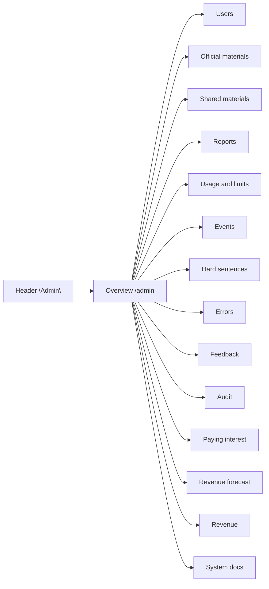
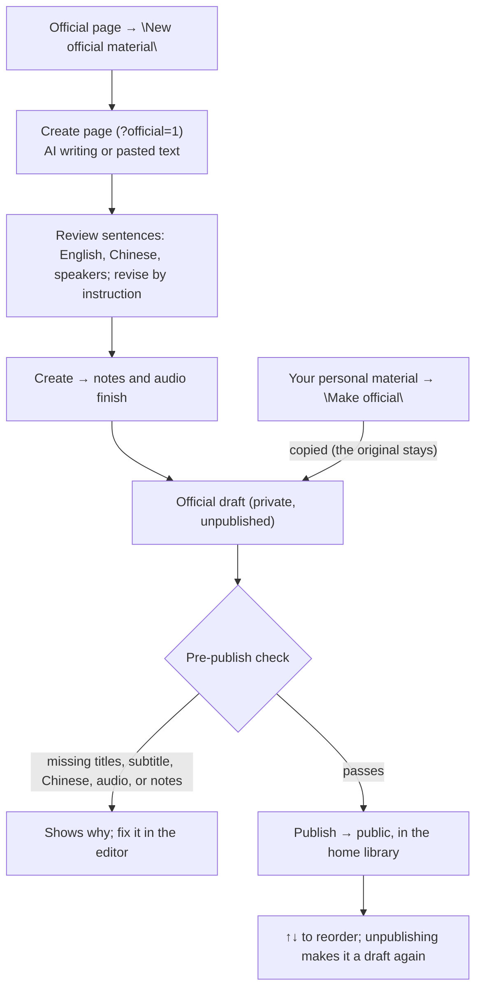
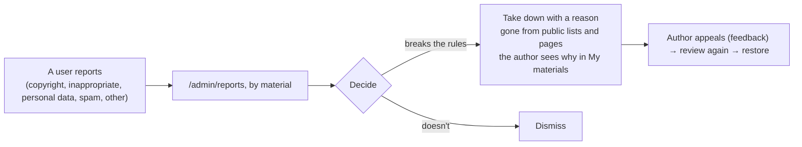

# ListenLoop Admin Manual

For ListenLoop's admins: what each admin page is for and how to use it, official materials from creation to publishing, allowances, reports, users, class plans, paying interest and the revenue forecast, and the monthly checklist.

## Contents

1. [Becoming an admin and opening the dashboard](#1-becoming-an-admin-and-opening-the-dashboard)
2. [The admin pages](#2-the-admin-pages)
3. [Official materials: create, review, publish](#3-official-materials-create-review-publish)
4. [AI allowances and costs](#4-ai-allowances-and-costs)
5. [Handling reports](#5-handling-reports)
6. [Managing users](#6-managing-users)
7. [Turning on class plans](#7-turning-on-class-plans)
8. [Paying interest and the revenue forecast](#8-paying-interest-and-the-revenue-forecast)
9. [The news schedule](#9-the-news-schedule)
10. [Monthly checklist](#10-monthly-checklist)
11. [Operations and incidents](#11-operations-and-incidents)
12. [Questions](#12-questions)

---

## 1. Becoming an admin and opening the dashboard

- **The first admins**: their emails are in Vercel's `ADMIN_EMAILS` (comma separated). They become admins every time they sign in, and the dashboard can't demote or disable them.
- **Other admins**: "Admin → Users → a user" → "Make admin".
- **Way in**: signed in, the header shows "Admin" and "Official". On phones the header wraps, so they're still there.
- Anyone else opening an `/admin` address gets a 404.
- Each admin page starts with a row of section links; on phones it scrolls sideways.

---

## 2. The admin pages

| Page               | Address                   | What it's for                                                                                                                                                          | Common actions                                                                                 |
| ------------------ | ------------------------- | ---------------------------------------------------------------------------------------------------------------------------------------------------------------------- | ---------------------------------------------------------------------------------------------- |
| Overview           | `/admin`                  | Users, active today / this week, sign-ups, new materials, days completed, API cost this month, Azure credit left, speech characters, Supabase usage, waiting list      | Look daily; a warning appears at 80% of the monthly cap. Opening it also prunes old logs       |
| Users              | `/admin/users`            | User number, sign-up date, last active, materials, usage this month, role, status, plan (no emails)                                                                    | Click a number for the user's page                                                             |
| A user             | `/admin/users/<number>`   | Role, status, plan, class plan, recent events                                                                                                                          | Make admin, disable (press twice), switch plan (Free / Plus / Pro), turn on a class plan       |
| Official materials | `/admin/official`         | Drafts and published, filterable by category                                                                                                                           | Create, edit, publish, unpublish, ↑↓ order, update notes in a batch                            |
| Shared materials   | `/admin/materials`        | Public materials people shared, and taken-down ones                                                                                                                    | Filter, set categories and subtitles, take down or restore                                     |
| Reports            | `/admin/reports`          | Open reports, grouped by material                                                                                                                                      | Take down (with a reason), dismiss, restore                                                    |
| Usage and limits   | `/admin/usage`            | Setup check, connection test, cost today and this month, limits, last 50 calls                                                                                         | Change the 5 limits; test connections (free)                                                   |
| Events             | `/admin/events`           | What users did (sign-in, start, done, again, create, report…)                                                                                                          | Filter by user number, type, date; the address can be shared                                   |
| Hard sentences     | `/admin/sentences`        | Shadowing problem reports, grouped by sentence                                                                                                                         | Open the material to fix the sentence or notes                                                 |
| Learners' reports  | Top of `/admin/sentences` | Learners' reports of a wrong translation, notes, or audio, by sentence (D113)                                                                                          | After fixing, mark fixed (the reporter is told) or won't fix                                   |
| Fixes to review    | `/admin/fixes`            | Fixes suggested by the quality audit and its rules (full-width digits, names, translations, shorter notes), each with the current text, the suggestion, and why (D117) | Accept writes it into the material and the admin audit; reject changes nothing; filter by type |
| Errors             | `/admin/errors`           | Server errors (path, type, message, error code)                                                                                                                        | Look up the "error code" a user reports                                                        |
| Feedback           | `/admin/feedback`         | What users sent                                                                                                                                                        | Mark handled                                                                                   |
| Audit              | `/admin/audit`            | Who did what to what, and when (before → after)                                                                                                                        | Check a change                                                                                 |
| Paying interest    | `/admin/interest`         | Funnel: pricing page → switch period → subscribe → waiting list; 8-week trend; plan, period, source shares                                                             | See which entry point works                                                                    |
| Revenue forecast   | `/admin/forecast`         | Editable subscribers, prices, costs; monthly revenue, prepaid cash, gross margin, profit, live                                                                         | Try scenarios                                                                                  |
| Retention          | `/admin/retention`        | Day 1, 7, and 30 retention, weekly actives, 7-day loop completion overall and by category (D114)                                                                       | Check the trend weekly                                                                         |
| Revenue            | `/admin/revenue`          | Subscriptions, payments, refunds (test data for now)                                                                                                                   | Refund (confirm twice)                                                                         |
| Waiting list CSV   | `/admin/waitlist/export`  | Download the waiting list                                                                                                                                              | Before sending launch notices                                                                  |
| System docs        | `/admin/docs`             | This manual, the system manual, the user manual, in Chinese or English                                                                                                 | —                                                                                              |

---

## 3. Official materials: create, review, publish

### 3.1 Creating

1. Header "Official" → "New official material".
2. Choose a source:
   - **AI writing**: title (optional; kept exactly if given), category, scenario, level, length, format (monologue by default), accent, and "What do you want to practice?";
   - **Pasted text**: English or Chinese. Start dialogue lines with "A:" and "B:" for two voices.
3. "Split and translate", then review each sentence: merge, split, edit English and Chinese, switch A / B. "Revise by instruction" (for example "use simpler words") can be undone.
4. Choose voices and "Create". You can leave while notes and audio are made; they appear on the official page.
5. It uses the **admin manual allowance** (US$1.00 a day).

### 3.2 What to review

- Natural English with no real people, brands, or current events; suitable for students;
- Smooth Chinese with Taiwanese usage;
- Correct notes (especially connected-speech explanations);
- Both titles and a subtitle (60 characters or fewer);
- Audio for every sentence, with no odd sounds.

### 3.3 Publishing and order

- Set the status to "Published" on the official page. If something's missing, it says what.
- Without a subtitle, one is written by AI when publishing (it publishes anyway if that fails; add it later).
- Use ↑↓ to set the order on the home page.
- **Update notes in a batch**: tick materials whose notes aren't the latest → "Update notes". It uses the **batch allowance**; ones already current cost nothing. Old notes stay in the version history, so learners mid-week aren't affected.

### 3.4 Fixes to review (D117)

- `npm run content:fixes` makes the suggestions (**no AI, no cost**):
  - full-width letters and digits → half-width (rule);
  - notes over 1,100 characters → shortened by rule to 1,000 or fewer (one example per word, at most two collocations…);
  - names and translations: suggestions written by hand after the quality audit, in `scripts/content-fixes/*.json`.
- By default it only prints what it would add; `FIXES_YES=1` stores them. A sentence and field with a pending fix isn't suggested twice.
- On `/admin/fixes`, accept or reject each one. If the sentence changed after the suggestion, accepting skips it and marks it out of date, so newer text is never overwritten.
- New materials: the translation and notes prompts carry these rules, new output is made half-width and shortened automatically, and the pre-publish check blocks full-width letters and digits, names written two ways, and long notes.

### 3.5 Video materials from Blender's open movies (D118)

- Excerpts are set in `lib/blender-films.ts`; subtitles are in `data/subtitles/`.
- `npm run blender:drafts` prints the plan and the worst-case cost; `BLENDER_YES=1` calls the AI for translations and notes and saves official drafts (YouTube materials, no audio). Existing excerpts are skipped; `BLENDER_ONLY=<key>` makes just that one.
- When reviewing, look at names (kept in English), one- or two-word lines, and slang or rude words. Then publish them on the official materials page.

### 3.6 Many at once with a script (needs Joe's approval of the cost)

- `npm run official:drafts`: prints the plan and the worst-case cost only.
- `OFFICIAL_YES=1 npm run official:drafts`: runs it. The budget (`OFFICIAL_BUDGET_USD`) is checked before every call and it stops when reached.
- Ones that pass the check are published; the rest stay drafts with reasons.

---

## 4. AI allowances and costs

### 4.1 Limits

Set in US dollars under "AI allowances" on `/admin/usage`; saving writes to the audit log:

| Item          | Default | Notes                                                                                |
| ------------- | ------- | ------------------------------------------------------------------------------------ |
| Admin manual  | US$1.00 | Per admin per day (creating, editing)                                                |
| Admin batch   | US$1.00 | Per admin per day (scripts, batch notes updates)                                     |
| Paid (Plus)   | US$0.20 | Per person per day; Pro gets 3 ×                                                     |
| Free          | US$0.05 | Per person per day                                                                   |
| Site, monthly | US$8.00 | Pauses regular users' creating when reached; admins can still create; warning at 80% |

Speech has its own daily character limit (16,000 per person; 120,000 for batches). Days reset at 00:00 Taiwan time; months on the 1st.

### 4.2 Reading usage

- **Cost today and this month**, **Azure student credit left** (US$100 minus the total), **Azure speech characters this month** (F0 allows 500,000).
- **Last 50 calls**: time, provider, operation, tokens, characters, cost, failure reason (for example "Failed (config; HTTP 401)").
- A weekly cost report: tell Claude Code "this week's usage" (the `cost-report` skill).

### 4.3 When setup breaks

1. See which "Setup check" item is ✗ (keys are never shown).
2. Press "Test connection (free)": no cost; it shows the status code and which setting to check.
3. After changing environment variables in Vercel, redeploy.

---

## 5. Handling reports

- Nothing is taken down automatically because of report counts; an admin decides.
- Neither the author nor the review page shows who reported.
- Every action is in the audit log.
- Copyright notices: follow section 5 of the terms; ask for proof of rights when needed.

---

## 6. Managing users

| Action              | How                                            | Notes                                                                                                         |
| ------------------- | ---------------------------------------------- | ------------------------------------------------------------------------------------------------------------- |
| Find someone        | Users list: number, sign-up date, last active  | No emails in the dashboard. To find someone by email, look up their user id in Supabase's Authentication page |
| Make / unmake admin | Buttons on the user's page                     | Not your own account; `ADMIN_EMAILS` accounts can't be demoted                                                |
| Disable / restore   | User's page, confirm twice                     | Disabled accounts are treated as signed out and banned in Auth; issued tokens expire within an hour           |
| Switch plan         | Plan menu on the user's page (Free, Plus, Pro) | For testing; subscriptions will update it later. Audited                                                      |
| See activity        | Bottom of the user's page, or Events by number | Only the needed fields, no text                                                                               |
| Delete an account   | The user does it on their account page         | Admins don't delete for them; if they can't sign in, ask them to use the feedback page                        |

### 6.1 Sign-ups and invites (`/admin/beta`, D132)

| Task                         | How                                                                                                     | Note                                                                                                     |
| ---------------------------- | ------------------------------------------------------------------------------------------------------- | -------------------------------------------------------------------------------------------------------- |
| See the places               | "Accounts / cap" at the top: accounts in (admins not counted) against the cap                           | At the cap or when closed, a new person is stopped after their first sign-in and sees "The Beta is full" |
| Open or close sign-ups, cap  | Choose Open or Closed, enter the cap, Save                                                              | Only new people are affected; existing accounts can always sign in. Audited                              |
| Make an invite link          | Uses (1–10,000), valid days (empty = never expires), a note → "Make an invite link"; copy and send it   | People with an invite skip the cap and the switch; each uses it once at their first sign-in              |
| See how invites are used     | The invites table: used / allowed, expiry, state (usable, used up, expired, withdrawn)                  | The latest 100                                                                                           |
| Withdraw an invite           | "Withdraw" in the table                                                                                 | The link stops working; people who already used it stay                                                  |
| Invite from the waiting list | Choose people (or "Choose the N not invited yet") → "Invite the N chosen" → copy each link and email it | One single-use link each, valid 30 days; send them yourself until an email service is set up             |

- A new account that's stopped is deleted at once (nothing kept), so it doesn't take a place; they can join the waiting list at `/beta`.
- Email sign-ups are stopped before the confirmation email when the Beta is full.

---

## 7. Turning on class plans

1. The teacher signs in once (making the account).
2. "Admin → Users → the teacher's number" → "Class plan" → **40 students** → save (audited).
3. The teacher goes to header "Classroom" → "Classes I teach", creates a class, and gets an 8-character invite code.
4. Choose "None" to turn it off. Other sizes turned on under D103 (10 / 20 / 80 / 100) still work.
5. Admins can create classes without a class plan (trials, demos), up to 100 students each.

With it, a teacher gets 40 students a class, 160 minutes of their own materials a month (when that's more than their personal plan), and shared materials in full.

---

## 8. Paying interest and the revenue forecast

### 8.1 Paying interest (`/admin/interest`)

| Step            | Meaning                                                 |
| --------------- | ------------------------------------------------------- |
| pricing_view    | Opened the pricing page                                 |
| interval_switch | Switched monthly / yearly                               |
| subscribe_click | Pressed "Subscribe"                                     |
| waitlist_join   | Joined the waiting list                                 |
| unlock_click    | Pressed an unlock on a feature (colors, shared preview) |

**How to read it**:

- **Conversion**: each step over the one before. Few pricing views turning into subscribe clicks suggests the price or plan isn't appealing; few clicks turning into joins may mean "coming soon" disappoints.
- **Sources**: which entry point brings the most pricing views (for example `trial-used`, `speed`, `shared-preview`). The busiest ones show what users want most.
- **Plans and periods**: Plus vs Pro, monthly vs yearly, for choosing defaults and prices.
- Signed-out visitors count once each via a random cookie; no personal data.

### 8.2 Revenue forecast (`/admin/forecast`)

- Every number can be changed: subscribers per plan and period, prices, AI cost (by default this month's actual cost ÷ minutes created this month), other costs.
- It shows monthly revenue, prepaid cash (yearly plans pay up front), gross margin, and profit, live.
- Use it with the interest numbers times a sensible conversion (for example 10–30% of the waiting list) to estimate the first month.

---

## 9. The news schedule

- Mondays 09:00 Taiwan time, GitHub Actions runs `npm run news:make`, 3 stories each time (D100).
- **Off by default**. To turn it on, GitHub → Settings → Secrets and variables → Actions:
  1. Secrets: the Supabase URL and secret key, Azure OpenAI and Azure Speech keys and settings;
  2. Variables: set `NEWS_SCHEDULE` to `on`.
- US$0.30 a run at most, and within the batch daily allowance and the site's monthly cap.
- It can also be run once by hand from the Actions page.
- Published news appears under the "News" category on the official page; unpublish anything wrong.

**Practice reminders** (D111) also run on GitHub Actions, every 15 minutes: generate VAPID keys (`npx web-push generate-vapid-keys`), set the public key as `NEXT_PUBLIC_VAPID_PUBLIC_KEY` in Vercel, add `NEXT_PUBLIC_VAPID_PUBLIC_KEY` and `VAPID_PRIVATE_KEY` to the GitHub secrets, and the variable `REMINDERS_SCHEDULE=on`.

---

## 10. Monthly checklist

| #   | Item                                                                              | Where                                                               |
| --- | --------------------------------------------------------------------------------- | ------------------------------------------------------------------- |
| 1   | AI cost this month, Azure student credit, F0 speech characters near their limits? | `/admin/usage`, overview                                            |
| 2   | Supabase database and file usage (free plan 500 MB / 1 GB)                        | Overview                                                            |
| 3   | New or repeating server errors                                                    | `/admin/errors`                                                     |
| 4   | Open reports cleared                                                              | `/admin/reports`                                                    |
| 5   | Feedback handled                                                                  | `/admin/feedback`                                                   |
| 6   | Hard sentences: fix the top few                                                   | `/admin/sentences`                                                  |
| 7   | Official materials: review drafts, notes current, news quality                    | `/admin/official`                                                   |
| 8   | Changes in interest conversion and sources                                        | `/admin/interest`                                                   |
| 9   | Back up the database (`npm run db:backup`) and store it safely                    | Locally (see `docs/backup.md`)                                      |
| 10  | Production check: pages, headers, CSP, RLS                                        | Claude Code "check production" (`verify-prod`), `npm run rls:check` |
| 11  | Security updates of dependencies (minor / patch)                                  | `npm outdated`, then a PR via Claude Code                           |
| 12  | Audit log: any change you don't recognize                                         | `/admin/audit`                                                      |
| 13  | Learners' sentence reports handled                                                | `/admin/sentences`                                                  |
| 14  | Run the official quality audit monthly (rules are free; check the AI cost first)  | `npm run official:audit` (`AUDIT_YES=1` calls AI)                   |

---

## 11. Operations and incidents

When something goes wrong, contain it first, then find the cause. The full steps are in `docs/incident-runbook.md`.

### 11.1 Emergency switches (`/admin/ops`, D155)

| Switch           | Effect                                                                                                             |
| ---------------- | ------------------------------------------------------------------------------------------------------------------ |
| Maintenance mode | Everyone but admins sees the maintenance page (HTTP 503). Sign-in, status, privacy, and terms stay open            |
| Read-only mode   | Browsing and practising go on; creating (AI, uploads, quiz questions), public sharing, and new sign-ups are paused |
| Features         | AI text generation, revising, audio upload, speech to text, public sharing, and new sign-ups can each be paused    |

- "Save switches" asks once more; every change goes in the audit log (`site_switches`).
- Each server caches the switches for up to 30 seconds, so a change reaches the whole site within about 30 seconds.
- Admins aren't affected, so they can keep checking and fixing.
- Public sharing is also refused by the database (a trigger), even for someone calling the API directly.
- With sign-ups paused, invite links don't work either; people with an account sign in as usual.

### 11.2 Announcements and the status page

- Post an announcement at the bottom of `/admin/ops`: a level (notice, heads-up, important), the Chinese and English text, and how many hours it shows (empty: until ended).
- It shows under the header on every page; people can dismiss it, except an important one.
- The public status page `/status` (footer: "Service status") shows the state, what's paused, and the announcements.

### 11.3 Monitoring and alerts (D156)

- `.github/workflows/ops.yml` checks the site every 15 minutes, prunes old logs daily, and makes a usage summary every Monday morning. Setup steps: "Things to do yourself" in `docs/roadmap.md`.
- Alerts are under "Alerts" on `/admin/ops`, and on Discord when a webhook is set. The same problem is sent at most once in 6 hours.
- What raises one: the site or a health check failing, a burst of errors, an AI or speech allowance at 80% or used up, today's spend over 3× the 7-day average, Supabase at 80%, many sign-ups or reports in an hour.
- Forecasts and weekly summaries are on `/admin/usage`.

### 11.4 Signing in again (D159)

- Risky actions need a sign-in within the last 30 minutes: changing a role, plan, or status, class seats, taking down or restoring a material, refunds, the emergency switches, the AI cost limits, the sign-up switch, and exporting the waiting list.
- Past that, you're asked to sign out and in again: use "Account" at the top right, then retry.

### 11.5 Quotas (D161)

- Every plan's quotas: `docs/quotas.md`.
- More or less for one person: "Users → number → Quota": an amount, days, and a reason; you can also pause that account's AI.
- Audio no material has used for 7 days is removed daily; if too much looks unused, it stops and alerts you: check Supabase Storage.

## 12. Questions

| Question                                   | Answer                                                                                                                                  |
| ------------------------------------------ | --------------------------------------------------------------------------------------------------------------------------------------- |
| A user can't create materials              | Check their plan and trial (user page) and whether the site's monthly cap is used up (overview)                                         |
| A user can't see a shared material in full | The free plan previews only (D106); switch them to Plus on their page to test                                                           |
| An official material won't publish         | Read the check's reasons; usually a missing Chinese title or subtitle                                                                   |
| Changing a plan or price                   | Plans in `lib/plans.ts`; change only monthly prices (`lib/payments/pricing.ts`), yearly is 10 × automatically; ask Claude Code for a PR |
| A user reports an "error code"             | Search it (the digest) on the errors page                                                                                               |
| A refund                                   | Revenue page, confirm twice; test data only for now                                                                                     |

---

Last updated: 2026-11-11
