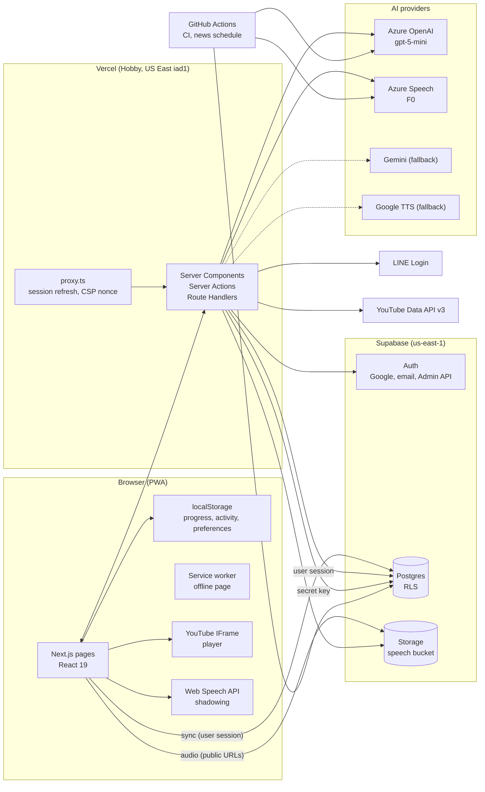
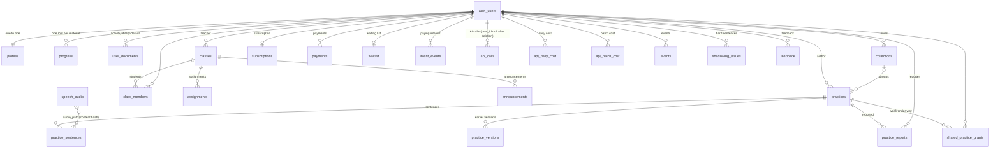
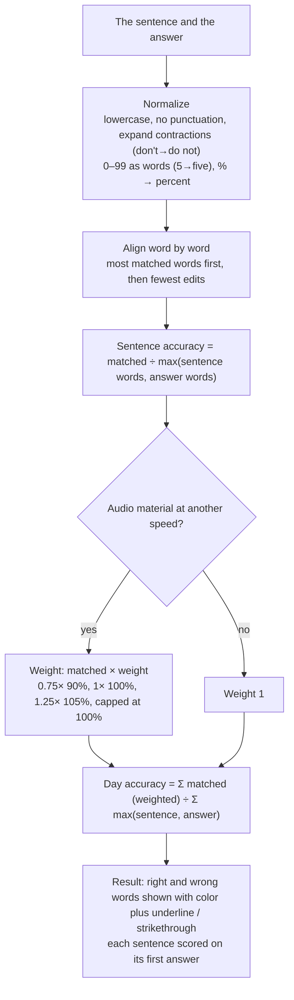
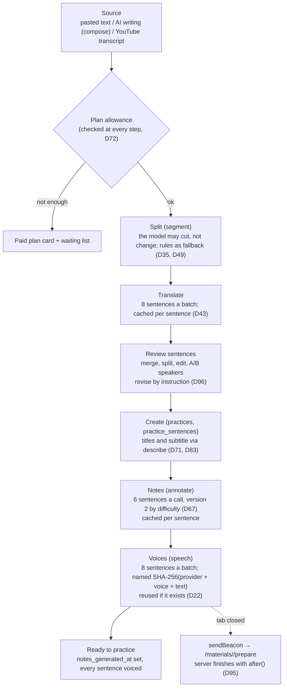
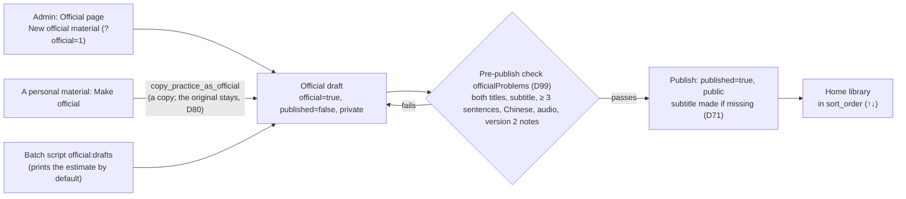
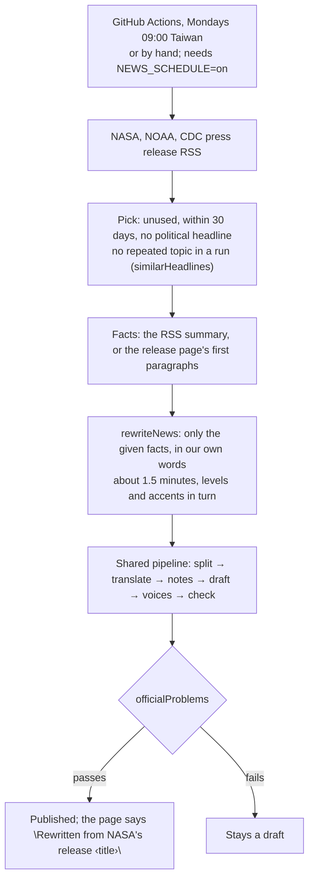
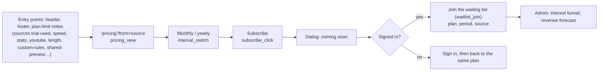
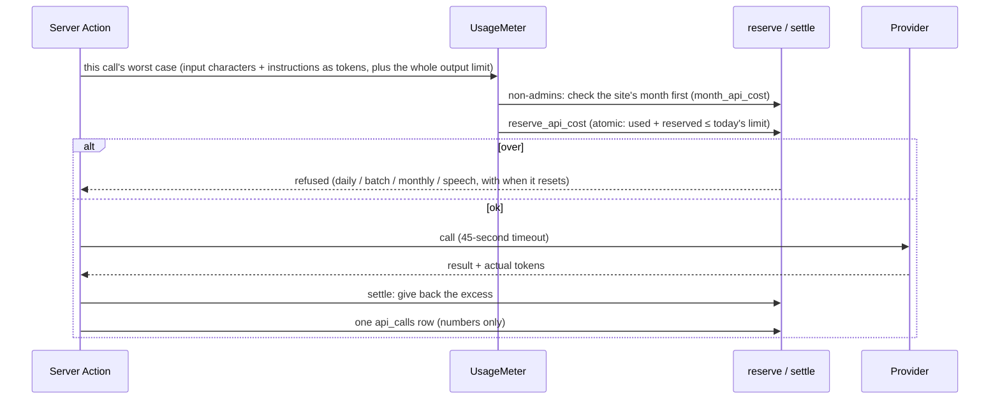
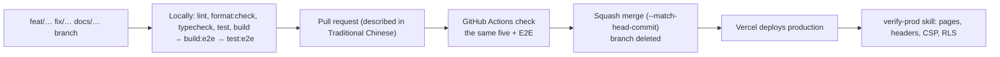

# ListenLoop System Manual (Technical)

For engineers who develop, operate, or review ListenLoop. It follows the code and `docs/decisions.md` (cited as D numbers). Where they disagree, the code is right; please update this document.

## Contents

1. [Product overview](#1-product-overview)
2. [Architecture](#2-architecture)
3. [Technology choices and why](#3-technology-choices-and-why)
4. [Data model](#4-data-model)
5. [Main flows](#5-main-flows)
6. [AI and cost control](#6-ai-and-cost-control)
7. [Plans and permissions](#7-plans-and-permissions)
8. [Internationalization, design system, accessibility](#8-internationalization-design-system-accessibility)
9. [Security and privacy](#9-security-and-privacy)
10. [Deployment and operations](#10-deployment-and-operations)
11. [Testing strategy](#11-testing-strategy)
12. [Known limits and roadmap](#12-known-limits-and-roadmap)

---

## 1. Product overview

### 1.1 Who it's for

- **Students in Taiwan** (high school and university) and **students studying abroad** who want to hear English better;
- Also: working adults, test takers (TOEFL, IELTS, TOEIC, GEPT), and English teachers (class plan, D103).

Positioning: not a tool but **a course with a rhythm**. The point is progress you can see: one material for a week, Day 7 compared with Day 1.

### 1.2 The core idea: a 7-day loop

Every material (built-in videos, official materials, your own, shared ones) follows the same loop. Each has its own start date and progress, and several can run at once (M5).

| Day         | Task                                                                                     | Done when (default; adjustable, D92)                     |
| ----------- | ---------------------------------------------------------------------------------------- | -------------------------------------------------------- |
| Day 1       | Dictation: sentence by sentence, type it, compared word by word; the handout opens after | Every sentence answered                                  |
| Days 2–6    | Shadowing: repeat after each sentence; the browser's speech recognition checks the words | Each sentence ≥ 60% covered                              |
| Day 7       | Dictation again, compared with Day 1                                                     | Weighted accuracy above Day 1's (100% if Day 1 was 100%) |
| Week result | Passed → choose the next; not passed → the same one again (from the day after Day 7)     | —                                                        |

- Each day needs the day before it, on a **different calendar day** (`NEXT_PUBLIC_DEV_TEST_MODE=true` skips this).
- **Practice again**: after a day is done it can be repeated; the official score is the first one, and repeats are never saved.

### 1.3 Features

| Area                 | Features                                                                                                                                                                              | Where                                                                  |
| -------------------- | ------------------------------------------------------------------------------------------------------------------------------------------------------------------------------------- | ---------------------------------------------------------------------- |
| Practice             | Dictation, shadowing, re-dictation, replay, loop (D90), audio speed (D73), notes (D67, D68), bilingual handout and PDF, listening mode (D135), vocabulary quiz (D136)                 | `/videos/<id>`, `/videos/<id>/day/<n>`, `/handout`, `/listen`, `/quiz` |
| Library              | Built-in videos and official materials; search, categories (up to 5), length, level, accent, scenario; searches as you tap (D104); saved default filter (D98)                         | Home `/`                                                               |
| Shared materials     | What people share; free plan previews, paid plans practice (D106)                                                                                                                     | `/explore`                                                             |
| Creating             | Pasted text, AI writing, audio uploads (D130); YouTube links (D97) paused (D131); splitting, translation, notes, voices; revise by instruction (D96); editing and versions (D44, D45) | `/materials`, `/materials/new`                                         |
| Progress             | Practice calendar, today's tasks, progress, stats, points and accent colors (D75, D93)                                                                                                | `/`, `/practices`, `/stats`                                            |
| Review and reminders | My misheard words (spaced review, D108), level test (D109), progress share card (D110), practice reminders (PWA push, D111), offline audio (D112), reporting a sentence (D113)        | `/review`, `/level-test`, account page                                 |
| By topic             | Public topic pages (SEO, D116)                                                                                                                                                        | `/learn`, `/learn/<category>`                                          |
| Account              | Google, LINE, email and password (D101); data download, account deletion (D60)                                                                                                        | `/login`, `/account`                                                   |
| Plans                | Free, Plus, Pro, class plan (fake door, D102, D105); waiting list                                                                                                                     | `/pricing`, `/pricing/classroom`                                       |
| Classroom            | Classes, invites, assignments, progress dashboard, CSV, announcements (D103)                                                                                                          | `/classroom`                                                           |
| Admin                | Overview, users, official materials, shared materials, reports, usage and limits, events, errors, feedback, paying interest, revenue forecast, revenue, retention, system docs        | `/admin/*`                                                             |

---

## 2. Architecture

### 2.1 Overview



### 2.2 What each part does

| Part                  | Responsibility                                                                                                                            | Main code                          |
| --------------------- | ----------------------------------------------------------------------------------------------------------------------------------------- | ---------------------------------- |
| **Browser**           | Screens, sentence playback, dictation scoring (client only), speech recognition, progress written locally then to the cloud, offline page | `components/`, `lib/` (pure logic) |
| **Server Components** | Read the database to build pages (materials, library, admin), permission checks, `notFound()` / `redirect()`                              | `app/**/page.tsx`, `auth/`         |
| **Server Actions**    | Every write and paid API call: each creation step, organizing, reports, feedback, paying interest, classroom, admin actions               | `app/**/actions.ts`                |
| **Route Handlers**    | OAuth callback, LINE login, webhook, data download, CSV, finishing a material in the background                                           | `app/**/route.ts`                  |
| **proxy.ts**          | Refreshes the Supabase session (PKCE cookies) on every request, makes the CSP nonce, adds security headers                                | `proxy.ts`, `lib/security/csp.ts`  |
| **Supabase Auth**     | Accounts, OAuth (Google), email confirmation and reset, Admin API (LINE sign-in magic links, bans)                                        | `auth/session.ts`, `auth/line.ts`  |
| **Postgres**          | All data; RLS decides who reads and writes; SQL functions for atomic work (allowances, rate limits, saving versions)                      | `supabase/migrations/`             |
| **Storage `speech`**  | One MP3 per sentence (named by content hash, public read, server-only upload)                                                             | `auth/audio-store.ts`              |
| **AI providers**      | Language model (splitting, translation, notes, writing, subtitles, revising, news rewriting) and speech; switched through interfaces      | `lib/ai/`                          |
| **GitHub Actions**    | CI (the `check` job; branch protection uses that name); weekly news (off by default, D100)                                                | `.github/workflows/`               |

### 2.3 Folders

| Folder                 | Contents                                                                          |
| ---------------------- | --------------------------------------------------------------------------------- |
| `app/`                 | Pages, Server Actions, Route Handlers                                             |
| `components/`          | UI components (design system tokens only)                                         |
| `lib/`                 | Pure logic: scoring, the loop, storage, sync, plans, prices, AI interfaces, stats |
| `auth/`                | Server-side Supabase clients and code that needs cookies                          |
| `i18n/`                | next-intl setup and the language switch                                           |
| `messages/`            | `zh-Hant.json`, `en.json`                                                         |
| `data/videos/`         | Built-in video JSON                                                               |
| `supabase/migrations/` | Tables, RLS, functions                                                            |
| `scripts/`             | Recording fixtures, official batches, news, backups, RLS check                    |
| `tests/`, `e2e/`       | Vitest unit tests, Playwright end-to-end tests                                    |
| `qa/`, `usability/`    | QA sweep, AI usability test                                                       |
| `docs/`                | Specs, decision log, design system, this document                                 |

---

## 3. Technology choices and why

| Item              | Choice                                                            | Why (decision)                                                                                         |
| ----------------- | ----------------------------------------------------------------- | ------------------------------------------------------------------------------------------------------ |
| Framework         | Next.js App Router, strict TypeScript, React 19                   | Server Components keep permissions and reads on the server; Server Actions need no API layer           |
| Styling           | Tailwind CSS 4, tokens in `app/globals.css`                       | Tokens defined once; dark mode through CSS variables                                                   |
| Languages         | next-intl, no URL prefix, language in a cookie                    | Clean URLs; shared links work in either language                                                       |
| Accounts and data | Supabase (Auth, Postgres, Storage)                                | One service for all three; RLS is the last line of defense (D4, D12); region us-east-1 (D11)           |
| Env var names     | Kept `NEXT_PUBLIC_SUPABASE_ANON_KEY`, `SUPABASE_SERVICE_ROLE_KEY` | New keys do the same job; nothing to re-enter (D10)                                                    |
| Video             | YouTube IFrame Player API, no audio download                      | YouTube's terms; each sentence's time range with padding (`lib/player/padding.ts`)                     |
| Shadowing         | Web Speech API (en-US)                                            | Free, no recordings uploaded; Android's repeated results handled (D89)                                 |
| Language model    | Azure OpenAI gpt-5-mini (Global Standard, UAE North)              | The only new model the Azure for Students regions allow (D37, D40); Gemini kept as fallback (D28, D29) |
| Speech            | Azure Speech neural voices, F0 (free)                             | 500,000 characters a month free (D39); Google TTS kept as fallback                                     |
| Speech to text    | Azure Speech short audio REST, F0 (free)                          | Practices from uploaded recordings (D130); 5 hours a month free, site cap 4.5 hours                    |
| Structured output | Strict JSON schema                                                | The model always answers in shape; the app still checks every item (D40)                               |
| Payments          | `PaymentProvider` interface with a fake provider                  | Test willingness to pay first (fake door); a real provider later without changing features (D85, D102) |
| Hosting           | Vercel Hobby                                                      | Fits Next.js; 60-second functions, so long jobs run in small batches (D22, D33, D95)                   |
| Charts            | No library: HTML, CSS, SVG                                        | Only bars and a line; saves 100 KB+ of JavaScript (D75)                                                |
| Tests             | Vitest, Playwright, axe-core                                      | Unit tests, E2E on the production build, automatic accessibility checks (D18, D61)                     |
| Chinese fonts     | System fonts                                                      | 1.4 MB of web fonts slowed phones' first paint (D87)                                                   |
| New packages      | Only when needed, official or well maintained, reason logged      | D9                                                                                                     |

---

## 4. Data model

### 4.1 ER diagram (main tables)



### 4.2 Tables and columns

All tables are in the `public` schema with RLS on (`tests/rls-coverage.test.ts` checks).

#### Accounts and progress

| Table            | Columns                                                                                                             | Purpose                                                                                                                   |
| ---------------- | ------------------------------------------------------------------------------------------------------------------- | ------------------------------------------------------------------------------------------------------------------------- |
| `profiles`       | `user_id`, `number`, `role`, `status`, `plan`, `practices_created`, `classroom_seats`, `created_at`, `last_seen_at` | User number (admin pages say "User 001", never the email), role, disabled, plan, trial count, class plan (D50, D72, D103) |
| `progress`       | `user_id`, `video_id`, `data` (jsonb), `updated_at`                                                                 | Each material's 7-day progress, the same format as localStorage (`lib/progress.ts`, D4)                                   |
| `user_documents` | `user_id`, `key`, `data`, `updated_at`                                                                              | Other personal documents: `activity` (tasks, practice time), `library-default` (saved filter)                             |

#### Materials

| Table                    | Columns (selection)                                                                                                                                                                                                                                                                                                                                                                                                                                       | Purpose                                                                                                                                                                                                                |
| ------------------------ | --------------------------------------------------------------------------------------------------------------------------------------------------------------------------------------------------------------------------------------------------------------------------------------------------------------------------------------------------------------------------------------------------------------------------------------------------------- | ---------------------------------------------------------------------------------------------------------------------------------------------------------------------------------------------------------------------- |
| `practices`              | `id`, `user_id`, `title`, `title_en`, `title_zh`, `subtitle`, `source_language`, `voice`, `voice_b`, `visibility`, `official`, `published`, `sort_order`, `category`, `categories`, `scenario`, `level`, `exam`, `exam_target`, `vocab`, `grammar`, `notes_generated_at`, `version`, `removed_at`, `removed_reason`, `estimated_seconds`, `duration_sec`, `youtube_id`, `youtube_channel`, `youtube_license`, `source_name`, `source_title`, `source_url` | One material (created, official, news, YouTube). Official status only by the server (`guard_official` trigger); `categories` is generated (GIN index); `duration_sec` is kept by a trigger from the audio sizes (D104) |
| `practice_sentences`     | `practice_id`, `i`, `en`, `zh`, `audio_path`, `notes` (jsonb, version 2 is `v: 2`), `speaker`, `start_sec`, `end_sec`                                                                                                                                                                                                                                                                                                                                     | Each sentence's text, translation, audio, notes; YouTube materials use start and end seconds (D43, D57, D97)                                                                                                           |
| `practice_versions`      | `practice_id`, `version`, `title`, `sentences`, `vocab`, `grammar`, `created_at`                                                                                                                                                                                                                                                                                                                                                                          | Snapshots of earlier versions, insert only (D44)                                                                                                                                                                       |
| `collections`            | `id`, `user_id`, `title`, `description`, `visibility`                                                                                                                                                                                                                                                                                                                                                                                                     | Groups of your own materials (D19, D24)                                                                                                                                                                                |
| `practice_reports`       | `practice_id`, `reporter_id`, `reason`, `details`, `status`, `resolved_at`                                                                                                                                                                                                                                                                                                                                                                                | Reports (D31)                                                                                                                                                                                                          |
| `shared_practice_grants` | `user_id`, `practice_id`, `week`, `started_at`, `created_at`                                                                                                                                                                                                                                                                                                                                                                                              | The week already under way when shared materials became paid (D106)                                                                                                                                                    |
| `speech_audio`           | `hash`, `path`, `bytes`, `mime_type`, `created_at`                                                                                                                                                                                                                                                                                                                                                                                                        | Audio already made (D22)                                                                                                                                                                                               |
| `ai_cache`               | `hash`, `kind`, `result`, `created_at`                                                                                                                                                                                                                                                                                                                                                                                                                    | Cache for splitting, translation, notes (D27, D43)                                                                                                                                                                     |

#### AI usage

| Table            | Columns                                                                                                                                         | Purpose                                               |
| ---------------- | ----------------------------------------------------------------------------------------------------------------------------------------------- | ----------------------------------------------------- |
| `api_calls`      | `user_id`, `provider`, `operation`, `input_tokens`, `output_tokens`, `chars`, `cost_micros`, `error`, `http_status`, `error_code`, `created_at` | One row per call, numbers only, never text (D38, D49) |
| `api_daily_cost` | `user_id`, `day`, `micros`                                                                                                                      | Manual creation's daily cost (reserve, then settle)   |
| `api_batch_cost` | `user_id`, `day`, `micros`                                                                                                                      | Batch jobs' daily cost (D77)                          |
| `api_usage`      | `user_id`, `day`, `kind`, `chars`                                                                                                               | Speech characters a day                               |
| `usage_settings` | `admin_manual_micros`, `admin_batch_micros`, `paid_micros`, `free_micros`, `site_monthly_micros`                                                | Limits set on the admin page (D77)                    |

#### Logs and operations

| Table                                         | Purpose                                                                                                                  | Kept                                              |
| --------------------------------------------- | ------------------------------------------------------------------------------------------------------------------------ | ------------------------------------------------- |
| `events`                                      | Events (sign-in, start, done, practice again, create, report…, D55)                                                      | 180 days                                          |
| `shadowing_issues`                            | Hard shadowing sentences reported (D52)                                                                                  | 365 days                                          |
| `admin_audit`                                 | Admin audit: who, when, on what, before → after (D56)                                                                    | 2 years                                           |
| `error_logs`                                  | Server errors (D63)                                                                                                      | 90 days                                           |
| `feedback`                                    | Feedback (D60)                                                                                                           | Not deleted                                       |
| `sentence_reports`                            | Learners report a problem with a sentence (translation, notes, audio); admins resolve it and the reporter is told (D113) | Not deleted                                       |
| `reminders`                                   | Each browser's push subscription, reminder time, and time zone (D111)                                                    | Deleted when turned off or the account is deleted |
| `rate_limits`                                 | Fixed-window counters (D63)                                                                                              | Overwritten each window                           |
| `intent_events`                               | Paying-interest funnel (D93, D102)                                                                                       | Not deleted                                       |
| `waitlist`                                    | Waiting list (plan, period, source)                                                                                      | Not deleted                                       |
| `subscriptions`, `payments`, `payment_events` | Subscriptions, payments, webhook idempotency (D85)                                                                       | Not deleted                                       |

#### Classroom (D103)

| Table           | Columns                                                                 |
| --------------- | ----------------------------------------------------------------------- |
| `classes`       | `id`, `teacher_id`, `name`, `invite_code` (8 characters), `archived_at` |
| `class_members` | `class_id`, `user_id`, `display_name`, `minor_consent`, `joined_at`     |
| `assignments`   | `id`, `class_id`, `video_id`, `title`, `starts_on`, `due_on`, `rules`   |
| `announcements` | `id`, `class_id`, `body` (up to 500 characters)                         |

### 4.3 Database functions

| Function                                                                    | Purpose                                                                        | Who may call                  |
| --------------------------------------------------------------------------- | ------------------------------------------------------------------------------ | ----------------------------- |
| `can_practice(target)`                                                      | Whether the viewer may practice it (D106)                                      | anon, authenticated           |
| `practice_notes(target)`                                                    | The practice-wide vocabulary and grammar, through `can_practice`               | anon, authenticated           |
| `practice_preview(target)`                                                  | A shared material's preview: first 3 sentences, first sentence's audio         | anon, authenticated           |
| `public_practice_readiness(targets)`                                        | Sentence and voiced counts of public materials                                 | anon, authenticated           |
| `reserve_api_cost` / `settle_api_cost` (and batch versions)                 | Reserve and settle AI cost, atomically                                         | service_role                  |
| `reserve_api_usage`                                                         | Reserve speech characters                                                      | service_role                  |
| `month_api_cost(month_start)`                                               | The site's cost this month                                                     | service_role                  |
| `hit_rate_limit`                                                            | Count and check a rate limit                                                   | service_role                  |
| `save_practice_edit`                                                        | Edit: snapshot, replace sentences, version + 1 (optimistic locking)            | authenticated (author)        |
| `upgrade_practice_notes`                                                    | Notes upgrade: snapshot, new notes, version + 1                                | service_role                  |
| `copy_practice_as_official`                                                 | Copy as an official draft (D80)                                                | service_role                  |
| `join_class`, `class_progress`, `is_class_member`, `is_class_teacher`       | Joining a class; a teacher reading progress (that class, its assignments only) | authenticated                 |
| `admin_overview`, `admin_users`, `api_usage_totals`                         | Admin numbers                                                                  | service_role                  |
| `material_learner_counts`, `practice_audio_bytes`, `practice_audio_seconds` | Library counts and lengths                                                     | anon, authenticated / trigger |
| `prune_logs`                                                                | Deletes logs past their retention                                              | service_role                  |
| `is_admin`                                                                  | RLS check for admins                                                           | authenticated                 |

### 4.4 Row level security at a glance

| Table                                                                                                                             | Read                                                                                           | Write                                                         |
| --------------------------------------------------------------------------------------------------------------------------------- | ---------------------------------------------------------------------------------------------- | ------------------------------------------------------------- |
| `profiles`                                                                                                                        | Own                                                                                            | Server only                                                   |
| `progress`, `user_documents`, `collections`                                                                                       | Own                                                                                            | Own                                                           |
| `practices`                                                                                                                       | Own; public and not taken down (everyone). `vocab` and `grammar` can't be read directly (D106) | Own; `official`, `published`, `removed_at` server only        |
| `practice_sentences`, `practice_versions`                                                                                         | Own; where `can_practice` is true                                                              | Own (versions insert only)                                    |
| `practice_reports`                                                                                                                | Own reports                                                                                    | Report someone else's public, live material                   |
| `waitlist`, `subscriptions`, `payments`                                                                                           | Own                                                                                            | Waiting list: insert own; the rest server only                |
| `classes`                                                                                                                         | Teacher, members                                                                               | Teacher                                                       |
| `class_members`                                                                                                                   | Own, the class's teacher                                                                       | Leave (self), remove (teacher); joining only via `join_class` |
| `assignments`, `announcements`                                                                                                    | Members                                                                                        | Teacher                                                       |
| `events`, `shadowing_issues`, `error_logs`, `feedback`, `admin_audit`                                                             | Admins (`is_admin()`)                                                                          | Server only                                                   |
| `api_*`, `usage_settings`, `rate_limits`, `intent_events`, `payment_events`, `shared_practice_grants`, `speech_audio`, `ai_cache` | Server only                                                                                    | Server only                                                   |

Signed-out visitors (anon) read only listed `practices` columns (column grants, no `user_id`). A new `practices` column needs its own grant to `authenticated` (and to `anon` when signed-out pages read it); a test checks.

---

## 5. Main flows

### 5.1 Signing up and in

```mermaid
sequenceDiagram
  autonumber
  actor U as Learner
  participant B as Browser
  participant S as Next.js server
  participant A as Supabase Auth
  participant L as LINE

  alt Google
    U->>B: Header "Sign in" → /login → "Continue with Google"
    B->>A: OAuth (PKCE)
    A-->>B: back to /auth/callback?code=…
    B->>S: /auth/callback
    S->>A: exchange for a session (cookies)
  else Email and password
    U->>S: Create account (NIST 800-63B password rules)
    S->>A: signUp → confirmation email
    U->>S: link in the email → /auth/confirm (one-time token)
  else LINE
    U->>S: /auth/line (state, nonce)
    S->>L: authorize
    L-->>S: /auth/line/callback?code
    S->>L: token, then /verify the id_token
    S->>A: Admin API one-time sign-in link, verified on the server
  end
  S->>S: proxy.ts refreshes the session on every request; getClaims() verifies it
  S->>S: a trigger makes the profile; ADMIN_EMAILS accounts become admins
  S-->>B: back to the page (same-site paths only)
  B->>S: sync: local progress ⇄ cloud (D3, D14, D15)
```

- **One email, one account**: Supabase links Google and email sign-ups by verified email; LINE signs in to the account with that email (D101).
- **No hint whether an account exists**: sign-up and reset answers are always the same.
- **Disabled**: with `profiles.status = disabled` the server treats the account as signed out, and Auth bans it (D50).

### 5.2 The 7-day loop

```mermaid
stateDiagram-v2
  [*] --> Day1: start Day 1 (version and start date recorded)
  Day1 --> Day2: every sentence answered (+ minimum accuracy, if set)
  Day2 --> Day3: next calendar day, each sentence covered enough
  Day3 --> Day4
  Day4 --> Day5
  Day5 --> Day6
  Day6 --> Day7
  Day7 --> Passed: week result: Day 7 weighted accuracy > Day 1 (or the set accuracy)
  Day7 --> Repeat: not passed
  Repeat --> Day1: a new week from the day after Day 7 (history kept)
  Passed --> [*]: choose the next; every day can still be reviewed
```



- Progress lives in localStorage (`ll-progress:v1:<videoId>`) and, signed in, in the cloud too; format and validation in `lib/progress.ts`.
- Unlocking, settling, and repeats: `lib/cycle.ts`; pass rules: `lib/pass-rules.ts`, saved in progress as `rules`.
- A created material's week keeps the version it started with (`materialVersion`, `VersionGate` adds `?v=`, D44).

### 5.3 How dictation is scored



- Code: `lib/scoring/` (normalizing and alignment), `lib/dictation.ts`, `lib/speed.ts`.
- Extra words lower the score, so typing common words doesn't pay; an empty answer is 0.
- Possessives and `'d` are ambiguous and not expanded.

### 5.4 Shadowing recognition

```mermaid
sequenceDiagram
  autonumber
  actor U as Learner
  participant P as Player
  participant R as Web Speech API
  participant C as Scoring
  U->>P: "Play and repeat"
  P-->>U: plays the sentence
  P->>R: listen (en-US; continuous on desktop and iOS, single on Android, D89)
  U->>R: repeats it
  R-->>C: interim and final results (mergeTranscript drops repeats)
  C->>C: coverage = matched words ÷ sentence words (extra words don't count against)
  alt coverage ≥ threshold (60% by default)
    C-->>U: done; missed words marked; confetti at 100%
  else 5 tries under 50% in a row
    C-->>U: troubleshooting dialog: try again / skip and report (shadowing_issues, D52)
  end
```

- If the browser can't recognize speech or the microphone is blocked, the reason is shown and "I've said it" marks the sentence (`coverage: null`).

### 5.5 Creating a material (AI writing, splitting, translation, notes, voices, caching)



- Every AI step: **reserve the worst case → call → settle the actual cost** (section 6).
- Splitting is cached per text; translation and notes per "provider id (model and prompt version) + sentence"; audio is named by "provider + voice + text". The same content is paid for once, in any material.
- Time estimate: 2.5 seconds a sentence, or this device's measured average (D95).

### 5.6 Editing and versions

```mermaid
sequenceDiagram
  autonumber
  actor A as Author
  participant E as Edit page
  participant S as Server Action
  participant DB as save_practice_edit
  A->>E: change titles, voice, sentences, Chinese, notes
  E->>S: save (with the version it opened)
  S->>S: unchanged English keeps its audio and notes; translate what's needed
  S->>DB: one transaction
  DB->>DB: version differs → "version conflict"
  DB->>DB: old version practicable → snapshot in practice_versions
  DB->>DB: replace sentences, version + 1
  S-->>E: saved
  E->>S: finish notes and audio (changed sentences only)
```

- A week in progress keeps its version; the server reads the `?v=` snapshot (D44).
- YouTube materials can't have their sentences edited (D97).

### 5.7 Publishing official materials



- `official`, `published`, `sort_order` change only through the server (trigger `guard_official`).
- Notes upgrades: `upgradeOfficialNotes` in batches, then `upgrade_practice_notes` makes a new version (D80).

### 5.8 News materials (D100)



- Cost: US$0.30 a run at most (`NEWS_RUN_BUDGET_USD`), and within the batch daily allowance and the site's monthly cap.

### 5.9 Reports and takedowns (D31)

```mermaid
sequenceDiagram
  autonumber
  actor R as Reporter (signed in)
  participant DB as practice_reports
  actor M as Admin
  participant P as practices
  R->>DB: reason + details (1 open report per material, 20 a day)
  M->>DB: /admin/reports, grouped by material
  alt take down
    M->>P: removed_at, removed_reason (server, audited)
    P-->>R: gone from public lists and pages
    P-->>P: the author still sees and practices it; My materials shows why
  else dismiss
    M->>DB: status=dismissed
  end
```

- Nothing is taken down automatically; authors never see who reported.

### 5.10 Fake-door pricing and the waiting list (D102, D105)



- Yearly = 10 × monthly (`yearlyFromMonthly`), shown as "2 months free" and the monthly average, never as a percentage.
- The test checkout `/checkout/fake` exists only with the fake provider, and never on the production site (D85).

### 5.11 Classroom assignments (D103)

```mermaid
sequenceDiagram
  autonumber
  actor T as Teacher (class plan)
  participant C as classes / assignments
  actor S as Student
  participant F as class_progress
  T->>C: create a class → 8-character invite code
  S->>C: join_class(code, class name, age confirmation) (seat limit)
  T->>C: assign: material, start, due date, pass rules
  S->>S: class page shows the assignment; apply the teacher's rules; practice as usual
  T->>F: read progress (this class's students × this class's assignments only)
  F-->>T: each student's day, Day 1–7 scores, gain, unfinished, the class's most-missed words
  T->>T: export CSV (UTF-8 with BOM)
```

- An assigned shared material can be practiced by its students without paying (`can_practice`, D106).

### 5.12 Shared materials: preview or practice (D106)

```mermaid
flowchart TD
  O["Open /videos/p-…"] --> R{"can_practice?\nauthor, Plus / Pro / class plan, admin,\nassigned student, week under way before the rule"}
  R -- yes --> FULL["The whole material: sentences, notes, handout, 7-day loop"]
  R -- no --> PV["practice_preview: both titles, subtitle, category, level, length, accent\nfirst 3 sentences in English and Chinese, listen to the first"]
  PV --> UP["\"Upgrade to practice this material\"\n/pricing?from=shared-preview"]
  D["Open /day/<n> or /handout"] --> R2{"can_practice?"}
  R2 -- no --> PV
```

---

## 6. AI and cost control

### 6.1 Switching providers

| Variable               | Values                      | Notes                                                                   |
| ---------------------- | --------------------------- | ----------------------------------------------------------------------- |
| `AI_LANGUAGE_PROVIDER` | `azure` (default), `google` | Language model                                                          |
| `AI_SPEECH_PROVIDER`   | `azure` (default), `google` | Speech                                                                  |
| `AI_PROVIDERS`         | `fake`                      | Everything fake; always ignored on production (`VERCEL_ENV=production`) |

- Features call only the interfaces in `lib/ai/types.ts` (D20). A misspelled value counts as unset and turns creating off; it never silently switches vendors.
- `languageSetup` and `speechSetup` decide whether setup is complete; the setup check on `/admin/usage` uses the same code (D47).

### 6.2 Prices (`lib/ai/pricing.ts`)

| Provider / model            | Input (per million tokens)        | Output (per million tokens) |
| --------------------------- | --------------------------------- | --------------------------- |
| Azure OpenAI gpt-5-mini     | US$0.25                           | US$2.00                     |
| Azure OpenAI gpt-4.1-mini   | US$0.40                           | US$1.60                     |
| Gemini 3.6 Flash (fallback) | US$0.75                           | US$3.75                     |
| Azure Speech F0             | Free (500,000 characters a month) | —                           |

Only priced models can be turned on, so no call goes unbilled (D40).

### 6.3 Reserve and settle



- A failure without usage data keeps the reservation; a failure with usage settles at the actual cost (D38).
- Output limits per call: `lib/ai/budgets.ts`.

### 6.4 Limits (defaults; adjustable on the admin page, D77)

| Allowance                  | Default                                                  |
| -------------------------- | -------------------------------------------------------- |
| Admin manual (daily)       | US$1.00                                                  |
| Admin batch (daily)        | US$1.00                                                  |
| Plus (daily)               | US$0.20                                                  |
| Pro (daily)                | US$0.60 (3 × Plus)                                       |
| Free (daily)               | US$0.05                                                  |
| Site, monthly              | US$8.00 (pauses regular users' creating; warning at 80%) |
| Speech (per person, daily) | 16,000 characters; batch 120,000                         |

Days reset at 00:00 Taiwan time, months on the 1st.

### 6.5 Caching

| Kind        | Key                                                         | Where                             |
| ----------- | ----------------------------------------------------------- | --------------------------------- |
| Splitting   | Provider id (model, prompt version) + the whole text        | `ai_cache`                        |
| Translation | Provider id + direction + one sentence                      | `ai_cache`                        |
| Notes       | Provider id + notes version (`v: 2`) + one English sentence | `ai_cache`                        |
| Audio       | SHA-256(provider id + voice + text)                         | Storage `speech` + `speech_audio` |
| AI writing  | Not cached (new content each time)                          | —                                 |

Changing a model, prompt, or voice means raising its version (`PROMPT_VERSION`, `NOTES_VERSION`, `AZURE_TTS_ID`), so old cache entries aren't reused.

### 6.6 Actual costs

| Item                                                | Size                          | Cost            | Source    |
| --------------------------------------------------- | ----------------------------- | --------------- | --------- |
| First live test (one of each of 5 calls)            | 1,177 in / 249 out tokens     | US$0.0008       | D41       |
| 14 official drafts                                  | 121 calls                     | US$0.1026       | D59       |
| Notes upgraded to version 2 (13)                    | 70 calls                      | US$0.3875       | D69       |
| 14 subtitles                                        | 14 calls                      | US$0.0019       | D71       |
| 18 official drafts (2 per category)                 | —                             | US$0.4795       | D84       |
| 34 official materials + 3 news                      | —                             | US$0.7455       | D99, D100 |
| Official quality audit (AI sample of 139 sentences) | 12 calls                      | US$0.0122       | D115      |
| Notes per sentence (version 2), average             | about 210 in / 380 out tokens | about US$0.0008 | D67       |
| Notes for a 30-sentence material                    | —                             | about US$0.025  | D67       |

All speech so far is within Azure F0's free tier. Live numbers: `/admin/usage` or the `cost-report` skill.

---

## 7. Plans and permissions

### 7.1 What each plan can do (`lib/plans.ts`)

| Item                                 | Free                        | Plus (`paid`)                      | Pro                                  | Class plan (teacher)                          | Admin    |
| ------------------------------------ | --------------------------- | ---------------------------------- | ------------------------------------ | --------------------------------------------- | -------- |
| Official materials, videos, the loop | ✓                           | ✓                                  | ✓                                    | ✓                                             | ✓        |
| Shared materials                     | Preview (first 3 sentences) | Practice in full                   | Practice in full                     | Practice in full                              | In full  |
| Your own materials                   | One to try (30 seconds)     | 40 minutes a month, 5 minutes each | 120 minutes a month, 10 minutes each | 160 minutes a month (whichever is more)       | No limit |
| YouTube materials                    | —                           | ✓                                  | ✓                                    | By personal plan                              | ✓        |
| Playback speed                       | —                           | ✓                                  | ✓                                    | By personal plan                              | ✓        |
| Full stats                           | Basics                      | ✓                                  | ✓                                    | By personal plan                              | ✓        |
| Custom pass rules                    | Defaults                    | ✓                                  | ✓                                    | By personal plan (assignments can carry them) | ✓        |
| Priority, batch PDF                  | —                           | —                                  | ✓ (label)                            | —                                             | ✓        |
| Classes (create, assign, reports)    | Join a class                | Join a class                       | Join a class                         | 40 students                                   | 100      |

- The account plan is `profiles.plan` (`free` / `paid` / `pro`); the class plan is `profiles.classroom_seats`.
- Code asks only `can(plan, action)`; changing a plan means editing `PLANS` (D54).

### 7.2 Counting allowances

- **One to try**: `profiles.practices_created` (a trigger adds 1 on insert; deleting doesn't give it back, D72).
- **Minutes a month**: the sum of `practices.estimated_seconds` created this month (Taiwan time); text at 130 words a minute, YouTube by the excerpt's length (D102).
- **Characters per material**: 2,000 on Free and Plus, 10,000 on Pro (technical limit).
- Checked before every AI step and on saving (`auth/creation-quota.ts`).

### 7.3 Previewing and practicing shared materials (D106)

- `/explore` lists only what people shared; official materials are only in the home library.
- Who may practice, what the preview shows, sending practice links back to it, the week under way: see 5.12 and `can_practice`.
- Prices:

| Plan                  | Monthly | Yearly (× 10) | A month on average |
| --------------------- | ------- | ------------- | ------------------ |
| Plus                  | NT$149  | NT$1,490      | NT$124             |
| Pro                   | NT$299  | NT$2,990      | NT$249             |
| Class                 | NT$499  | NT$4,990      | NT$416             |
| Class (priority list) | NT$349  | NT$3,490      | NT$291             |

---

## 8. Internationalization, design system, accessibility

### 8.1 Internationalization

- Interface in Traditional Chinese (default) and English; next-intl with the language in a cookie (`ll-locale`), first chosen from the browser.
- All interface text is in `messages/*.json`; tests check both files have the same keys, and that `.tsx` files in `app/` and `components/` have no hard-coded Chinese (except `global-error`).
- `<html lang>` follows the interface; English practice content is always `lang="en"`, Chinese titles `lang="zh-Hant"`.
- Handout translations are always Traditional Chinese (the learners are in Taiwan).

### 8.2 Design system

- Spec: `docs/design-system.md`; calm, professional, black, white, and orange, with dark mode; examples on `/styleguide`.
- Tokens in `app/globals.css` (`--ll-*`), used by every component; accent colors unlock with points (D93), each passing WCAG AA in both modes.
- Highlighter marks `mark-miss` (misheard, solid) and `mark-key` (key point, dotted), never color alone (D66).

### 8.3 Accessibility

- Target WCAG 2.1 AA: axe in E2E and the QA sweep (light and dark, both languages).
- Touch targets: 44 px on phones, 24 px elsewhere (`tap` utility, D76, D91).
- Keyboard: skip link, Enter in dictation, focus kept in dialogs (native `<dialog>`).
- Every chart has a summary sentence and a data table (D75); reduced motion turns animation off.

---

## 9. Security and privacy

| Item               | How                                                                                                                                                                                                        |
| ------------------ | ---------------------------------------------------------------------------------------------------------------------------------------------------------------------------------------------------------- |
| Authentication     | Supabase Auth; the server verifies tokens with `getClaims()`; `proxy.ts` refreshes sessions; redirects accept same-site paths only (D13)                                                                   |
| Authorization      | RLS is the last line; writes use the user's own session where possible; secret-key actions run only on the server after an identity check (D63)                                                            |
| CSP                | A new nonce per request + `'strict-dynamic'`; iframes only from YouTube; connections only to the site and Supabase; `object-src 'none'`, `frame-ancestors 'none'` (D63)                                    |
| Other headers      | HSTS 2 years, `nosniff`, `X-Frame-Options: DENY`, `Referrer-Policy`, `Permissions-Policy` (microphone only), `COOP same-origin`                                                                            |
| Rate limits        | Fixed windows in the database: feedback 5/h, hard sentences 30/h, events 300/h, reports 10/h, AI steps 600/h, data download 10/h, sign-in 20/h, billing 20/h, paying interest 120/h; signed out by IP hash |
| Webhook signatures | HMAC-SHA256 + a 5-minute timestamp; event ids for idempotency; older events never overwrite newer (D85)                                                                                                    |
| Secrets            | Environment variables only; keys in headers, never URLs; `api_calls` never stores text or keys                                                                                                             |
| Data collected     | Account (number, role, status, plan), progress, created materials, events, hard sentences (with recognized text), feedback, reports, API usage, paying interest (with a visitor cookie), LINE id           |
| Retention          | Events 180 days, hard sentences 365 days, errors 90 days, admin audit 2 years, API usage kept (unlinked when an account is deleted)                                                                        |
| Users' rights      | Download data (`/account/export`, JSON); delete the account (cascade; audio used only by that account goes too)                                                                                            |
| Minors             | Notice on first use; under 13 shouldn't make an account; parental consent confirmed when joining a class                                                                                                   |
| AI data            | Azure OpenAI doesn't train on it and keeps it up to 30 days for abuse monitoring; Azure Speech processes in the UAE (D40)                                                                                  |

---

## 10. Deployment and operations

### 10.1 Environment variables (names and purposes only)

| Name                                                                                             | Purpose                                                   |
| ------------------------------------------------------------------------------------------------ | --------------------------------------------------------- |
| `NEXT_PUBLIC_APP_URL`, `NEXT_PUBLIC_SITE_URL`                                                    | The site's address (SEO, links)                           |
| `NEXT_PUBLIC_DEV_TEST_MODE`                                                                      | Skip the different-calendar-day rule while developing     |
| `NEXT_PUBLIC_SUPABASE_URL`                                                                       | Supabase project URL                                      |
| `NEXT_PUBLIC_SUPABASE_ANON_KEY`                                                                  | Publishable key                                           |
| `SUPABASE_SERVICE_ROLE_KEY`                                                                      | Secret key (server only)                                  |
| `ADMIN_EMAILS`                                                                                   | Admin emails (comma separated)                            |
| `AI_LANGUAGE_PROVIDER`, `AI_SPEECH_PROVIDER`, `AI_PROVIDERS`                                     | Provider switches                                         |
| `AZURE_OPENAI_ENDPOINT`, `AZURE_OPENAI_API_KEY`, `AZURE_OPENAI_DEPLOYMENT`, `AZURE_OPENAI_MODEL` | Azure OpenAI                                              |
| `AZURE_SPEECH_KEY`, `AZURE_SPEECH_REGION`                                                        | Azure Speech                                              |
| `GEMINI_API_KEY`, `GOOGLE_CLOUD_API_KEY`                                                         | Fallback providers                                        |
| `YOUTUBE_API_KEY`, `YOUTUBE_PROVIDER`                                                            | YouTube materials (hidden without a key); `fake` in tests |
| `LINE_CHANNEL_ID`, `LINE_CHANNEL_SECRET`                                                         | LINE sign-in (hidden without them)                        |
| `PAYMENTS_PROVIDER`, `PAYMENTS_WEBHOOK_SECRET`                                                   | Payments (only `fake` now; off on production)             |
| `OFFICIAL_BUDGET_USD`, `NEWS_BUDGET_USD`, `NEWS_COUNT`, `NEWS_YES`, …                            | Batch scripts' budgets and switches                       |
| `LISTENLOOP_UNATTENDED`                                                                          | When 1, every script that calls a real API refuses to run |

The template is `.env.example`; values live only in `.env.local` and Vercel.

### 10.2 CI/CD and branch protection



- `main` is protected: pull requests only, and `check` must pass. Don't rename the job.
- Migrations: add-only ones with `npm run db:push -- --yes`; ones that change permissions or delete go in two steps, "add, deploy, then restrict" (D106).

### 10.3 Backup and restore

- `npm run db:backup`: every table as JSON in `backups/` (git-ignored).
- Full SQL backup and restore: `docs/backup.md`. Supabase's free plan has no restorable automatic backups, so back up by hand (D63).

### 10.4 Setup check and connection test

- The setup check on `/admin/usage` lists every condition creating needs (never the values, D47).
- "Test connection (free)" checks each provider with an unbilled request (D49): an empty chat to Azure OpenAI (400, no tokens), the voice list from Azure Speech.

### 10.5 Troubleshooting

| Symptom                                                                    | Likely cause and fix                                                                           |
| -------------------------------------------------------------------------- | ---------------------------------------------------------------------------------------------- |
| "Voice and translation services aren't connected", `/materials/new` is 404 | See which setup item fails; usually the deployment name, region, or endpoint format (D47, D51) |
| Failed (config; HTTP 401)                                                  | Wrong key or Azure credit used up; paste the key again and redeploy                            |
| HTTP 404 DeploymentNotFound                                                | `AZURE_OPENAI_DEPLOYMENT` differs from the deployment's name in Azure                          |
| Speech service busy                                                        | F0 allows 20 requests a minute; the app waits and retries (D39)                                |
| Creating stopped halfway                                                   | "Finish preparing" in My materials does only what's left                                       |
| "Can't reach the server; the site may have just updated"                   | An old page calling an old Server Action after a deploy; copy the text and reload              |
| Regular users can't create                                                 | The site's monthly cap is reached; check or adjust on `/admin/usage`                           |
| Signed out, the library has no official materials                          | A new `practices` column without an anon grant (fixed once in D106); run `npm run rls:check`   |
| Confirmation emails don't arrive                                           | Supabase's built-in mail sends very few an hour; set up your own SMTP (Resend)                 |

---

## 11. Testing strategy

| Level                  | Tools and scope                                                                                                                                | Command                                 |
| ---------------------- | ---------------------------------------------------------------------------------------------------------------------------------------------- | --------------------------------------- |
| Unit                   | Vitest: scoring, the loop, sync, plans, prices (yearly = 10 × monthly), AI answer checks, static RLS checks, matching message keys, components | `npm test`                              |
| AI fixtures            | Real answers recorded in `tests/fixtures/ai/` and replayed; recording prints an estimate by default (D41)                                      | `npm run ai:record`                     |
| End to end             | Playwright on the production build; YouTube blocked; dates via `page.clock`; stand-in Supabase (`e2e/mock-supabase/`); fake AI and payments    | `npm run build:e2e && npm run test:e2e` |
| Accessibility          | axe (WCAG 2.1 A / AA) on main pages, light and dark, signed in and out                                                                         | Inside E2E                              |
| QA sweep               | 5 widths × light and dark × two languages: overlap, truncation, overflow, targets, axe, errors, broken links, slow pages (D91)                 | `npm run qa`, `qa-sweep` skill          |
| AI usability test      | 7 personas, 11 tasks, Nielsen severity (D86)                                                                                                   | `ai-usability-test` skill               |
| Live RLS check         | With the public key against production: private reads, writes, and admin functions must all be refused                                         | `npm run rls:check`                     |
| Production check       | Pages, headers, CSP, YouTube, manifest, RLS                                                                                                    | `verify-prod` skill                     |
| Official quality audit | Rules on every published official material, an AI sample of translations (D115)                                                                | `npm run official:audit`                |

**Cost rule**: development and every automatic test use fake providers or fixtures only; `tests/setup-network.ts` blocks Azure and Google; Playwright forces `AI_PROVIDERS=fake` and clears keys.

---

## 12. Known limits and roadmap

### 12.1 Known limits

- **Supabase free plan**: 1 GB of files (about 48 hours of audio), 5 GB uncached egress a month (about 600 learner-weeks, D46); no automatic backups.
- **Vercel Hobby**: 60-second functions; background finishing gets about 5 minutes (D95).
- **Azure F0**: 20 requests a minute, 500,000 characters a month; student credit US$100.
- **Web Speech API**: results vary by browser and room; Chrome recommended; Android needs a real-device check (D89).
- **Signed-out progress is on the device only** and disappears with browser data; when shared materials became paid, only accounts with progress in the cloud could finish their week (D106).
- **YouTube materials** can't have sentences edited or be copied as official (D97).
- **Payments**: only the fake provider; plans are set by admins.
- **Priority** is a label for now; **batch PDF** isn't built yet.
- **News schedule** is off by default.
- **Migrations waiting for Joe's approval**: shared materials' read policies (`20261111000100_shared_practice_lock.sql`; until then the server's `can_practice` check enforces the rule, D106), reminders (`20261111010000_reminders.sql`), sentence reports (`20261111020000_sentence_reports.sql`).
- **Practice reminders** appear once the VAPID keys and the GitHub schedule are set (D111).
- **Sync**: restarting offline a material removed on another device deletes it at the next sync (D15).

### 12.2 Roadmap

- A real payment provider (`docs/payments.md`) and Google Play (`docs/play-store.md`, `docs/twa.md`).
- The Product Hunt launch (`docs/launch/product-hunt.md`); fixing the translations the quality audit flagged.
- Classroom: reminders, gradebook, co-teachers, school plans (`docs/classroom.md`).
- Content: subtitles and timing for the Blender open movies (the rest of M3).

---

Last updated: 2026-11-11
