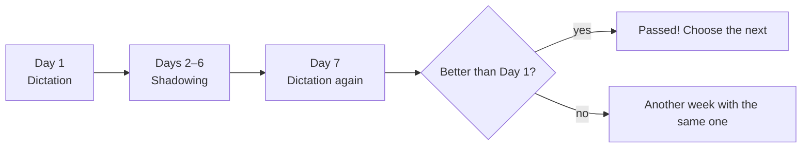
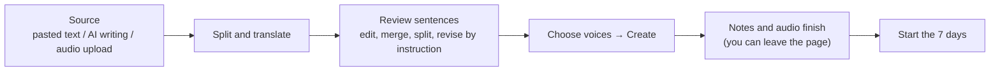

# ListenLoop User Manual

ListenLoop is an English listening practice site: pick one material and spend 7 days learning to hear every word, then compare Day 7 with Day 1 and see your progress.

## Contents

1. [Signing up and in](#1-signing-up-and-in)
2. [Choosing a material](#2-choosing-a-material)
3. [How the 7 days work](#3-how-the-7-days-work)
4. [Dictation](#4-dictation)
5. [Shadowing](#5-shadowing)
6. [Reading the notes and highlights](#6-reading-the-notes-and-highlights)
7. [Handout and PDF](#7-handout-and-pdf)
8. [Progress and stats](#8-progress-and-stats)
9. [Making your own materials](#9-making-your-own-materials)
10. [Classroom](#10-classroom)
11. [Plans](#11-plans)
12. [Account and privacy](#12-account-and-privacy)
13. [Questions](#13-questions)

---

## 1. Signing up and in

- **You can practice built-in videos and official materials without signing in**; your records stay on this device. On a first visit, "**Try your first sentence free**" at the top of the home page opens Day 1 of an easy material; "Take the 2-minute level test" suggests a level.
- **Signed in**, you see the practice calendar, today's tasks, progress, and stats, and your progress is kept in your account on every device. This device's earlier records join your account the first time you sign in.
- Press "Sign in" at the top right and choose one:
  1. **Google**;
  2. **LINE** (your LINE account needs an email);
  3. **Email and password**: "Create account" → click the link in the confirmation email. At least 10 characters; spaces and Chinese are fine; don't reuse a password from another site.
- **One email is one account**: after signing up with Google, you can set a password with "Forgot password" and use either from then on.
- **Forgot your password**: sign-in page → "Forgot password" → email → set a new one.
- Under 18, please use it with a parent's or guardian's consent; under 13, please don't make an account yourself.

---

## 2. Choosing a material

### 2.1 The official library on the home page

- **Built-in videos**: Blender open movies and more, with credits.
- **Official materials**: audio materials made by ListenLoop in categories like daily life, travel, campus, studying abroad, work, news, and test styles. Free.
- Filters:
  - **Categories**: tap tags, up to 5 ("X / 5 chosen" above); "All" clears them. Results update by themselves.
  - **Length**: all, under 3 minutes, 3–5, 5–10, over 10.
  - **Level, accent, scenario, type**, and a title search.
  - "Save as my default filter": applied next time you open the home page.
- **Not sure where to start?** Take the 2-minute level test (`/level-test`) for a suggested level and a first material. How it's scored: a few dictation sentences at beginner, intermediate, and advanced; **you reach a level at 60% or more**, and the result is the highest level reached in a row from beginner up. Afterwards the library opens filtered to that level (unless you saved a default filter of your own).
- Cards show the English and Chinese titles, a subtitle, length, accent, and about how many minutes a day it takes.

### 2.2 Shared materials

- Header "Shared": materials other people shared (official materials aren't here).
- **Free plan or signed out**: **preview** both titles, the subtitle, category, level, length, accent, and the first 3 sentences in English and Chinese, and listen to the first sentence.
- **Plus, Pro, class plans**: practice them in full. "Upgrade to practice this material" shows the plans.
- A shared material your teacher assigns can be practiced for free.

---

## 3. How the 7 days work

- One day at a time; **the next day opens tomorrow** (each material counts its own).
- You can practice several materials at once, each with its own progress.
- **Satisfaction survey**: when signed in, the Day 7 result asks "How likely are you to recommend ListenLoop to a friend?" (0–10) and an optional comment; once per material and week, and you can skip it.
- **Share card**: after Day 7, the result page makes an image (Day 1 and Day 7 accuracy, the change, the title, the site address; nothing personal) to download or share.
- After finishing a day, "Practice again" shows a score but doesn't change the official one.
- **Pass rules** ("Pass rules" on the material's page): by default "answer every sentence on Day 1", "say 60% of each sentence when shadowing", "Day 7 better than Day 1". Plus and above can change them, for example requiring 70% in dictation.

---

## 4. Dictation

1. Open Day 1; the first sentence plays once by itself.
2. Type what you hear and press **Enter**.
3. You see a word-by-word comparison:
   - right words look normal;
   - misheard or missed words are colored and underlined; extra words are struck through.
4. Below are the Chinese translation and the notes. "Next sentence" continues.

| Button / feature | What it does                                                                       |
| ---------------- | ---------------------------------------------------------------------------------- |
| Replay           | Hear the sentence again                                                            |
| Loop             | Plays the sentence again 1.5 seconds after it ends, until you answer               |
| Speed            | Audio materials: 0.75×, 1×, 1.25× (Plus and above); slow scores × 90%, fast × 105% |
| Captions         | For YouTube videos, press the player's CC button to turn captions off              |

- Score: matched words ÷ (the sentence's words or yours, whichever is more). Typing lots of extra words lowers it.
- Numbers can be digits or words (5 = five); contractions are fine (don't = do not).
- Each sentence counts on its first answer; no second tries.

---

## 5. Shadowing

1. On Days 2–6, press "Play and repeat": the sentence plays, then listening starts.
2. Say the whole sentence. You see which words were heard and which were missed, and the coverage.
3. Reaching the threshold (60% by default) finishes the sentence; 100% gets confetti.
4. When every sentence is done, so is today.

- Use **Chrome on a computer or Android** and allow the microphone; a quiet room helps.
- If the microphone is blocked or the browser can't recognize speech, it says why, and "I've said it" marks the sentence yourself.
- After 5 tries in a row under 50%, you get tips (check the microphone, find a quiet spot, listen to the whole sentence first) and can "Skip this one and report it" without affecting completion.

---

## 6. Reading the notes and highlights

Shown after a dictation answer or a shadowed sentence:

| Section                             | What's in it                                                                |
| ----------------------------------- | --------------------------------------------------------------------------- |
| Difficulty                          | Easy, medium, hard; harder sentences get more detail                        |
| What you misheard                   | Only when something was wrong, shown first                                  |
| Chinese translation                 | Right under the English sentence                                            |
| Key points                          | The 1–2 words or phrases most worth learning                                |
| Structure and meaning, part by part | Hard sentences: main clause, subordinate clause, modifiers, each translated |
| Why it's hard to hear               | Linking, weak forms, dropped sounds (for example want to → wanna)           |
| Words and phrases                   | IPA, part of speech, Chinese, collocations, an example with Chinese         |
| Grammar                             | How it's used, the example in the sentence, a new example, a common mistake |

**Highlights**:

- **Orange, solid underline**: words you misheard or missed;
- **Yellow, dotted underline**: the sentence's key points.
- Screen readers say "misheard" and "key point".

---

## 7. Handout and PDF

- The handout opens **after Day 1** (so you don't read the text first).
- It has every sentence in English and Chinese, this week's Day 1 misheard words (orange), key points (yellow), the vocabulary list, grammar, and hard sentences' structure and linking.
- "Print / Save as PDF" → choose "Save as PDF" in the print dialog. Colors print lighter; the underlines still tell the two marks apart.

### 7.1 Listening mode (D135)

- **Opens after Day 1** (like the handout). Find it next to the handout on the material's page, on each day's result, and as "Listen" in today's tasks.
- No test, just listening: the whole text plays through, the current sentence highlighted; select any sentence to play from there.
- **Subtitles**: none, English, both, or Chinese; your choice is remembered.
- **Three passes**: one button plays the whole text three times: first with nothing, then the English, then both languages.
- **Repeat**: one sentence or the whole text. Audio materials can change speed (Plus and above).
- **Lock screen**: audio materials keep playing with the phone locked or in another app, with pause and previous/next on the lock screen. YouTube videos can't play in the background (YouTube's terms).
- Day 1's misheard words are highlighted. Listening counts toward practice time, but doesn't finish the day's task; while the audio plays it keeps counting in another tab or on a locked screen, and stops when paused (D183).
- Keyboard: Space plays or pauses; the arrow keys go to the previous or next sentence.

### 7.2 Vocabulary quiz (D136)

- After Day 1's and Day 7's dictation, the result offers "Vocabulary quiz (about 3 minutes)"; you can skip it, find it on the material's page, and take it again.
- 5–10 words each time: the ones you misheard first, then the material's key words.
- **Step 1, spell what you hear**: the word plays by itself; replay it or play it slowly; type it, and the check marks wrong, missing, and extra letters. Two hints (the number of letters, then the first letter) are noted in the result.
- **Step 2, choose the meaning**: four choices; then the part of speech, Chinese, and an example with its translation.
- **Result**: spellings right, meanings right, hints used. Missed words go on "My misheard words" and come back in today's tasks after 1, 3, and 7 days.
- Quiz scores never change your dictation score or pass rules. Signed in, they're kept and shown in your stats.

---

## 8. Progress and stats

- **Home** (signed in): practice calendar → today's tasks → official library. The calendar's colors are tasks finished; a yellow glow around a date is the time practiced: a step each at 15 min, 30 min, 1 hour, 2 hours, and 3 hours, brighter and wider for longer, with a legend below.
- **My misheard words** (`/review`): words you mishear in dictation are listed automatically and come back in today's tasks the next day, 3 days later, and 7 days later; fill the word back into its sentence (with the Chinese and, for audio materials, the sound). Three right in a row and it's learned. Each word plays its sound when it comes up; "Replay" and "Loop" (again every 1.5 seconds) play it more. After answering you see its part of speech, Chinese, IPA, an example with its Chinese, and "From ‘material’, sentence N"; "Hear the sentence" opens listening mode at that sentence.
- **Progress** (header): every material you're practicing, which day, the full calendar; remove ones you don't want (removed on your other devices too).
- **Stats** (header):
  - Streak and practice time a day (dictation, shadowing, listening, the vocabulary quiz, and the misheard-words review; only while the page is in front and you've acted in the last 2 minutes or audio is playing, listening mode in the background included; the same numbers as the calendar's glow);
  - Accuracy over time (weighted and raw), each material's Day 1 and Day 7;
  - Your 10 most-misheard words, categories and levels you practice (full charts on Plus and above);
  - **Vocabulary quiz**: quizzes taken, average accuracy, words mastered (both steps right last time, no hint); the trend on Plus and above;
  - **Points**: +10 for each day, +2 for each perfect sentence, +5 for streaks; points unlock accent colors and background themes.

---

## 9. Making your own materials

Header "My materials" → "Create". The free plan makes 2 minutes a week (two of a minute or one of two; it resets Monday 00:00 Taiwan time, and the create page shows what's left and when it resets; deleting a material doesn't give minutes back); Plus gets 40 minutes a month, Pro 120.

1. **Pasted text**: English or Chinese (Chinese is translated into English to practice). Start dialogue lines with "A:" and "B:" for two voices.
2. **AI writing**: title (optional; used as is), category, scenario, level, length, accent, and "What do you want to practice?".
   - The category starts on "My own category", with the cursor in its name. With a name, AI writes within that category and the material goes into a folder of that name.
   - The name can stay empty: AI files the text under the closest category, or Other when none fits. The review step after splitting shows its choice, and you can change it from the menu.
   - With both the name and "What do you want to practice?" empty, AI picks an everyday topic itself.
   - You can still pick one of the categories and scenarios from the category menu.
3. **Upload audio** (Plus and above): choose your own English MP3 or MP4 (Plus: up to 100 MB and 5 minutes a file; Pro: 200 MB and 10 minutes). For a video, only the sound is taken out, in your browser; the picture is never uploaded. AI writes it down with each sentence's times; you can play each sentence, fix its words and times, join or remove sentences, then translate and create. Practicing plays your original recording. It starts private; to share it, you must confirm you own the recording or have permission.
4. **Review sentences**: you see the sentence count and the estimated length (from the actual words, at about 150 words a minute). Edit English and Chinese, merge, split; or type an instruction like "use simpler words" and "Undo" if you don't like it.
5. **Voices**: American, British, Australian, Indian; female and male; try each one.
6. **After creating**: you see an estimate (calibrated from the site's recent real times); if it's over a minute you can leave and find it in My materials later. If it stopped, "Finish preparing".
7. **Later**: edit (only changed sentences are redone), share publicly, delete. A week in progress keeps the version it started with.
8. **Folders in My materials**: "My folders" can be created, renamed, and deleted (their materials go back to the top); "By category" sorts itself; a category of your own (when AI writes the text) becomes a folder of that name. Open a folder to see its materials (both titles, subtitle, length, progress); "My materials › folder" at the top goes back. Switch between grid and list. To move a material, drag its card onto a folder on a computer, or use its "Move to" (on phones too). Each card's "Manage" has edit, sharing, and delete.

---

## 10. Classroom

- **Students**: your teacher gives an 8-character code or link → header "Classroom" → enter the code, your name for the class (for example seat number and name), confirm your age → join.
  - The class page shows announcements, assignments and due dates, and your progress; "Use my teacher's pass rules".
  - Your teacher sees only your progress on the class's assignments and your class name, never your email or other practice.
  - You can leave the class any time.
- **Teachers**: need a class plan (turned on by an admin for now). Create classes, invite, assign, follow progress, export CSV, post announcements. See `docs/classroom.md`.

---

## 11. Plans

| Plan    | Price (monthly / yearly)                            | What's included                                                                                                                                                               |
| ------- | --------------------------------------------------- | ----------------------------------------------------------------------------------------------------------------------------------------------------------------------------- |
| Free    | NT$0                                                | Every official material and built-in video, the 7-day loop, handouts and PDF, shared previews, 2 minutes of your own materials a week (up to 2 minutes each), basic stats     |
| Plus    | NT$149 / NT$1,490                                   | Shared materials in full, 40 minutes of your own a month (5 minutes each), audio uploads, speed, full stats, custom pass rules                                                |
| Student | NT$90 / NT$900                                      | The same as Plus. Signing in with a school (.edu, .edu.tw …) Google account verifies you automatically for a year; after that, sign in again with the school account to renew |
| Pro     | NT$299 / NT$2,990                                   | All of Plus, 120 minutes a month (10 minutes each), priority, batch PDF                                                                                                       |
| Class   | Small NT$349, Standard NT$549, Large NT$800 a month | 15, 40, or 100 students; assignments and progress, CSV, announcements; 45/70/105 minutes a month for the teacher                                                              |

- Yearly = 10 × monthly: **2 months free**, on every plan (D173).
- Paid plans are **coming soon**: "Subscribe" adds you to the waiting list; nothing is charged.
- Refunds: in full within 7 days of the first payment; a yearly plan cancelled early refunds the unused whole months (`/refund`).

---

## 12. Account and privacy

- **Background themes**: on the account page, change the page background (19, each with a light and a dark version). Each theme is a full set (background, card style: solid, paper, or frosted glass, and accent colour); thumbnail cards draw the home and practice pages live, six recommended themes come first and the rest are grouped by style, and arrow keys move between them. Some are free, some open with points. With reduced motion, switching doesn't fade and animated backgrounds stand still.
- **Practice reminders**: turn on a daily reminder on the account page and pick a time; no reminder once you have practiced that day.
- **Account page**: sign out, download my data (JSON), delete my account (tick to confirm; permanent).
- We keep only what's needed (progress, events, what you choose to report); no recordings.
- Text you use to create materials goes to an AI service (Azure) for translations, notes, and voices, and isn't used to train models.
- Full details: "Privacy" and "Terms" in the footer.

---

## 13. Questions

- **Are there guides?** The footer's "Articles" link has guides (in Chinese) on linking, dictation, TOEIC, and everyday English for studying abroad, each with lessons to practice.

| Question                                          | Answer                                                                                                                                                    |
| ------------------------------------------------- | --------------------------------------------------------------------------------------------------------------------------------------------------------- |
| The next day opens only tomorrow?                 | Yes: one task a day, the next on a new calendar day, so listening has time to settle                                                                      |
| I didn't pass Day 7                               | Practice the same material for another week from the day after; earlier records stay                                                                      |
| Shadowing doesn't hear me                         | Chrome, allow the microphone, get closer, find a quiet room; or skip and report                                                                           |
| The video has no sound or won't play              | Check your connection and that YouTube opens; starting from inside the site helps autoplay                                                                |
| My progress is gone on a new phone                | Sign in to the same account; signed out, progress stays on the old device                                                                                 |
| A shared material shows only 3 sentences          | The free plan previews; Plus and above practice in full                                                                                                   |
| Creating says my allowance is used                | The free plan's 2 minutes reset each Monday; paid plans' minutes reset on the 1st. "Account" → "My quota" shows each allowance and when it resets         |
| Can I practice offline?                           | Once an audio material's practice page is open, its sentences are kept on the device and play on a shaky connection; opening new pages needs the internet |
| A translation, note, or audio is wrong            | Press "Report a problem with this sentence" under it; you'll be told on the home page when it's fixed                                                     |
| The site says maintenance, or something is paused | "Service status" in the footer shows the state and announcements; your progress is saved in the cloud                                                     |

---

Last updated: 2026-11-12
