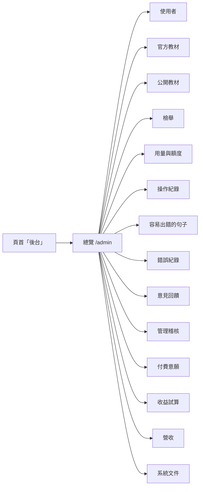
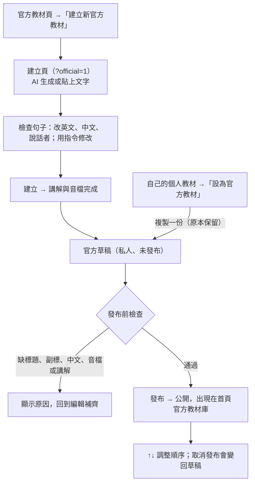
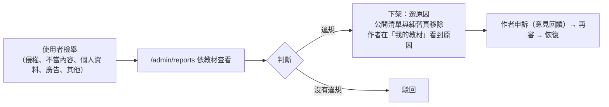

# ListenLoop 管理員手冊

給 ListenLoop 的管理員：後台每一頁的用途與操作、官方教材的建立到發布、額度、檢舉、使用者、班級開通、付費意願與收益試算，以及每月的例行檢查。

## 目錄

1. [成為管理員與進入後台](#1-成為管理員與進入後台)
2. [後台各頁](#2-後台各頁)
3. [官方教材：建立、審核、發布](#3-官方教材建立審核發布)
4. [AI 額度與費用](#4-ai-額度與費用)
5. [檢舉處理](#5-檢舉處理)
6. [使用者管理](#6-使用者管理)
7. [班級方案開通](#7-班級方案開通)
8. [付費意願與收益試算](#8-付費意願與收益試算)
9. [新聞教材排程](#9-新聞教材排程)
10. [每月例行檢查清單](#10-每月例行檢查清單)
11. [服務控制與緊急應變](#11-服務控制與緊急應變)
12. [常見問題](#12-常見問題)

---

## 1. 成為管理員與進入後台

- **第一位管理員**：Email 寫在 Vercel 的環境變數 `ADMIN_EMAILS`（多個用逗號分隔）。這些帳號每次登入都會自動成為管理員，後台也不能把他們降級或停用。
- **其他管理員**：在「後台 → 使用者 → 某位使用者」按「設為管理員」。
- **入口**：登入後，頁首會出現「後台」與「官方教材」。手機上頁首會換行，一樣看得到。
- 非管理員打開 `/admin` 開頭的任何網址都是 404。
- 後台每一頁上方是一排區塊連結；手機上左右捲動。

---

## 2. 後台各頁

| 頁面             | 網址                      | 用途                                                                                                                                        | 常用操作                                                              |
| ---------------- | ------------------------- | ------------------------------------------------------------------------------------------------------------------------------------------- | --------------------------------------------------------------------- |
| 總覽             | `/admin`                  | 使用者數、今日／本週活躍、新註冊、新增練習、完成天數、本月 API 費用、Azure 額度剩餘、聲音字元、Supabase 用量、Vercel 函式儲存空間、等候名單 | 每天看一次；本月費用達全站上限 80% 時有警告。打開時也會清除過期紀錄   |
| 使用者           | `/admin/users`            | 使用者編號、註冊日、最後活動、練習數、本月用量、角色、狀態、方案（不顯示 Email）                                                            | 點編號進入個人頁                                                      |
| 使用者個人頁     | `/admin/users/<編號>`     | 角色、狀態、方案、班級方案、最近的操作紀錄                                                                                                  | 設為管理員、停用（按兩次）、切換方案（免費／Plus／Pro）、開通班級方案 |
| 官方教材         | `/admin/official`         | 草稿與已發布兩區，依類別篩選                                                                                                                | 建立、編輯、發布、取消發布、↑↓ 排序、批次更新講解                     |
| 公開教材         | `/admin/materials`        | 使用者分享的公開教材與已下架的教材                                                                                                          | 篩選、改分類與副標、下架或恢復                                        |
| 檢舉             | `/admin/reports`          | 待處理檢舉，依教材分組                                                                                                                      | 下架（選原因）、駁回、恢復                                            |
| 用量與額度       | `/admin/usage`            | 設定診斷、測試連線、今日與本月費用、額度設定、最近 50 次呼叫                                                                                | 調整 5 個上限；測試連線（免費）                                       |
| 操作紀錄         | `/admin/events`           | 使用者的操作（登入、開始、完成、重練、建立、檢舉…）                                                                                         | 依使用者編號、類型、日期篩選；網址可分享                              |
| 容易出錯的句子   | `/admin/sentences`        | 跟讀問題句子回報，依句子分組                                                                                                                | 點進教材修改句子或講解                                                |
| 學習者回報的問題 | `/admin/sentences` 最上方 | 學習者回報某句的翻譯、講解、音檔問題，依句子分組（D113）                                                                                    | 修正教材後按「已修正」（回報者會收到通知）或「不處理」                |
| 待審修正         | `/admin/fixes`            | 品質稽核與規則產生的修正建議（全形數字、人名統一、翻譯、講解精簡），每筆有原文、建議、理由（D117）                                          | 「接受」才寫入教材並記在管理稽核；「拒絕」不改；可依類型篩選          |
| 錯誤紀錄         | `/admin/errors`           | 伺服器錯誤（路徑、類型、訊息、錯誤代碼）                                                                                                    | 使用者回報的「錯誤代碼」可在這裡對照                                  |
| 意見回饋         | `/admin/feedback`         | 使用者送出的回饋                                                                                                                            | 標示已處理                                                            |
| 管理稽核         | `/admin/audit`            | 誰在何時對什麼做了什麼（改前 → 改後）                                                                                                       | 查證變更                                                              |
| 付費意願         | `/admin/interest`         | 付費漏斗：看定價頁 → 切換週期 → 按訂閱 → 加入等候名單；近 8 週趨勢；方案、週期、來源比例                                                    | 看哪個入口最有效                                                      |
| 收益試算         | `/admin/forecast`         | 可調整的訂閱人數、價格、成本，即時算月營收、預收、毛利、淨利                                                                                | 試算不同情境                                                          |
| 留存分析         | `/admin/retention`        | 第 1、7、30 天留存、每週活躍、完成 7 天循環的比例與各類別完成率（D114）                                                                     | 每週看一次趨勢                                                        |
| 營收             | `/admin/revenue`          | 訂閱、付款、退款（目前只有測試資料）                                                                                                        | 退款（按兩次確認）                                                    |
| 等候名單 CSV     | `/admin/waitlist/export`  | 下載等候名單                                                                                                                                | 寄送開放通知前使用                                                    |
| 系統文件         | `/admin/docs`             | 本手冊、系統說明書、使用者手冊，中英文切換                                                                                                  | —                                                                     |

---

## 3. 官方教材：建立、審核、發布

### 3.1 建立

1. 頁首「官方教材」→「建立新官方教材」。
2. 選文字來源：
   - **AI 生成**：填標題（選填，有填會原樣保留）、類別、情境、程度、長度、形式（預設獨白）、口音，以及「想練什麼？」；
   - **貼上文字**：貼英文或中文。對話每行開頭寫「A:」「B:」，會用兩個聲音。
3. 「斷句並翻譯」後檢查每一句：可合併、拆分、改中英文、切換 A／B。也可以「用指令修改」，例如「換成更簡單的單字」，可復原。
4. 選聲音後「建立」。講解與音檔產生時可以離開頁面，完成後在官方教材頁看到。
5. 用的是**管理員手動額度**（每日 US$1.00）。

### 3.2 審核重點

- 英文自然、沒有真實人名品牌時事、適合學生；
- 中文翻譯通順，台灣用語；
- 講解正確（尤其連音說明）；
- 雙語標題、副標題（60 字內）都有；
- 音檔每句都有，聽起來沒有怪音。

### 3.3 發布與排序

- 在官方教材頁把狀態改成「已發布」。不符合檢查的會說明缺什麼。
- 發布時沒有副標，會自動用 AI 產生（失敗也會照常發布，之後再補）。
- 用 ↑↓ 調整首頁的順序。
- **批次更新講解**：勾選講解不是最新版的教材 →「更新講解」。用**批次額度**；已是最新版的不花費。舊講解保留在版本紀錄，已開始的學習者不受影響。

### 3.4 待審修正（D117）

- 修正建議由 `npm run content:fixes` 產生（**不呼叫 AI、不花錢**）：
  - 全形英數字 → 半形（規則）；
  - 講解超過 1,100 字 → 依規則精簡到 1,000 字以內（每個單字留 1 個例句、搭配最多 2 個……）；
  - 人名統一與翻譯修正：品質稽核後人工整理的建議，放在 `scripts/content-fixes/*.json`。
- 預設只印出會新增哪些；加 `FIXES_YES=1` 才存進資料庫。同一句同一欄已有待審的，不會重複新增。
- 在 `/admin/fixes` 逐筆「接受」或「拒絕」。接受時如果那句在建議之後被改過，會略過並標成「已過期」，不會蓋掉新內容。
- 之後新產生的教材：翻譯與講解的提示詞已加上這些規則，產生後也會自動轉半形、精簡講解；發布前檢查會擋全形英數字、人名寫法不一致、講解過長。

### 3.5 Blender 開放電影的影片教材（D118）

- 片段設定在 `lib/blender-films.ts`，字幕在 `data/subtitles/`。
- `npm run blender:drafts` 先印出計畫與最壞費用；`BLENDER_YES=1` 才呼叫 AI 翻譯與講解，存成官方草稿（YouTube 影片教材，沒有音檔）。已存在的片段會略過；`BLENDER_ONLY=<key>` 只做指定片段。
- 審核時特別看：人名（應保留英文）、只有一兩個字的短句翻譯、俚語與不雅用語。看完在「官方教材」頁發布。

### 3.6 用腳本大量建立（需要 Joe 同意費用）

- `npm run official:drafts`：預設只印計畫與最壞情況的費用。
- `OFFICIAL_YES=1 npm run official:drafts`：真的執行。每次呼叫前檢查預算（`OFFICIAL_BUDGET_USD`），超過就停。
- 通過檢查的直接發布，沒通過的留成草稿並列出原因。

---

## 4. AI 額度與費用

### 4.1 上限

在 `/admin/usage` 的「AI 額度設定」以美元輸入，儲存後寫進管理稽核：

| 項目         | 預設    | 說明                                                     |
| ------------ | ------- | -------------------------------------------------------- |
| 管理員手動   | US$1.00 | 每位管理員每日（建立、編輯）                             |
| 管理員批次   | US$1.00 | 每位管理員每日（腳本、批次更新講解）                     |
| 付費（Plus） | US$0.20 | 每人每日；Pro 自動為 3 倍                                |
| 免費         | US$0.05 | 每人每日                                                 |
| 全站每月     | US$8.00 | 超過時暫停一般使用者建立；管理員仍可手動建立；80% 時警告 |

聲音另有每日字元上限（每人 16,000；批次 120,000）。每日台灣時間 00:00 重設；每月 1 日重設。

### 4.2 怎麼看用量

- **今日與本月費用**、**Azure 學生額度剩餘**（US$100 減累計）、**本月 Azure 聲音字元**（F0 每月 50 萬）。
- **最近 50 次呼叫**：時間、供應者、操作、token、字元、費用、失敗原因（例如「失敗（config；HTTP 401）」）。
- 每週的成本報告：在 Claude Code 說「本週用量」（`cost-report` skill）。

### 4.3 設定出問題時

1. 看「設定診斷」哪一項是 ✗（不會顯示金鑰）。
2. 按「測試連線（免費）」：不計費，會顯示狀態碼與要檢查的設定。
3. 改 Vercel 的環境變數後要重新部署。

---

## 5. 檢舉處理

- 不會因為檢舉數量自動下架，一律由管理員判斷。
- 作者與審查頁都看不到檢舉人是誰。
- 每次操作都寫進管理稽核。
- 侵權通知：依服務條款第 5 條處理，必要時請對方提供權利證明。

---

## 6. 使用者管理

| 動作             | 怎麼做                              | 注意                                                                                        |
| ---------------- | ----------------------------------- | ------------------------------------------------------------------------------------------- |
| 找人             | 使用者清單看編號、註冊日、最後活動  | 後台不顯示 Email。需要依 Email 找人時，到 Supabase 後台的 Authentication 查 user id，再對照 |
| 設為管理員／取消 | 個人頁按鈕                          | 不能變更自己；`ADMIN_EMAILS` 的帳號不能降級                                                 |
| 停用／恢復       | 個人頁，按兩次確認                  | 停用後伺服器視為未登入，並在 Auth 封鎖；已發出的權杖最長 1 小時內失效                       |
| 切換方案         | 個人頁的方案選單（免費、Plus、Pro） | 測試用；之後由訂閱自動更新。寫進稽核                                                        |
| 查看操作         | 個人頁下方，或操作紀錄頁依編號篩選  | 只有必要欄位，沒有文字內容                                                                  |
| 刪除帳號         | 由使用者自己在帳號頁操作            | 管理員不代刪；使用者無法登入時，請他用意見回饋聯絡                                          |

### 6.1 註冊與邀請（`/admin/beta`，D132）

| 要做的事             | 怎麼做                                                                                        | 注意                                                                                       |
| -------------------- | --------------------------------------------------------------------------------------------- | ------------------------------------------------------------------------------------------ |
| 看名額               | 上方「註冊人數／上限」：已註冊的帳號（管理員不算）和上限                                      | 達到上限或關閉時，新使用者第一次登入後會被擋下，看到「目前 Beta 名額已滿」                 |
| 開關公開註冊、改上限 | 「公開註冊」選開放或關閉，填「帳號上限」，按「儲存」                                          | 只影響新使用者；已經有帳號的人隨時可以登入。寫進稽核                                       |
| 產生邀請連結         | 填可用次數（1～10,000）、有效天數（留空＝不過期）、備註，按「產生邀請連結」，複製連結傳給對方 | 持邀請連結的人不受上限與開關限制，第一次登入時用掉一次                                     |
| 看邀請碼的使用狀況   | 邀請碼表格：已用／可用、到期日、狀態（可用、已用完、已過期、已停用）                          | 只列最近 100 個                                                                            |
| 停用邀請碼           | 表格裡的「停用」                                                                              | 連結立刻失效；已經用它註冊的人不受影響                                                     |
| 從等候名單分批邀請   | 勾選（或「勾選還沒邀請的 N 人」）→「邀請勾選的 N 人」→ 複製每個人的連結，用 Email 寄出        | 每人一個只能用一次、30 天有效的連結；寄信服務設定好之前要自己寄。等候名單裡有 Email 與用途 |

- 被擋下的新帳號會立刻刪除（不留任何資料），所以不會佔名額；他們可以在 `/beta` 加入等候名單。
- 用 Email 註冊時，名額已滿會先擋下，不寄確認信。

---

## 7. 班級方案開通

1. 老師先登入一次（建立帳號）。
2. 「後台 → 使用者 → 老師的編號」→「班級方案」選 **40 人** → 儲存（寫進稽核）。
3. 老師在頁首「班級」→「我教的班級」建立班級，取得 8 碼邀請碼。
4. 要取消時選「無」。D103 時開通的其他人數（10／20／80／100）照舊有效。
5. 管理員自己沒有班級方案也能建立班級（試用、展示），每班上限 100 人。

開通時選級距：小班（15 位學生、每月自建 45 分鐘）、標準班（40 位、70 分鐘）、大班（100 位、105 分鐘）。分鐘數比老師的個人方案多時取代，可以完整練習公開教材（D173）。

---

## 8. 付費意願與收益試算

### 8.1 付費意願（`/admin/interest`）

| 步驟            | 意義                                 |
| --------------- | ------------------------------------ |
| pricing_view    | 打開定價頁                           |
| interval_switch | 切換月繳／年繳                       |
| subscribe_click | 按「訂閱」                           |
| waitlist_join   | 加入等候名單                         |
| unlock_click    | 按功能上的解鎖（顏色、公開教材預覽） |

**怎麼看**：

- **轉換率**：每一步除以前一步。看定價頁 → 按訂閱的比例低，表示價格或方案內容不吸引人；按訂閱 → 加入名單低，可能是「即將推出」讓人失望。
- **來源**：哪個入口帶來最多看定價頁的人（例如 `trial-used`、`speed`、`shared-preview`）。來源多的功能，代表使用者最想要。
- **方案與週期**：Plus／Pro、月繳／年繳的比例，用來決定預設值與價格。
- 未登入訪客用隨機 cookie 算成一人，不含個人資料。

### 8.2 收益試算（`/admin/forecast`）

- 所有數字都能改：各方案、各週期的訂閱人數、價格、AI 成本（預設用本月實際花費 ÷ 本月建立的分鐘數）、其他成本。
- 即時算出：月營收、預收現金（年繳一次收）、毛利率、淨利。
- 用法：拿付費意願的人數乘上合理的轉換率（例如等候名單的 10～30%）估算第一個月。

---

## 9. 新聞教材排程

- 每週一台灣時間 09:00 由 GitHub Actions 執行 `npm run news:make`，每次 3 則（D100）。
- **預設關閉**。開啟方式：GitHub → Settings → Secrets and variables → Actions：
  1. Secrets：Supabase 網址與秘密金鑰、Azure OpenAI 與 Azure Speech 的金鑰與設定；
  2. Variables：`NEWS_SCHEDULE` 設為 `on`。
- 每次上限 US$0.30，另受批次每日額度與全站每月上限限制。
- 也可以在 Actions 頁手動執行一次。
- 發布的新聞在官方教材頁「新聞」類別；有問題可以取消發布。

**練習提醒**（D111）也用 GitHub Actions，每 15 分鐘檢查一次：要先產生 VAPID 金鑰（`npx web-push generate-vapid-keys`），公開金鑰設成 Vercel 的 `NEXT_PUBLIC_VAPID_PUBLIC_KEY`，GitHub secrets 加上 `NEXT_PUBLIC_VAPID_PUBLIC_KEY`、`VAPID_PRIVATE_KEY`，變數 `REMINDERS_SCHEDULE=on`。

---

## 10. 每月例行檢查清單

| #   | 項目                                                        | 在哪裡                                                          |
| --- | ----------------------------------------------------------- | --------------------------------------------------------------- |
| 1   | 本月 AI 費用、Azure 學生額度剩餘、F0 聲音字元是否接近上限   | `/admin/usage`、總覽                                            |
| 2   | Supabase 資料庫與檔案用量（免費方案 500 MB／1 GB）          | 總覽                                                            |
| 3   | 錯誤紀錄有沒有新的、重複出現的錯誤                          | `/admin/errors`                                                 |
| 4   | 待處理檢舉清空                                              | `/admin/reports`                                                |
| 5   | 意見回饋都已處理                                            | `/admin/feedback`                                               |
| 6   | 容易出錯的句子：修正前幾名                                  | `/admin/sentences`                                              |
| 7   | 官方教材：草稿審核、講解是否最新、新聞教材品質              | `/admin/official`                                               |
| 8   | 付費意願的轉換率與來源變化                                  | `/admin/interest`                                               |
| 9   | 備份資料庫（`npm run db:backup`），並把檔案存到安全的地方   | 本機（見 `docs/backup.md`）                                     |
| 10  | 正式站檢查：頁面、標頭、CSP、RLS                            | Claude Code「檢查正式站」（`verify-prod`）、`npm run rls:check` |
| 11  | 依賴套件的安全更新（minor／patch）                          | `npm outdated`，交給 Claude Code 開 PR                          |
| 12  | 管理稽核：有沒有不認得的變更                                | `/admin/audit`                                                  |
| 13  | 學習者回報的問題都已處理                                    | `/admin/sentences`                                              |
| 14  | 每月跑一次官方教材品質稽核（規則免費；AI 抽查要先確認費用） | `npm run official:audit`（`AUDIT_YES=1` 才呼叫 AI）             |

---

## 11. 服務控制與緊急應變

出問題時先止血，再查原因。完整的處理步驟見 `docs/incident-runbook.md`。

### 11.1 緊急開關（`/admin/ops`，D155）

| 開關     | 效果                                                                                |
| -------- | ----------------------------------------------------------------------------------- |
| 維護模式 | 除了管理員，所有人看到維護頁（HTTP 503）。登入、服務狀態、隱私權與條款頁仍可開啟    |
| 唯讀模式 | 可以瀏覽和練習既有教材；暫停建立教材（含 AI、上傳、單字測驗出題）、公開分享、新註冊 |
| 個別功能 | AI 生成文字、用指令修改、上傳音檔、語音轉文字、公開分享、新註冊，可以分別暫停       |

- 按「儲存開關」後會再確認一次；每次變更記在「管理稽核」（`site_switches`）。
- 每台伺服器最多快取 30 秒，所以約 30 秒內全站生效。
- 管理員不受開關限制，可以照常檢查與修正。
- 公開分享在資料庫也會擋（觸發器），就算有人繞過網頁直接呼叫 API 也一樣。
- 暫停新註冊時，連邀請連結也不能註冊；已經有帳號的人可以照常登入。

### 11.2 公告與服務狀態頁

- 在 `/admin/ops` 下方發布公告：選等級（公告、注意、重要），填中英文內容與顯示時數（留空表示直到手動結束）。
- 公告出現在每一頁頁首下方，使用者可以關閉；「重要」不能關閉。
- 公開的服務狀態頁 `/status`（頁尾「服務狀態」）顯示目前狀態、暫停中的功能與公告。

### 11.3 監控與通知（D156）

- **UptimeRobot**（免費）每 5 分鐘讀 `/api/health`，網站掛掉時通知 Discord；網站自己在被讀到時，最多每 15 分鐘跑一次完整監控、每天 03:00 後整理一次舊紀錄（D163，`docs/uptime-monitoring.md`）。
- 排程 `.github/workflows/ops.yml` 每 6 小時檢查一次當備援，每週一早上產生用量摘要。設定步驟見 `docs/roadmap.md` 的「需要你親手做的事」。
- GitHub Actions 每月免費 2,000 分鐘（repo 私人）：月中跑 `npm run actions:usage` 看用量與推估；快用完時把 repo 變數 `CI_LITE` 設成 `on`（見 `docs/github-private.md`）。
- 通知在 `/admin/ops` 的「通知紀錄」；設定了 Discord webhook 時也會送到 Discord。同一件事 6 小時內只通知一次。
- 通知的情況：網站或健康檢查失敗、錯誤突然變多、AI 或語音額度達 80% 或用完、今日花費超過過去 7 天平均的 3 倍、Supabase 容量達 80%、Vercel 函式儲存空間達 70% 或 90%（每天檢查一次，D175）、1 小時內大量註冊或檢舉。
- 預測與每週摘要在 `/admin/usage`。

### 11.4 重新登入（D159）

- 高風險操作要在 30 分鐘內登入過：改角色、方案、狀態、班級座位、下架或恢復教材、退款、緊急開關、AI 費用上限、註冊開關、匯出等候名單。
- 超過時間會顯示「請登出再登入」。從右上角「帳號」登出，再登入一次就可以繼續。

### 11.5 額度（D161）

- 各方案的額度總表見 `docs/quotas.md`。
- 單一使用者要多一點或少一點：後台「使用者 → 編號 → 額度調整」，填增減量、天數與理由；也可以暫停這個帳號的 AI 功能。
- 每天會自動清除超過 7 天、沒有被任何教材使用的音檔；看起來沒用的檔案太多時會暫停並通知，請到 Supabase Storage 確認。

### 11.6 濫用標記（D162）

- 後台「濫用標記」列出自動偵測的可疑帳號：同一個 IP 多個帳號、短時間大量 AI 呼叫、連續多天接近上限、公開教材被多人檢舉。後兩種有些會自動暫停 AI。
- 「確認」維持暫停（要停用帳號到使用者頁）；「解除」恢復 AI。都需要 30 分鐘內登入過。

### 11.7 Beta 測試（`/admin/beta-test`，D165）

- 計畫見 `docs/beta-test-plan.md`；給測試者的須知見 `docs/beta-tester-guide.md`（可以直接傳）。
- 每一梯在「註冊與邀請」產生一個邀請連結（備註寫梯次名稱）。「Beta 測試」頁上方可以選梯次。
- 頁面內容：整體（完成第 1 天、完成 7 天、最近有練習的比例）、**需要追蹤的人**（加入 1 天還沒開始，或超過 2 天沒練習，最久的排前面）、每位測試者的進度與最後練習、訪談時機（第 3 天、第 14 天）、測試者的滿意度調查與意見回饋。
- 每天看一次「需要追蹤」，私訊提醒或詢問卡在哪裡。

### 11.8 滿意度調查（D164）

- 學習者完成第 7 天後填的推薦意願（0～10 分）與意見，在「意見回饋」頁最上方：NPS（推薦者 9～10 分比例減批評者 0～6 分比例，−100～100）、平均、三類人數、最新意見。

## 12. 常見問題

| 問題                         | 答案                                                                                                  |
| ---------------------------- | ----------------------------------------------------------------------------------------------------- |
| 一般使用者說不能建立教材     | 看他的方案與試用次數（個人頁）；看全站每月上限是否用完（總覽）                                        |
| 使用者說看不到公開教材的全文 | 免費方案只能預覽（D106）；可以在個人頁切到 Plus 測試                                                  |
| 官方教材發布不了             | 看發布檢查列出的原因；常見是缺中文標題或副標                                                          |
| 想改方案內容或價格           | 方案在 `lib/plans.ts`，價格只改月繳（`lib/payments/pricing.ts`），年繳自動 × 10；請 Claude Code 開 PR |
| 使用者回報「錯誤代碼」       | 到錯誤紀錄搜尋該代碼（digest）                                                                        |
| 需要退款                     | 營收頁按兩次確認；目前只有測試資料                                                                    |

---

最後更新：2026-11-11
