# ListenLoop 系統說明書（技術）

給接手開發、維運或審查 ListenLoop 的工程師。內容以程式碼與 `docs/decisions.md`（以下簡稱 D 編號）為準；兩者不一致時，以程式碼為準，並請更新本文件。

## 目錄

1. [產品概述](#1-產品概述)
2. [系統架構](#2-系統架構)
3. [技術選型與理由](#3-技術選型與理由)
4. [資料模型](#4-資料模型)
5. [主要流程](#5-主要流程)
6. [AI 與成本控制](#6-ai-與成本控制)
7. [方案與權限](#7-方案與權限)
8. [國際化、設計系統、無障礙](#8-國際化設計系統無障礙)
9. [安全與隱私](#9-安全與隱私)
10. [部署與維運](#10-部署與維運)
11. [測試策略](#11-測試策略)
12. [已知限制與未來規劃](#12-已知限制與未來規劃)

---

## 1. 產品概述

### 1.1 目標使用者

- **台灣學生**（國高中、大學）與**留學生**，需要提升英語聽力；
- 次要：上班族、準備托福／雅思／多益／全民英檢的考生、英語老師（班級方案，D103）。

產品定位：不是工具，而是**有節奏的課程**。重點是「看得見的進步」：同一份素材練一週，第 7 天和第 1 天比較。

### 1.2 核心概念：7 天循環

每份教材（內建影片、官方教材、自建教材、公開教材）都走同一個循環。每支教材各自有起始日與進度，可以同時練習多份（M5）。

| 天數       | 任務                                                                      | 完成條件（預設，可自訂，D92）                     |
| ---------- | ------------------------------------------------------------------------- | ------------------------------------------------- |
| 第 1 天    | 精聽聽寫：逐句播放、打字、逐字比對；完成後開放雙語講義                    | 每句都作答                                        |
| 第 2～6 天 | 跟讀：逐句播放後跟念，瀏覽器的語音辨識判斷念對哪些字                      | 每句涵蓋率 ≥ 60%                                  |
| 第 7 天    | 重新聽寫，和第 1 天比較                                                   | 加權正確率比第 1 天進步（第 1 天 100% 時需 100%） |
| 週結算     | 通過 → 引導選下一份；沒通過 → 同一份重新一週（第 7 天之後的日曆日才開始） | —                                                 |

- 每一天要完成前一天，而且在**不同的日曆日**才解鎖（`NEXT_PUBLIC_DEV_TEST_MODE=true` 可略過）。
- **重練**：當天任務完成後可以再練；正式成績以第一次為準，重練不儲存、不影響結算。

### 1.3 主要功能清單

| 類別       | 功能                                                                                                                                      | 主要位置                                                               |
| ---------- | ----------------------------------------------------------------------------------------------------------------------------------------- | ---------------------------------------------------------------------- |
| 練習       | 聽寫、跟讀、重新聽寫、單句重播、循環播放（D90）、音檔調速（D73）、講解（D67、D68）、雙語講義與 PDF、聆聽模式（D135）、單字測驗（D136）    | `/videos/<id>`、`/videos/<id>/day/<n>`、`/handout`、`/listen`、`/quiz` |
| 教材庫     | 內建影片＋官方教材，搜尋、分類（最多 5 個）、長度、程度、口音、情境篩選，自動搜尋（D104）、我的預設篩選（D98）                            | 首頁 `/`                                                               |
| 公開教材   | 使用者分享的教材；免費方案只能預覽，付費方案完整練習（D106）                                                                              | `/explore`                                                             |
| 建立教材   | 貼上文字、AI 生成、上傳音檔（D130）；YouTube 連結（D97）暫停中（D131）；斷句、翻譯、講解、配音；用指令修改（D96）；編輯與版本（D44、D45） | `/materials`、`/materials/new`                                         |
| 進度與分析 | 練習日曆、今日任務、學習進度、學習分析、分數與主題顏色（D75、D93）                                                                        | `/`、`/practices`、`/stats`                                            |
| 複習與提醒 | 我的錯字（間隔複習，D108）、程度測驗（D109）、進步分享卡（D110）、練習提醒（PWA 推播，D111）、離線音檔（D112）、回報教材錯誤（D113）      | `/review`、`/level-test`、帳號頁                                       |
| 依主題     | 各類別的公開介紹頁（SEO，D116）                                                                                                           | `/learn`、`/learn/<類別>`                                              |
| 帳號       | Google、LINE、Email 與密碼（D101）；資料下載、刪除帳號（D60）                                                                             | `/login`、`/account`                                                   |
| 方案       | 免費、Plus、Pro、班級方案（假門測試，D102、D105）；等候名單                                                                               | `/pricing`、`/pricing/classroom`                                       |
| 班級       | 建立班級、邀請、作業、進度後台、CSV、公告（D103）                                                                                         | `/classroom`                                                           |
| 管理       | 後台總覽、使用者、官方教材、公開教材、檢舉、用量與額度、操作紀錄、錯誤、意見回饋、付費意願、收益試算、營收、留存分析、系統文件            | `/admin/*`                                                             |

---

## 2. 系統架構

### 2.1 整體架構圖

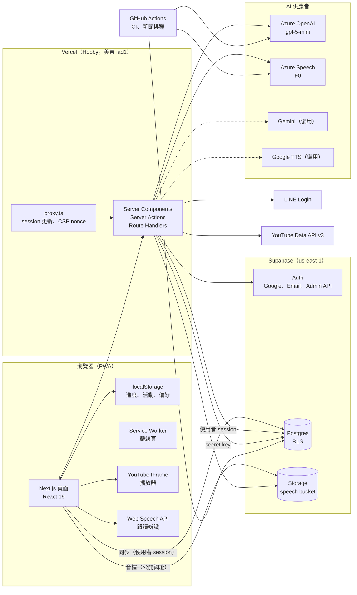

### 2.2 元件職責

| 元件                  | 職責                                                                                    | 主要程式                          |
| --------------------- | --------------------------------------------------------------------------------------- | --------------------------------- |
| **前端（瀏覽器）**    | 畫面、逐句播放、聽寫評分（純前端）、跟讀辨識、進度先寫本機再送雲端、離線頁              | `components/`、`lib/`（純邏輯）   |
| **Server Components** | 讀資料庫組頁面（教材、教材庫、後台），權限判斷，`notFound()`／`redirect()`              | `app/**/page.tsx`、`auth/`        |
| **Server Actions**    | 所有寫入與付費 API 呼叫：建立教材的每個步驟、整理、檢舉、回饋、付費意願、班級、後台操作 | `app/**/actions.ts`               |
| **Route Handlers**    | OAuth callback、LINE 登入、webhook、資料下載、CSV、背景完成教材                         | `app/**/route.ts`                 |
| **proxy.ts**          | 每個請求更新 Supabase session（PKCE cookie）、產生 CSP nonce、加安全標頭                | `proxy.ts`、`lib/security/csp.ts` |
| **Supabase Auth**     | 帳號、OAuth（Google）、Email 確認與重設、Admin API（LINE 登入產生一次性連結、停用帳號） | `auth/session.ts`、`auth/line.ts` |
| **Postgres**          | 所有資料；RLS 決定誰能讀寫；原子操作用 SQL 函式（額度、速率限制、版本儲存）             | `supabase/migrations/`            |
| **Storage `speech`**  | 每句一個 MP3（以內容雜湊命名，公開讀取，只有伺服器能上傳）                              | `auth/audio-store.ts`             |
| **AI 供應者**         | 語言模型（斷句、翻譯、講解、生成、副標、修改、新聞改寫）與語音合成；透過介面切換        | `lib/ai/`                         |
| **GitHub Actions**    | CI（`check` job，分支保護依此名稱）；每週新聞排程（預設關閉，D100）                     | `.github/workflows/`              |

### 2.3 程式目錄

| 目錄                   | 內容                                                      |
| ---------------------- | --------------------------------------------------------- |
| `app/`                 | 頁面、Server Actions、Route Handlers                      |
| `components/`          | UI 元件（只用設計系統的 tokens）                          |
| `lib/`                 | 純邏輯：評分、循環、儲存、同步、方案、價格、AI 介面、分析 |
| `auth/`                | 伺服器端的 Supabase 用戶端與需要 cookie 的程式            |
| `i18n/`                | next-intl 設定與切換語言                                  |
| `messages/`            | `zh-Hant.json`、`en.json`                                 |
| `data/videos/`         | 內建影片 JSON                                             |
| `supabase/migrations/` | 資料表、RLS、函式                                         |
| `scripts/`             | 錄製 fixture、批次建立官方教材、新聞、備份、RLS 檢查      |
| `tests/`、`e2e/`       | Vitest 單元測試、Playwright E2E                           |
| `qa/`、`usability/`    | QA 逐頁檢查、AI 模擬使用者測試                            |
| `docs/`                | 規格、決策紀錄、設計系統、本文件                          |

---

## 3. 技術選型與理由

| 項目         | 選擇                                                              | 理由（決策）                                                                                     |
| ------------ | ----------------------------------------------------------------- | ------------------------------------------------------------------------------------------------ |
| 框架         | Next.js App Router、TypeScript strict、React 19                   | Server Components 讓權限與資料讀取留在伺服器；Server Actions 免寫 API 層                         |
| 樣式         | Tailwind CSS 4，tokens 定義在 `app/globals.css`                   | 設計系統的 tokens 一處定義，深色模式用 CSS 變數                                                  |
| 多語系       | next-intl，不用網址前綴，語言存 cookie                            | 網址乾淨、分享連結不分語言                                                                       |
| 帳號與資料庫 | Supabase（Auth、Postgres、Storage）                               | 一個服務涵蓋三者；RLS 是權限的最後防線（D4、D12）；地區 us-east-1（D11）                         |
| 環境變數名稱 | 沿用 `NEXT_PUBLIC_SUPABASE_ANON_KEY`、`SUPABASE_SERVICE_ROLE_KEY` | 新版金鑰用途相同，避免重填（D10）                                                                |
| 影片播放     | YouTube IFrame Player API，不下載音檔                             | 遵守 YouTube 條款；逐句播放時間範圍（含緩衝 `lib/player/padding.ts`）                            |
| 跟讀辨識     | Web Speech API（en-US）                                           | 免費、不需錄音上傳；Android 的重複結果另外處理（D89）                                            |
| 語言模型     | Azure OpenAI gpt-5-mini（Global Standard，UAE North）             | Azure for Students 額度、區域限制下唯一可部署的新模型（D37、D40）；Gemini 保留為備用（D28、D29） |
| 語音合成     | Azure Speech 神經語音，F0 免費                                    | 每月 50 萬字元免費（D39）；Google TTS 保留為備用                                                 |
| 語音轉文字   | Azure Speech short audio REST，F0 免費                            | 上傳音檔建立教材（D130）；每月 5 小時免費，全站上限 4.5 小時；uaenorth 沒有 fast transcription   |
| 結構化輸出   | strict JSON schema                                                | 模型一定照格式回答，程式再逐筆檢查（D40）                                                        |
| 金流         | `PaymentProvider` 介面＋假的供應者                                | 先驗證付費意願（假門測試），之後換真的供應者不改功能程式（D85、D102）                            |
| 部署         | Vercel Hobby                                                      | 與 Next.js 整合；函式上限 60 秒，所以長工作拆小批次（D22、D33、D95）                             |
| 圖表         | 不加套件，HTML／CSS／SVG                                          | 只需要長條與折線，省 100 KB 以上 JavaScript（D75）                                               |
| 測試         | Vitest、Playwright、axe-core                                      | 單元＋對 production build 的 E2E＋自動無障礙檢查（D18、D61）                                     |
| 中文字型     | 系統字型                                                          | 網頁字型 1.4 MB 拖慢手機 FCP（D87）                                                              |
| 新套件政策   | 只在必要時加入官方或維護良好的套件，理由記在 decisions            | D9                                                                                               |

---

## 4. 資料模型

### 4.1 ER 圖（主要資料表）

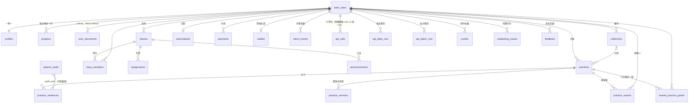

### 4.2 資料表與欄位

所有表都在 `public` schema，都開啟 RLS（`tests/rls-coverage.test.ts` 檢查）。

#### 帳號與進度

| 資料表           | 欄位                                                                                                                | 用途                                                                                                       |
| ---------------- | ------------------------------------------------------------------------------------------------------------------- | ---------------------------------------------------------------------------------------------------------- |
| `profiles`       | `user_id`、`number`、`role`、`status`、`plan`、`practices_created`、`classroom_seats`、`created_at`、`last_seen_at` | 使用者編號（後台顯示「使用者 001」，不顯示 Email）、角色、停用、方案、試用計數、班級方案（D50、D72、D103） |
| `progress`       | `user_id`、`video_id`、`data`（jsonb）、`updated_at`                                                                | 每份教材的 7 天循環進度，格式同 localStorage（`lib/progress.ts` 驗證，D4）                                 |
| `user_documents` | `user_id`、`key`、`data`、`updated_at`                                                                              | 其他個人文件：`activity`（活動、練習時間）、`library-default`（預設篩選）                                  |

#### 教材

| 資料表                   | 欄位（節錄）                                                                                                                                                                                                                                                                                                                                                                                                                                              | 用途                                                                                                                                                                   |
| ------------------------ | --------------------------------------------------------------------------------------------------------------------------------------------------------------------------------------------------------------------------------------------------------------------------------------------------------------------------------------------------------------------------------------------------------------------------------------------------------- | ---------------------------------------------------------------------------------------------------------------------------------------------------------------------- |
| `practices`              | `id`、`user_id`、`title`、`title_en`、`title_zh`、`subtitle`、`source_language`、`voice`、`voice_b`、`visibility`、`official`、`published`、`sort_order`、`category`、`categories`、`scenario`、`level`、`exam`、`exam_target`、`vocab`、`grammar`、`notes_generated_at`、`version`、`removed_at`、`removed_reason`、`estimated_seconds`、`duration_sec`、`youtube_id`、`youtube_channel`、`youtube_license`、`source_name`、`source_title`、`source_url` | 一份教材（自建、官方、新聞、YouTube）。官方由伺服器設定（`guard_official` 觸發器）；`categories` 是產生欄位（GIN 索引）；`duration_sec` 由觸發器依音檔大小計算（D104） |
| `practice_sentences`     | `practice_id`、`i`、`en`、`zh`、`audio_path`、`notes`（jsonb，第 2 版 `v: 2`）、`speaker`、`start_sec`、`end_sec`                                                                                                                                                                                                                                                                                                                                         | 每句的文字、翻譯、音檔、講解；YouTube 教材用起訖秒數（D43、D57、D97）                                                                                                  |
| `practice_versions`      | `practice_id`、`version`、`title`、`sentences`、`vocab`、`grammar`、`created_at`                                                                                                                                                                                                                                                                                                                                                                          | 舊版本快照，只能新增（D44）                                                                                                                                            |
| `collections`            | `id`、`user_id`、`title`、`description`、`visibility`                                                                                                                                                                                                                                                                                                                                                                                                     | 自建教材分組（D19、D24）                                                                                                                                               |
| `practice_reports`       | `practice_id`、`reporter_id`、`reason`、`details`、`status`、`resolved_at`                                                                                                                                                                                                                                                                                                                                                                                | 檢舉（D31）                                                                                                                                                            |
| `shared_practice_grants` | `user_id`、`practice_id`、`week`、`started_at`、`created_at`                                                                                                                                                                                                                                                                                                                                                                                              | 公開教材改付費前已在練的那一週（D106）                                                                                                                                 |
| `speech_audio`           | `hash`、`path`、`bytes`、`mime_type`、`created_at`                                                                                                                                                                                                                                                                                                                                                                                                        | 已產生的音檔（D22）                                                                                                                                                    |
| `ai_cache`               | `hash`、`kind`、`result`、`created_at`                                                                                                                                                                                                                                                                                                                                                                                                                    | 斷句、翻譯、講解的快取（D27、D43）                                                                                                                                     |

#### AI 用量

| 資料表           | 欄位                                                                                                                                            | 用途                                       |
| ---------------- | ----------------------------------------------------------------------------------------------------------------------------------------------- | ------------------------------------------ |
| `api_calls`      | `user_id`、`provider`、`operation`、`input_tokens`、`output_tokens`、`chars`、`cost_micros`、`error`、`http_status`、`error_code`、`created_at` | 每次呼叫一筆，只記數字不記文字（D38、D49） |
| `api_daily_cost` | `user_id`、`day`、`micros`                                                                                                                      | 手動建立的每日費用（預留＋結算）           |
| `api_batch_cost` | `user_id`、`day`、`micros`                                                                                                                      | 批次作業的每日費用（D77）                  |
| `api_usage`      | `user_id`、`day`、`kind`、`chars`                                                                                                               | 聲音字元的每日用量                         |
| `usage_settings` | `admin_manual_micros`、`admin_batch_micros`、`paid_micros`、`free_micros`、`site_monthly_micros`                                                | 後台可調的上限（D77）                      |

#### 紀錄與營運

| 資料表                                        | 用途                                                                       | 保留                     |
| --------------------------------------------- | -------------------------------------------------------------------------- | ------------------------ |
| `events`                                      | 操作紀錄（登入、開始、完成、重練、建立、檢舉…，D55）                       | 180 天                   |
| `shadowing_issues`                            | 跟讀問題句子回報（D52）                                                    | 365 天                   |
| `admin_audit`                                 | 管理稽核：誰、何時、對什麼、改前改後（D56）                                | 2 年                     |
| `error_logs`                                  | 伺服器錯誤（D63）                                                          | 90 天                    |
| `feedback`                                    | 意見回饋（D60）                                                            | 不自動刪除               |
| `sentence_reports`                            | 學習者回報某一句的問題（翻譯、講解、音檔），管理員處理後通知回報者（D113） | 不自動刪除               |
| `reminders`                                   | 每個瀏覽器的推播訂閱與提醒時間、時區（D111）                               | 取消提醒或帳號刪除時刪除 |
| `rate_limits`                                 | 固定時間窗的計數（D63）                                                    | 時間窗過後覆寫           |
| `intent_events`                               | 付費意願漏斗（D93、D102）                                                  | 不自動刪除               |
| `waitlist`                                    | 等候名單（方案、週期、來源）                                               | 不自動刪除               |
| `subscriptions`、`payments`、`payment_events` | 訂閱、付款、webhook 冪等（D85）                                            | 不自動刪除               |

#### 班級（D103）

| 資料表          | 欄位                                                                  |
| --------------- | --------------------------------------------------------------------- |
| `classes`       | `id`、`teacher_id`、`name`、`invite_code`（8 碼）、`archived_at`      |
| `class_members` | `class_id`、`user_id`、`display_name`、`minor_consent`、`joined_at`   |
| `assignments`   | `id`、`class_id`、`video_id`、`title`、`starts_on`、`due_on`、`rules` |
| `announcements` | `id`、`class_id`、`body`（500 字內）                                  |

### 4.3 資料庫函式

| 函式                                                                        | 用途                                         | 誰能呼叫                    |
| --------------------------------------------------------------------------- | -------------------------------------------- | --------------------------- |
| `can_practice(target)`                                                      | 能不能練這份教材（D106）                     | anon、authenticated         |
| `practice_notes(target)`                                                    | 經過 `can_practice` 讀整份的單字與文法       | anon、authenticated         |
| `practice_preview(target)`                                                  | 公開教材的預覽：前 3 句、第 1 句音檔         | anon、authenticated         |
| `public_practice_readiness(targets)`                                        | 公開教材的句數與已配音句數                   | anon、authenticated         |
| `reserve_api_cost`／`settle_api_cost`（及 batch 版）                        | AI 費用的預留與結算（原子）                  | service_role                |
| `reserve_api_usage`                                                         | 聲音字元的預留                               | service_role                |
| `month_api_cost(month_start)`                                               | 本月全站費用                                 | service_role                |
| `hit_rate_limit`                                                            | 速率限制計數＋檢查                           | service_role                |
| `save_practice_edit`                                                        | 編輯：快照、換句子、版本 +1（樂觀鎖定）      | authenticated（作者）       |
| `upgrade_practice_notes`                                                    | 講解升級：快照、換講解、版本 +1              | service_role                |
| `copy_practice_as_official`                                                 | 複製成官方草稿（D80）                        | service_role                |
| `join_class`、`class_progress`、`is_class_member`、`is_class_teacher`       | 加入班級、老師讀學生進度（只限該班、該作業） | authenticated               |
| `admin_overview`、`admin_users`、`api_usage_totals`                         | 後台數字                                     | service_role                |
| `material_learner_counts`、`practice_audio_bytes`、`practice_audio_seconds` | 教材庫的人數與長度                           | anon、authenticated／觸發器 |
| `prune_logs`                                                                | 依保留期限刪除舊紀錄                         | service_role                |
| `is_admin`                                                                  | RLS 判斷管理員                               | authenticated               |

### 4.4 RLS 權限規則一覽

| 資料表                                                                                                                            | 讀                                                                          | 寫                                                       |
| --------------------------------------------------------------------------------------------------------------------------------- | --------------------------------------------------------------------------- | -------------------------------------------------------- |
| `profiles`                                                                                                                        | 自己                                                                        | 只有伺服器                                               |
| `progress`、`user_documents`、`collections`                                                                                       | 自己                                                                        | 自己                                                     |
| `practices`                                                                                                                       | 自己的；公開且未下架的（所有人）。`vocab`、`grammar` 欄位不能直接讀（D106） | 自己的；`official`、`published`、`removed_at` 只有伺服器 |
| `practice_sentences`、`practice_versions`                                                                                         | 自己的；`can_practice` 為真的                                               | 自己的（版本只能新增）                                   |
| `practice_reports`                                                                                                                | 自己送出的                                                                  | 檢舉別人公開、未下架的                                   |
| `waitlist`、`subscriptions`、`payments`                                                                                           | 自己                                                                        | 等候名單：自己新增；其他只有伺服器                       |
| `classes`                                                                                                                         | 老師、成員                                                                  | 老師                                                     |
| `class_members`                                                                                                                   | 自己、該班老師                                                              | 退出（自己）、移除（老師）；加入只能透過 `join_class`    |
| `assignments`、`announcements`                                                                                                    | 成員                                                                        | 老師                                                     |
| `events`、`shadowing_issues`、`error_logs`、`feedback`、`admin_audit`                                                             | 管理員（`is_admin()`）                                                      | 只有伺服器                                               |
| `api_*`、`usage_settings`、`rate_limits`、`intent_events`、`payment_events`、`shared_practice_grants`、`speech_audio`、`ai_cache` | 只有伺服器                                                                  | 只有伺服器                                               |

未登入（anon）只能讀 `practices` 指定的欄位（column grant，沒有 `user_id`）。之後在 `practices` 新增欄位時，要另外 grant 給 `authenticated`（以及需要時給 `anon`），測試會檢查。

---

## 5. 主要流程

### 5.1 註冊與登入

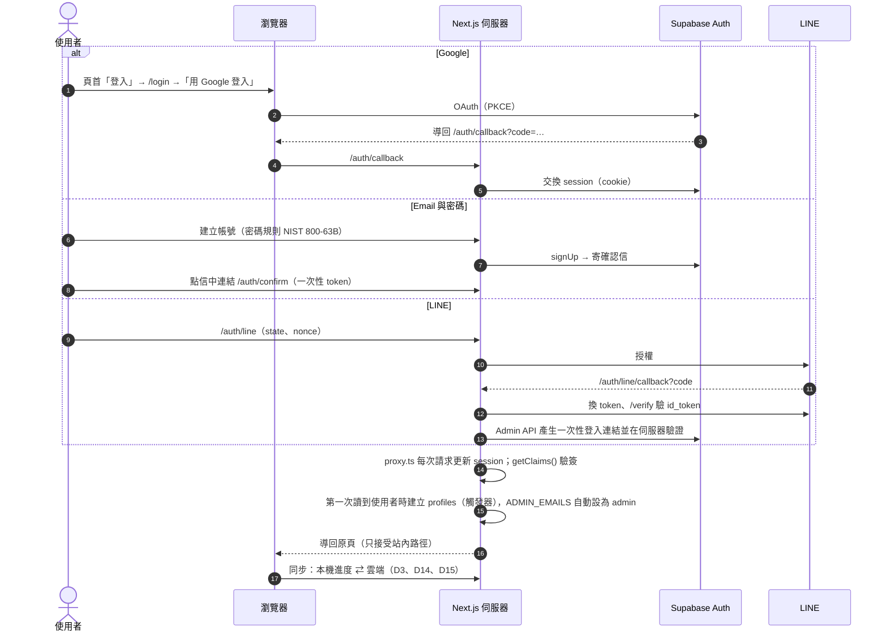

- **一個 Email 一個帳號**：Google 與 Email 註冊由 Supabase 依已驗證 Email 連結；LINE 用 Email 登入同一帳號（D101）。
- **不洩漏帳號是否存在**：註冊、忘記密碼的回應一律相同。
- **停用**：`profiles.status = disabled` 時伺服器視為未登入，並在 Auth 封鎖（D50）。

### 5.2 7 天練習循環

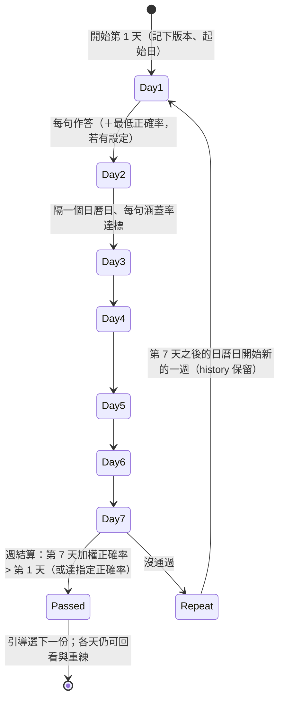

- 進度存在 localStorage（`ll-progress:v1:<videoId>`），登入時同時送雲端；格式與驗證在 `lib/progress.ts`。
- 解鎖、結算、重練規則在 `lib/cycle.ts`；通關條件在 `lib/pass-rules.ts`，存在進度的 `rules`。
- 自建教材的一週固定使用開始時的版本（`materialVersion`，`VersionGate` 加上 `?v=`，D44）。

### 5.3 聽寫評分演算法

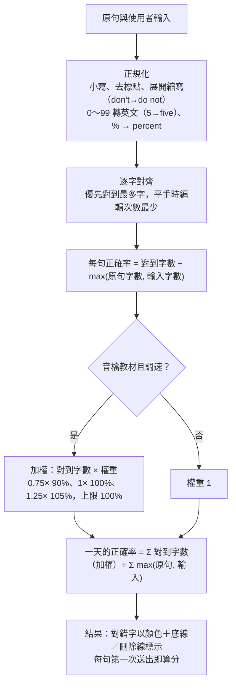

- 程式：`lib/scoring/`（正規化與對齊）、`lib/dictation.ts`、`lib/speed.ts`。
- 多寫的字會降低分數，避免亂打常見字矇分；什麼都沒寫是 0。
- 所有格與 `'d` 有歧義，不展開。

### 5.4 跟讀辨識

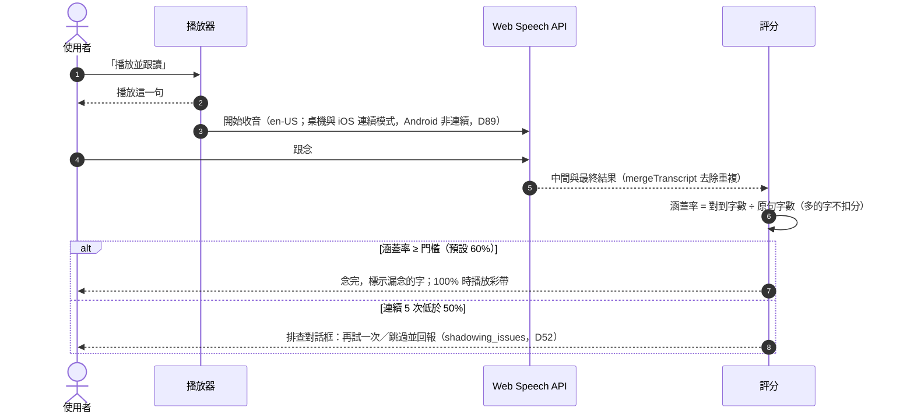

- 瀏覽器不支援或麥克風被拒時，顯示原因，改用「我念完了」自行標記（`coverage: null`）。

### 5.5 建立教材（AI 生成、斷句、翻譯、講解、配音、快取）

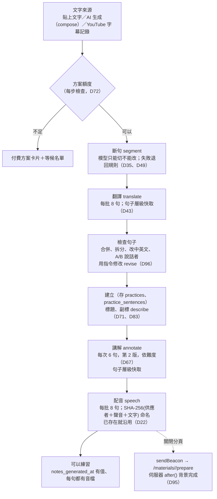

- 每個 AI 步驟：**預留最壞情況的費用 → 呼叫 → 依實際用量結算**（第 6 節）。
- 斷句以整段為快取鍵；翻譯與講解以「供應者 id（含模型與提示版本）＋句子文字」為鍵；音檔以「供應者＋聲音＋文字」命名。相同內容在任何教材都只付一次費用。
- 預估時間：每句 2.5 秒，或這台裝置的實測平均（D95）。

### 5.6 編輯與版本

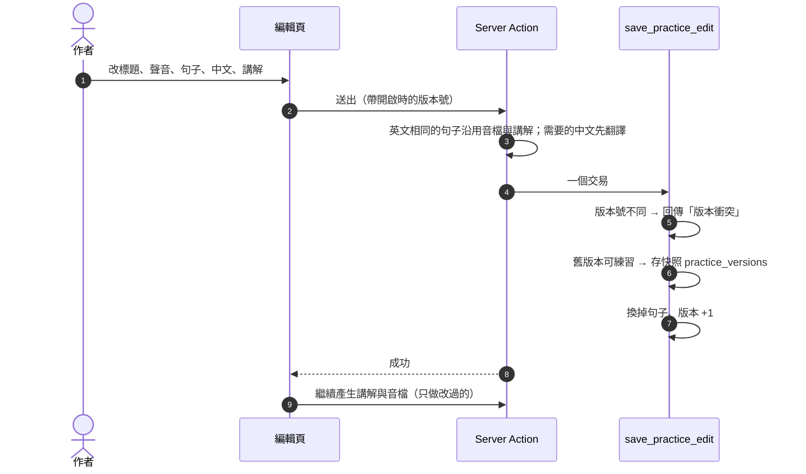

- 進行中的一週固定使用開始時的版本；伺服器讀 `?v=` 的快照（D44）。
- YouTube 教材不能編輯句子（D97）。

### 5.7 官方教材發布

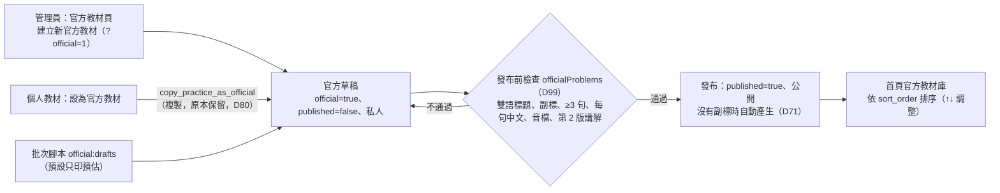

- `official`、`published`、`sort_order` 只有伺服器能改（觸發器 `guard_official`）。
- 講解升級：`upgradeOfficialNotes` 分批產生，再以 `upgrade_practice_notes` 建立新版本（D80）。

### 5.8 新聞教材（D100）

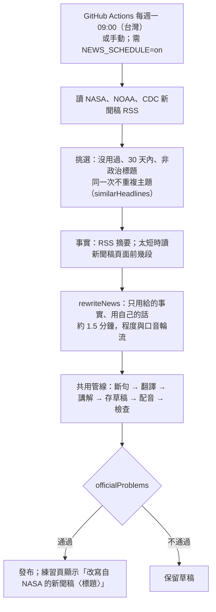

- 費用：每次上限 US$0.30（`NEWS_RUN_BUDGET_USD`），另受批次每日額度與全站每月上限限制。

### 5.9 檢舉與下架（D31）

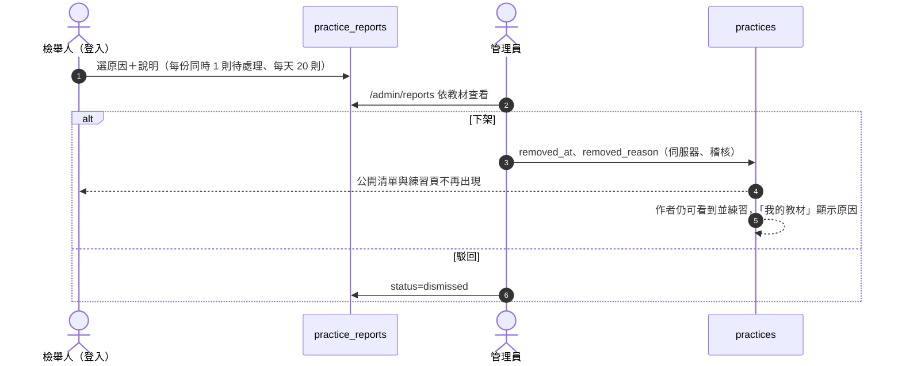

- 不自動下架；作者看不到是誰檢舉。

### 5.10 假門付費與等候名單（D102、D105）

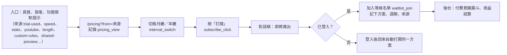

- 年繳 = 月繳 × 10（`yearlyFromMonthly`），顯示「省 2 個月」與每月平均，不顯示百分比。
- 測試結帳 `/checkout/fake` 只在假的供應者存在、而且不是正式站時可用（D85）。

### 5.11 班級作業（D103）

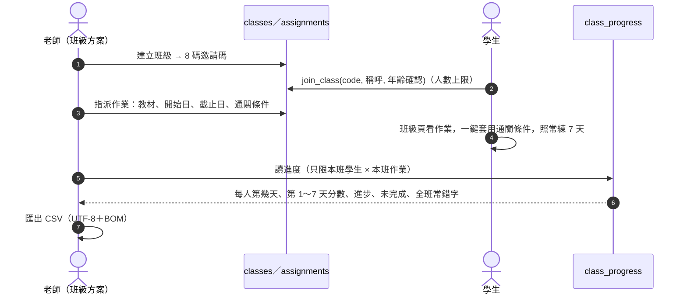

- 被指派的公開教材，學生不需付費也能練（`can_practice`，D106）。

### 5.12 公開教材的預覽與練習（D106）

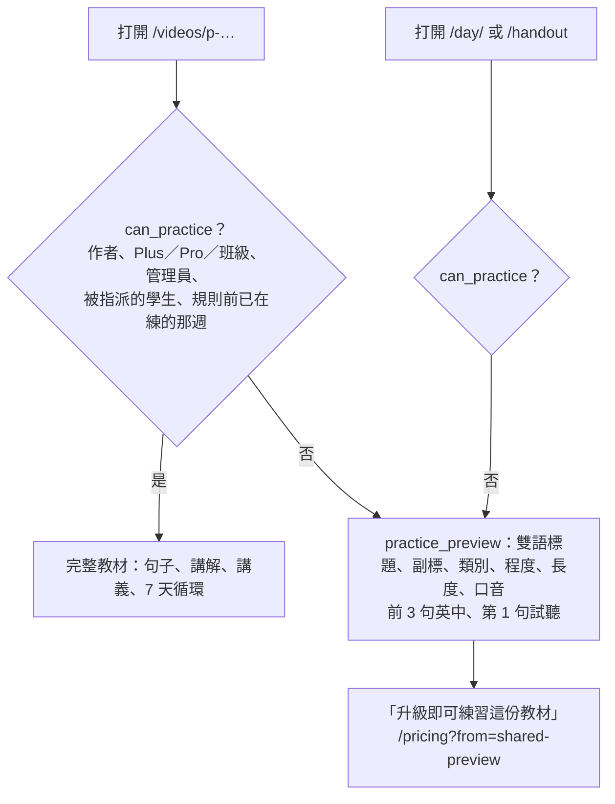

---

## 6. AI 與成本控制

### 6.1 供應者切換

| 環境變數               | 值                        | 說明                                                          |
| ---------------------- | ------------------------- | ------------------------------------------------------------- |
| `AI_LANGUAGE_PROVIDER` | `azure`（預設）、`google` | 語言模型                                                      |
| `AI_SPEECH_PROVIDER`   | `azure`（預設）、`google` | 語音合成                                                      |
| `AI_PROVIDERS`         | `fake`                    | 全部改用假的供應者；正式站（`VERCEL_ENV=production`）一律忽略 |

- 功能程式只呼叫 `lib/ai/types.ts` 的介面（D20）。值拼錯時視為沒設定，建立功能關閉，不會悄悄改用另一家。
- 設定是否完整由 `languageSetup`、`speechSetup` 判斷，`/admin/usage` 的「設定診斷」用同一份程式（D47）。

### 6.2 價格表（`lib/ai/pricing.ts`）

| 供應者／模型              | 輸入（每百萬 token）   | 輸出（每百萬 token） |
| ------------------------- | ---------------------- | -------------------- |
| Azure OpenAI gpt-5-mini   | US$0.25                | US$2.00              |
| Azure OpenAI gpt-4.1-mini | US$0.40                | US$1.60              |
| Gemini 3.6 Flash（備用）  | US$0.75                | US$3.75              |
| Azure Speech F0           | 免費（每月 50 萬字元） | —                    |

只有在價格表裡的模型才能啟用，避免出現沒計費的呼叫（D40）。

### 6.3 預留與結算

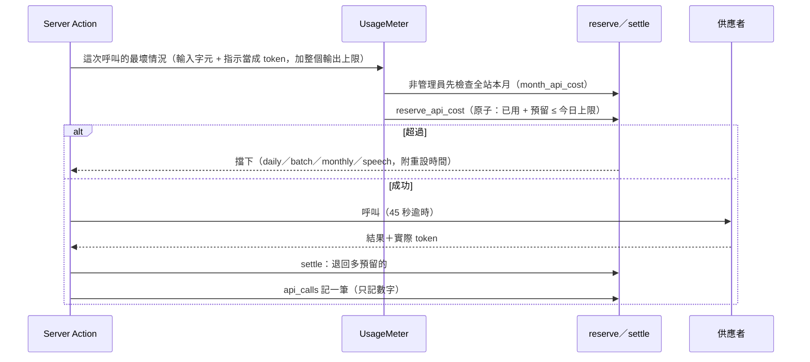

- 失敗而且沒有用量資料時，預留的不退；失敗但有用量時照實際結算（D38）。
- 每次呼叫的輸出上限集中在 `lib/ai/budgets.ts`。

### 6.4 上限（預設，後台可調，D77）

| 額度               | 預設                                              |
| ------------------ | ------------------------------------------------- |
| 管理員手動（每日） | US$1.00                                           |
| 管理員批次（每日） | US$1.00                                           |
| Plus（每日）       | US$0.20                                           |
| Pro（每日）        | US$0.60（Plus × 3）                               |
| 免費（每日）       | US$0.05                                           |
| 全站每月           | US$8.00（超過暫停一般使用者建立；80% 時後台警告） |
| 聲音（每人每日）   | 16,000 字元；批次 120,000 字元                    |

每日以台灣時間 00:00 重設，每月以台灣時間 1 日重設。

### 6.5 快取策略

| 種類    | 快取鍵                                   | 位置                             |
| ------- | ---------------------------------------- | -------------------------------- |
| 斷句    | 供應者 id（含模型、提示版本）＋整段文字  | `ai_cache`                       |
| 翻譯    | 供應者 id ＋語言方向＋一句文字           | `ai_cache`                       |
| 講解    | 供應者 id ＋講解版本（`v: 2`）＋一句英文 | `ai_cache`                       |
| 音檔    | SHA-256(供應者 id ＋聲音 ＋文字)         | Storage `speech`＋`speech_audio` |
| AI 生成 | 不快取（每次要新內容）                   | —                                |

改模型、提示詞或聲音時，調高版本號（`PROMPT_VERSION`、`NOTES_VERSION`、`AZURE_TTS_ID`），舊快取就不會被誤用。

### 6.6 實際成本數據

| 項目                               | 數量                        | 花費         | 來源      |
| ---------------------------------- | --------------------------- | ------------ | --------- |
| 第一次實測（5 種呼叫各 1 次）      | 1,177 輸入／249 輸出 token  | US$0.0008    | D41       |
| 14 份官方草稿                      | 121 次呼叫                  | US$0.1026    | D59       |
| 講解升級到第 2 版（13 份）         | 70 次呼叫                   | US$0.3875    | D69       |
| 14 份副標                          | 14 次呼叫                   | US$0.0019    | D71       |
| 18 份官方草稿（每類 2 份）         | —                           | US$0.4795    | D84       |
| 34 份官方教材＋3 則新聞            | —                           | US$0.7455    | D99、D100 |
| 官方教材品質稽核（AI 抽查 139 句） | 12 次呼叫                   | US$0.0122    | D115      |
| 每句講解（第 2 版）平均            | 約 210 輸入／380 輸出 token | 約 US$0.0008 | D67       |
| 一份 30 句教材的講解               | —                           | 約 US$0.025  | D67       |

聲音全部在 Azure F0 免費額度內。即時數字以 `/admin/usage` 或 `cost-report` skill 為準。

---

## 7. 方案與權限

### 7.1 權限表（`lib/plans.ts`）

| 項目                         | 免費                    | Plus（`paid`）                | Pro                             | 班級方案（老師）          | 管理員   |
| ---------------------------- | ----------------------- | ----------------------------- | ------------------------------- | ------------------------- | -------- |
| 官方教材、內建影片、7 天循環 | ✓                       | ✓                             | ✓                               | ✓                         | ✓        |
| 公開教材                     | 只能預覽（前 3 句）     | 完整練習                      | 完整練習                        | 完整練習                  | 完整練習 |
| 自建教材                     | 試做 1 份（最長 30 秒） | 每月 40 分鐘，單份最長 5 分鐘 | 每月 120 分鐘，單份最長 10 分鐘 | 每月 160 分鐘（取較大者） | 不限     |
| YouTube 建立練習             | —                       | ✓                             | ✓                               | 依個人方案                | ✓        |
| 播放速度                     | —                       | ✓                             | ✓                               | 依個人方案                | ✓        |
| 完整學習分析                 | 基本                    | ✓                             | ✓                               | 依個人方案                | ✓        |
| 自訂通關條件                 | 預設                    | ✓                             | ✓                               | 依個人方案（作業可帶入）  | ✓        |
| 優先產生、批次 PDF           | —                       | —                             | ✓（標示）                       | —                         | ✓        |
| 班級（建立、作業、報表）     | 加入班級                | 加入班級                      | 加入班級                        | 40 位學生                 | 100 位   |

- 帳號方案存在 `profiles.plan`（`free`／`paid`／`pro`）；班級方案是 `profiles.classroom_seats`。
- 程式只透過 `can(plan, action)` 判斷；改方案內容只改 `PLANS`（D54）。

### 7.2 額度計算

- **試做 1 份**：`profiles.practices_created`（觸發器在新增時 +1，刪除不減，D72）。
- **每月分鐘數**：本月（台灣時間）建立的 `practices.estimated_seconds` 加總；文字以每分鐘 150 字估算（D142），YouTube 用片段長度（D102）。
- **每份字數**：免費、Plus 2,000 字，Pro 10,000 字（技術上限）。
- 建立前每個 AI 步驟、存檔時都檢查（`auth/creation-quota.ts`）。

### 7.3 公開教材的預覽與練習規則（D106）

- `/explore` 只列使用者分享的教材；官方教材只在首頁教材庫。
- 誰能練、預覽內容、導回預覽、已在練的那週：見 5.12 與 `can_practice`。
- 價格：

| 方案             | 月繳   | 年繳（× 10） | 每月平均 |
| ---------------- | ------ | ------------ | -------- |
| Plus             | NT$149 | NT$1,490     | NT$124   |
| Pro              | NT$299 | NT$2,990     | NT$249   |
| 班級             | NT$499 | NT$4,990     | NT$416   |
| 班級（優先名單） | NT$349 | NT$3,490     | NT$291   |

---

## 8. 國際化、設計系統、無障礙

### 8.1 國際化

- 介面語言：繁體中文（預設）與英文；next-intl，語言存 cookie（`ll-locale`），第一次依瀏覽器語言。
- 所有介面文字在 `messages/*.json`；測試檢查兩份 key 完全一致，以及 `app/`、`components/` 的 .tsx 沒有寫死中文（只允許 `global-error`）。
- `<html lang>` 跟著介面語言；英文練習內容永遠標 `lang="en"`，中文標題標 `lang="zh-Hant"`。
- 講義翻譯固定繁體中文（目標使用者是台灣學生）。

### 8.2 設計系統

- 規格：`docs/design-system.md`；風格沉靜、專業、黑白橘，支援深色模式；`/styleguide` 有元件範例。
- tokens 在 `app/globals.css`（`--ll-*`），元件只用 tokens；主題顏色可依分數解鎖（D93），每個顏色在深淺色都通過 WCAG AA。
- 螢光筆 `mark-miss`（聽錯，實線）、`mark-key`（重點，點狀），不只靠顏色（D66）。

### 8.3 無障礙

- 目標 WCAG 2.1 AA：axe 自動檢查（E2E 與 QA 逐頁檢查，淺色／深色、中英文）。
- 點擊範圍：手機 44 px、其他 24 px（`tap` 工具類別，D76、D91）。
- 鍵盤：跳到主要內容、聽寫 Enter、對話框焦點留在內部（原生 `<dialog>`）。
- 圖表都有摘要句與資料表（D75）；減少動態效果時不播動畫。

---

## 9. 安全與隱私

| 項目         | 做法                                                                                                                                                                             |
| ------------ | -------------------------------------------------------------------------------------------------------------------------------------------------------------------------------- |
| 驗證         | Supabase Auth；伺服器用 `getClaims()` 驗證 token 簽章；`proxy.ts` 每次更新 session；導回網址只接受站內路徑（D13）                                                                |
| 權限         | RLS 是最後防線；寫入盡量用使用者自己的 session；需要 secret key 的動作只在伺服器，並先檢查身分（D63）                                                                            |
| CSP          | 每個請求新的 nonce＋`'strict-dynamic'`；iframe 只允許 YouTube；連線只允許本站與 Supabase；`object-src 'none'`、`frame-ancestors 'none'`（D63）                                   |
| 其他標頭     | HSTS 2 年、`nosniff`、`X-Frame-Options: DENY`、`Referrer-Policy`、`Permissions-Policy`（只開麥克風）、`COOP same-origin`                                                         |
| 速率限制     | 資料庫固定時間窗：意見回饋 5／時、問題句子 30／時、操作紀錄 300／時、檢舉 10／時、AI 步驟 600／時、下載資料 10／時、登入 20／時、結帳 20／時、付費意願 120／時；未登入依 IP 雜湊 |
| webhook 簽章 | HMAC-SHA256＋5 分鐘時間戳記；事件 ID 冪等；舊事件不覆蓋新事件（D85）                                                                                                             |
| 秘密資訊     | 只放環境變數；金鑰放在 header 不放網址；`api_calls` 不記文字與金鑰                                                                                                               |
| 蒐集的資料   | 帳號（編號、角色、狀態、方案）、進度、自建教材、操作紀錄、問題句子（含辨識文字）、回饋、檢舉、API 用量、付費意願（含訪客 cookie）、LINE 識別碼                                   |
| 保留期限     | 操作紀錄 180 天、問題句子 365 天、錯誤紀錄 90 天、管理稽核 2 年、API 用量不刪（刪帳號時解除關聯）                                                                                |
| 使用者權利   | 下載資料（`/account/export`，JSON）、刪除帳號（cascade；只屬於該帳號的音檔一併刪除）                                                                                             |
| 未成年       | 首次使用提示；未滿 13 歲勿自行建立帳號；班級加入時確認家長同意                                                                                                                   |
| AI 資料處理  | Azure OpenAI 不用於訓練，最多保留 30 天偵測濫用；Azure Speech 在阿聯處理（D40）                                                                                                  |

---

## 10. 部署與維運

### 10.1 環境變數（只列名稱與用途）

| 名稱                                                                                             | 用途                                          |
| ------------------------------------------------------------------------------------------------ | --------------------------------------------- |
| `NEXT_PUBLIC_APP_URL`、`NEXT_PUBLIC_SITE_URL`                                                    | 網站網址（SEO、連結）                         |
| `NEXT_PUBLIC_DEV_TEST_MODE`                                                                      | 開發時略過「不同日曆日」解鎖規則              |
| `NEXT_PUBLIC_SUPABASE_URL`                                                                       | Supabase 專案網址                             |
| `NEXT_PUBLIC_SUPABASE_ANON_KEY`                                                                  | 公開金鑰（publishable）                       |
| `SUPABASE_SERVICE_ROLE_KEY`                                                                      | 秘密金鑰（只在伺服器）                        |
| `ADMIN_EMAILS`                                                                                   | 管理員 Email（逗號分隔）                      |
| `AI_LANGUAGE_PROVIDER`、`AI_SPEECH_PROVIDER`、`AI_PROVIDERS`                                     | 供應者切換                                    |
| `AZURE_OPENAI_ENDPOINT`、`AZURE_OPENAI_API_KEY`、`AZURE_OPENAI_DEPLOYMENT`、`AZURE_OPENAI_MODEL` | Azure OpenAI                                  |
| `AZURE_SPEECH_KEY`、`AZURE_SPEECH_REGION`                                                        | Azure Speech                                  |
| `GEMINI_API_KEY`、`GOOGLE_CLOUD_API_KEY`                                                         | 備用供應者                                    |
| `YOUTUBE_API_KEY`、`YOUTUBE_PROVIDER`                                                            | YouTube 建立練習（沒有時隱藏）；測試用 `fake` |
| `LINE_CHANNEL_ID`、`LINE_CHANNEL_SECRET`                                                         | LINE 登入（沒有時隱藏）                       |
| `PAYMENTS_PROVIDER`、`PAYMENTS_WEBHOOK_SECRET`                                                   | 金流（目前只有 `fake`，正式站停用）           |
| `OFFICIAL_BUDGET_USD`、`NEWS_BUDGET_USD`、`NEWS_COUNT`、`NEWS_YES` 等                            | 批次腳本的預算與開關                          |
| `LISTENLOOP_UNATTENDED`                                                                          | 設為 1 時，所有真實 API 的腳本拒絕執行        |

範本在 `.env.example`；值只放 `.env.local` 與 Vercel。

### 10.2 CI/CD 與分支保護

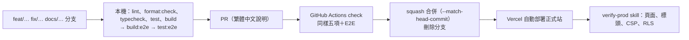

- `main` 受保護：必須透過 PR，而且 `check` 通過。job 名稱不可更改。
- migration：只新增的用 `npm run db:push -- --yes`；會改權限或刪除的，拆成「先加、部署後再收」兩步（D106）。

### 10.3 備份與還原

- `npm run db:backup`：每張表匯出 JSON 到 `backups/`（git 忽略）。
- 完整 SQL 備份與還原步驟：`docs/backup.md`。Supabase 免費方案沒有可還原的自動備份，所以要手動備份（D63）。

### 10.4 設定診斷與測試連線

- `/admin/usage` 的「設定診斷」逐項列出建立教材需要的條件（不顯示值，D47）。
- 「測試連線（免費）」用不計費的請求檢查各供應者（D49）：Azure OpenAI 送空對話（400 不計費）、Azure Speech 讀聲音清單。

### 10.5 常見問題排除

| 症狀                                               | 可能原因與處理                                                                    |
| -------------------------------------------------- | --------------------------------------------------------------------------------- |
| 「還沒有接上聲音和翻譯服務」、`/materials/new` 404 | 看設定診斷哪一項沒通過；常見是部署名稱、區域、端點格式（D47、D51）                |
| 失敗（config；HTTP 401）                           | 金鑰錯誤或 Azure 額度用完；重新貼金鑰並重新部署                                   |
| HTTP 404 DeploymentNotFound                        | `AZURE_OPENAI_DEPLOYMENT` 和 Azure 上的部署名稱不同                               |
| 語音服務忙碌                                       | F0 每分鐘 20 次；程式會自動等待重試（D39）                                        |
| 建立到一半停了                                     | 「我的教材」按「繼續準備」，只會做剩下的部分                                      |
| 「連不上伺服器，可能是網站剛更新」                 | 部署後舊頁面呼叫舊的 Server Action；複製文字、重新整理                            |
| 一般使用者暫停建立                                 | 全站本月費用達上限；到 `/admin/usage` 確認或調整                                  |
| 未登入時教材庫沒有官方教材                         | `practices` 新欄位沒有 grant 給 anon（D106 修正過一次）；執行 `npm run rls:check` |
| Email 確認信收不到                                 | Supabase 內建寄信每小時很少；設定自己的 SMTP（Resend）                            |

---

## 11. 測試策略

| 層級              | 工具與範圍                                                                                                             | 指令                                    |
| ----------------- | ---------------------------------------------------------------------------------------------------------------------- | --------------------------------------- |
| 單元測試          | Vitest：評分、循環、同步、方案、價格（年繳 = 月繳 × 10）、AI 回應檢查、RLS 靜態檢查、翻譯 key 一致、元件測試           | `npm test`                              |
| AI fixture        | 真實回應錄成 `tests/fixtures/ai/`，回放檢查；錄製預設只印預估（D41）                                                   | `npm run ai:record`                     |
| E2E               | Playwright 對 production build；擋 YouTube；`page.clock` 設日期；假的 Supabase（`e2e/mock-supabase/`）；假的 AI 與金流 | `npm run build:e2e && npm run test:e2e` |
| 無障礙            | axe（WCAG 2.1 A／AA），主要頁面淺色、深色、登入、未登入                                                                | E2E 內                                  |
| QA 逐頁檢查       | 5 種寬度 × 深淺色 × 中英文：重疊、截斷、超出、點擊範圍、axe、錯誤、壞連結、慢（D91）                                   | `npm run qa`、`qa-sweep` skill          |
| AI 模擬使用者測試 | 7 個角色、11 個任務，Nielsen 嚴重度（D86）                                                                             | `ai-usability-test` skill               |
| RLS 即時檢查      | 用公開金鑰對正式資料庫：讀私人表、寫入、呼叫管理函式都必須被拒絕                                                       | `npm run rls:check`                     |
| 正式站檢查        | 頁面、標頭、CSP、YouTube、manifest、RLS                                                                                | `verify-prod` skill                     |
| 官方教材品質稽核  | 規則檢查全部已發布的官方教材，AI 抽查翻譯（D115）                                                                      | `npm run official:audit`                |

**省錢規則**：開發與所有自動測試只用假的供應者或 fixture；`tests/setup-network.ts` 擋 Azure 與 Google 的網址；Playwright 強制 `AI_PROVIDERS=fake` 並清空金鑰。

---

## 12. 已知限制與未來規劃

### 12.1 已知限制

- **免費方案的 Supabase**：檔案 1 GB（約 48 小時音檔）、流量每月 5 GB 未快取（約 600 人週，D46）；沒有自動備份。
- **Vercel Hobby**：函式最長 60 秒；背景完成最多約 5 分鐘（D95）。
- **Azure F0**：每分鐘 20 次、每月 50 萬字元；學生額度 US$100。
- **Web Speech API**：辨識結果依瀏覽器與環境而異，建議 Chrome；Android 需真機確認（D89）。
- **未登入的進度只在本機**，清除瀏覽器資料會消失；公開教材改付費時，只有雲端有進度的帳號能完成當週（D106）。
- **YouTube 教材**不能編輯句子、不能複製成官方教材（D97）。
- **金流**只有假的供應者；方案由管理員手動開通。
- **優先產生**目前只是標示；**批次 PDF**尚未實作。
- **新聞排程**預設關閉。
- **等 Joe 同意後套用的 migration**：公開教材的資料庫讀取規則（`20261111000100_shared_practice_lock.sql`，在那之前由伺服器的 `can_practice` 檢查把關，D106）、練習提醒（`20261111010000_reminders.sql`）、回報教材錯誤（`20261111020000_sentence_reports.sql`）。
- **練習提醒**要設定 VAPID 金鑰與 GitHub 排程後才會出現（D111）。
- **同步**：離線時重新開始一份「在另一台裝置已移除」的教材，下次同步會被刪除（D15）。

### 12.2 未來規劃

- 真的金流供應者（見 `docs/payments.md`）與 Google Play 上架（`docs/play-store.md`、`docs/twa.md`）。
- Product Hunt 發表（`docs/launch/product-hunt.md`）；品質稽核標出的翻譯修正。
- 班級：自動提醒、成績冊、多位老師、學校方案（`docs/classroom.md`）。
- 內容：Blender 開放電影的字幕與時間點（M3 剩下的部分）。

---

最後更新：2026-11-11
