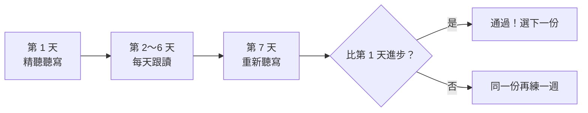
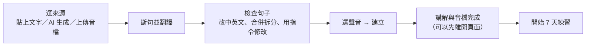

# ListenLoop 使用者手冊

ListenLoop 是一個英文聽力練習網站：選一份教材，用 7 天把它「聽清楚每個字」，第 7 天和第 1 天比較，看見自己的進步。

## 目錄

1. [註冊與登入](#1-註冊與登入)
2. [選教材](#2-選教材)
3. [7 天怎麼練](#3-7-天怎麼練)
4. [聽寫的操作](#4-聽寫的操作)
5. [跟讀的操作](#5-跟讀的操作)
6. [看懂講解與螢光筆標示](#6-看懂講解與螢光筆標示)
7. [講義與 PDF](#7-講義與-pdf)
8. [學習進度與學習分析](#8-學習進度與學習分析)
9. [建立自己的教材](#9-建立自己的教材)
10. [班級](#10-班級)
11. [方案說明](#11-方案說明)
12. [帳號與隱私](#12-帳號與隱私)
13. [常見問題](#13-常見問題)

---

## 1. 註冊與登入

- **不登入也能練習**內建影片與官方教材，紀錄存在這台裝置。第一次來時，首頁最上方的「**免費試聽寫第一句**」會直接打開一份初級教材的第 1 天；「先做 2 分鐘程度測驗」會推薦適合的程度。
- **登入後**才看得到練習日曆、今日任務、學習進度與分析，進度會存進帳號，換裝置也一樣。這台裝置之前的紀錄，第一次登入時會一起存進帳號。
- 按頁首右上角「登入」，三種方式擇一：
  1. **Google**；
  2. **LINE**（需要 LINE 帳號有 Email）；
  3. **Email 與密碼**：「建立帳號」→ 到信箱點確認連結。密碼至少 10 個字元，可以用空格或中文，不要和其他網站共用。
- **同一個 Email 就是同一個帳號**：用 Google 註冊後，也可以用「忘記密碼」設一組密碼，之後兩種都能登入。
- **忘記密碼**：登入頁 →「忘記密碼」→ 收信 → 設定新密碼。
- 未滿 18 歲請在家長或法定代理人同意下使用；未滿 13 歲請不要自行建立帳號。

---

## 2. 選教材

### 2.1 首頁的官方教材庫

- **內建影片**：Blender 開放電影等，標示出處。
- **官方教材**：ListenLoop 製作的音檔教材，涵蓋日常、旅遊、校園、留學、職場、新聞、考試風格等類別，免費。
- 篩選：
  - **類別**：點標籤選擇，最多 5 個，上方顯示「已選 X / 5」；點「全部」清除。選好後會自動搜尋。
  - **長度**：全部、3 分鐘以下、3–5、5–10、10 分鐘以上。
  - **程度、口音、情境、類型**，以及搜尋標題。
  - 「存為我的預設篩選」：下次打開首頁自動套用。
- **不知道從哪裡開始**：做 2 分鐘的「程度測驗」（`/level-test`），依結果推薦程度和第一份教材。分級規則：初級、中級、高級各聽寫幾句，**某一級的正確率達到 60% 就算達到那一級**，結果是從初級往上連續達到的最高一級。測完後教材庫會先篩選這個程度（自己存過預設篩選時以自己的為準）。
- 卡片上有英文與中文標題、副標題、長度、口音、每天大約要練幾分鐘。

### 2.2 公開教材

- 頁首「公開教材」：其他使用者分享的教材（官方教材不在這裡）。
- **免費方案與未登入**：可以**預覽**雙語標題、副標題、類別、程度、長度、口音、前 3 句的英文與中文，並試聽第 1 句。
- **Plus、Pro、班級方案**：可以完整練習。按「升級即可練習這份教材」看方案。
- 被老師指派為作業的公開教材，學生免費也能練。

---

## 3. 7 天怎麼練

- 每天完成一次，**隔天才會開放下一天**（每份教材各自計算）。
- 可以同時練好幾份教材，每份有自己的進度。
- **滿意度調查**：登入時，第 7 天的結果頁下方會問「你有多大可能推薦給朋友？」（0～10 分）和一個選填的意見；每份教材每週只問一次，可以略過。
- **進步分享卡**：第 7 天完成後，結果頁會產生一張圖片（第 1 天與第 7 天的正確率、進步幅度、教材標題、網址，沒有個人資料），可以下載或分享。
- 當天完成後可以按「再練一次」（重練）：只顯示分數，不影響正式成績。
- **通關條件**（影片頁的「通關條件」）：預設是「第 1 天每句作答」、「跟讀每句念到 60%」、「第 7 天比第 1 天進步」。Plus 以上可以自己調整，例如要求聽寫至少 70%。

---

## 4. 聽寫的操作

1. 進入第 1 天，第一句會自動播放一次。
2. 在輸入框打出你聽到的英文，按 **Enter** 送出。
3. 畫面顯示逐字比對：
   - 對的字正常顯示；
   - 聽錯或漏掉的字有顏色與底線，多寫的字有刪除線。
4. 下方是這句的中文翻譯與講解。按「下一句」繼續。

| 按鈕／功能 | 說明                                                                    |
| ---------- | ----------------------------------------------------------------------- |
| 重播       | 再聽一次這一句                                                          |
| 循環播放   | 每句播完 1.5 秒後自動再播，直到送出                                     |
| 播放速度   | 音檔教材可選 0.75×、1×、1.25×（Plus 以上）；慢速分數 × 90%、快速 × 105% |
| 字幕提示   | YouTube 影片請點播放器的 CC 按鈕關掉字幕                                |

- 分數算法：對到的字數 ÷（原句字數與你寫的字數中較多的那個）。亂打很多字會扣分。
- 數字寫阿拉伯數字或英文都可以（5 = five）；縮寫也可以（don't = do not）。
- 每句第一次送出就算分，不能重答。

---

## 5. 跟讀的操作

1. 第 2～6 天，按「播放並跟讀」：先播放這一句，接著開始收音。
2. 跟著念完整句。畫面會標出念到與漏掉的字，顯示涵蓋率。
3. 達到門檻（預設 60%）就算念完這句；100% 會有彩帶。
4. 全部句子念完，今天就完成。

- 請用**電腦版或 Android 的 Chrome**，允許麥克風；環境安靜一點效果比較好。
- 麥克風被拒絕、或瀏覽器不支援時，畫面會說明原因，可以按「我念完了」自己標記。
- 同一句連續 5 次都低於 50%，會出現建議（檢查麥克風、換安靜的地方、聽完整句再念），可以「跳過這句並回報」，不影響完成。

---

## 6. 看懂講解與螢光筆標示

聽寫送出、或跟讀念完後顯示：

| 區塊               | 內容                                           |
| ------------------ | ---------------------------------------------- |
| 難度               | 簡單、中等、困難；越難的句子講解越詳細         |
| 你這句聽錯的地方   | 只在有錯時出現，排在最前面                     |
| 中文翻譯           | 直接在英文句子下方                             |
| 重點               | 這句最值得學的 1～2 個字或片語                 |
| 句子結構與逐段意譯 | 困難句：主要子句、從屬子句、修飾語，每段附翻譯 |
| 為什麼難聽懂       | 連音、弱讀、省略（例如 want to → wanna）       |
| 單字與片語         | 音標、詞性、中文、常見搭配、例句與中文         |
| 文法               | 用法、句中的例子、例句、常見錯誤               |

**螢光筆**：

- **橘色、實線底線**：你聽錯或漏掉的字；
- **黃色、點狀底線**：這句的重點。
- 螢幕閱讀器會念出「你聽錯的字」「重點」。

---

## 7. 講義與 PDF

- **第 1 天完成後**才開放講義（避免先看到原文）。
- 內容：每句英文與中文、這週第 1 天聽錯的字（橘色）、每句重點（黃色）、單字表、文法、困難句的結構拆解與連音。
- 按「列印 / 存成 PDF」→ 在列印視窗選「另存為 PDF」。列印時顏色會調淡，只看底線也分得出兩種標示。

### 7.1 聆聽模式（D135）

- **第 1 天完成後開放**（和講義相同）。入口在教材頁講義旁、各天的結果頁，以及首頁今日任務的「聆聽」。
- 不測驗，只聽：整篇連續播放，目前的句子會高亮；點任何一句就從那句開始。
- **字幕**：盲聽、只有英文、英中對照、只有中文，會記住你的選擇。
- **三遍聽法**：一鍵依序播放整篇三次，第一遍盲聽、第二遍看英文、第三遍英中對照。
- **循環**：單句循環或整篇循環。音檔教材可以調語速（Plus 以上）。
- **鎖屏**：音檔教材在手機鎖屏或切到其他 App 時會繼續播放，鎖屏畫面可以暫停、換句。YouTube 影片因為條款，不能在背景播放。
- 第 1 天聽錯的字用螢光筆標示。聆聽的時間計入學習分析的練習時間，但不算完成當天的任務。
- 鍵盤：空白鍵播放／暫停，方向鍵切換上一句、下一句。

### 7.2 單字測驗（D136）

- 第 1 天、第 7 天的聽寫完成後，結果頁會出現「單字測驗（約 3 分鐘）」，可以跳過；教材頁也有入口，也可以重做。
- 每次 5～10 個單字，先考你聽寫時聽錯的字，再從教材的重點單字補足。
- **第 1 關，聽音拼字**：自動播放發音，可以重播、慢速播放；輸入拼字，送出後逐字母標出拼錯、漏掉、多打的字母。提示有兩段（先顯示字母數，再顯示第一個字母），用了提示會記在結果裡。
- **第 2 關，選出正確翻譯**：四選一；答完顯示詞性、中文、例句與翻譯。
- **結果**：拼字正確數、翻譯正確數、用了幾次提示。答錯的字自動加入「我的錯字」，1、3、7 天後出現在今日任務。
- 測驗分數不影響聽寫成績與通關。登入後會保存紀錄，並出現在學習分析。

---

## 8. 學習進度與學習分析

- **首頁**（登入後）：練習日曆 → 今日任務 → 官方教材庫。
- **我的錯字**（`/review`）：聽寫時聽錯的字自動收進清單，隔天、再 3 天、再 7 天出現在今日任務；看著挖空的原句（和中文、可播放的原音）填回那個字，連續答對 3 次就學會。每個字出現時會自動播放發音，可以按「重播」或「循環播放」（每隔 1.5 秒再播一次）；作答後顯示這個字的詞性、中文、音標、例句與例句翻譯，以及「出自《教材》第 N 句」，按「去聽原句」會打開聆聽模式並從那一句開始。
- **學習進度**（頁首）：所有在練的教材、第幾天、完整的練習日曆；可以移除不想練的教材（其他裝置也會一起移除）。
- **學習分析**（頁首）：
  - 連續練習天數、每天的練習時間（只算畫面在前景、有操作的時間）；
  - 正確率趨勢（加權與原始）、每份教材的第 1 天與第 7 天；
  - 最常聽錯的 10 個字、練習的類別與程度分布（完整圖表為 Plus 以上）；
  - **單字測驗**：測驗次數、平均正確率、已掌握單字（最近一次兩關都對、沒用提示）；正確率趨勢為 Plus 以上；
  - **分數**：完成每天 +10、整句全對 +2、連續練習 +5；分數可以解鎖主題顏色與背景主題。

---

## 9. 建立自己的教材

頁首「我的教材」→「建立練習」。免費方案每週 2 分鐘（2 份 1 分鐘或 1 份 2 分鐘，每週一 0 點台灣時間重設，建立頁會顯示本週剩餘與重設時間；刪除教材不會退回分鐘數）；Plus 每月 40 分鐘、Pro 每月 120 分鐘。

1. **貼上文字**：英文或中文都可以（中文會翻成英文來練）。對話每行開頭寫「A:」「B:」會用兩個聲音。
2. **AI 生成**：填標題（選填，有填就照用）、類別、情境、程度、長度、口音，以及「想練什麼？」。
   - 類別預設是「自訂類別」，打開時游標就在類別名稱欄位。填了名稱，AI 會依這個類別生成，教材也會放進同名資料夾。
   - 類別名稱可以留空：由 AI 依內容判斷最接近的類別，判斷不出來時歸為「其他」。斷句翻譯後的檢查畫面會顯示判斷結果，可以用下拉選單修改。
   - 類別名稱和「想練什麼？」都留空也可以，AI 會自己選一個日常主題。
   - 也可以從類別下拉選單改選既有的類別和情境。
3. **上傳音檔**（Plus 以上）：選自己的英文 MP3 或 MP4（Plus 每檔 100 MB、5 分鐘以內；Pro 200 MB、10 分鐘）。影片只在你的瀏覽器裡取出聲音，不上傳畫面。AI 轉成逐字稿和每句的時間點後，可以逐句播放、修改英文與時間、合併或刪除，再翻譯、建立。練習時播放你原本的錄音。建立後是私人的；要公開分享，必須勾選「我擁有此內容的權利或已取得授權」。
4. **檢查句子**：畫面顯示句數和預估長度（依實際字數，以每分鐘約 150 字估算）。每句可以改英文與中文、合併、拆分；也可以輸入指令，例如「換成更簡單的單字」，不滿意可以「復原上一步」。
5. **聲音**：美、英、澳、印四種口音，男聲女聲，可以試聽。
6. **建立後**：畫面顯示預估時間（依全站最近實際的產生時間校正）；超過 1 分鐘可以先離開，完成後在「我的教材」看到。中斷了就按「繼續準備」。
7. **之後**：可以編輯（只會重做改過的句子）、設為公開分享、刪除。正在練的一週會固定使用開始時的版本。
8. **我的教材的資料夾**：「我的資料夾」可以新增、重新命名、刪除（教材會回到最上層）；「依類別」自動整理；用 AI 生成時自己填的類別會變成同名資料夾。點資料夾進去看教材（中英標題、副標題、長度、目前進度），上方的「我的教材 › 資料夾」可以回上一層。可以切換格狀或清單。移動教材：電腦把卡片拖到資料夾上，或用每張卡片的「移動到」（手機也是）。卡片的「管理」裡有編輯、公開設定、刪除。

---

## 10. 班級

- **學生**：老師給你 8 碼邀請碼或連結 → 頁首「班級」→ 輸入邀請碼、填在班上的稱呼（建議座號＋姓名）、確認年齡 → 加入。
  - 班級頁看公告、作業與截止日期、自己的進度；按「套用老師的通關條件」。
  - 老師只看得到你在班上指派教材的進度與稱呼，看不到 Email 和其他練習。
  - 可以隨時退出班級。
- **老師**：需要班級方案（目前由管理員開通）。建立班級、邀請、指派作業、看進度、匯出 CSV、發布公告。詳見 `docs/classroom.md`。

---

## 11. 方案說明

| 方案     | 價格（月繳／年繳）                              | 內容                                                                                                                       |
| -------- | ----------------------------------------------- | -------------------------------------------------------------------------------------------------------------------------- |
| 免費     | NT$0                                            | 所有官方教材與內建影片、7 天循環、講義與 PDF、公開教材預覽、每週 2 分鐘自建教材（單份最長 2 分鐘）、基本學習分析           |
| Plus     | NT$149／NT$1,490                                | 完整練習公開教材、每月自建 40 分鐘（單份 5 分鐘）、上傳音檔建立、播放速度、完整分析、自訂通關                              |
| Pro      | NT$299／NT$2,990                                | Plus 全部，加上每月 120 分鐘（單份 10 分鐘）、優先產生、批次 PDF                                                           |
| 學生方案 | NT$90／NT$900                                   | 內容和 Plus 一樣。用學校信箱（.edu、.edu.tw 等）的 Google 帳號登入就自動認證，有效一年；到期後用學校帳號重新登入即可續認證 |
| 班級     | 小班 NT$349、標準班 NT$549、大班 NT$800（月繳） | 小班 15、標準班 40、大班 100 位學生；作業與進度後台、CSV、公告；老師每月自建 45／70／105 分鐘                              |

- 年繳 = 月繳 × 10，等於**省 2 個月**（所有方案都一樣，D173）。
- 付費方案**即將推出**：現在按「訂閱」可以加入等候名單，不會收費。
- 退款：第一次付款後 7 天內全額退款；年繳提前取消，未使用的完整月份按比例退款（`/refund`）。

---

## 12. 帳號與隱私

- **背景主題**：帳號頁可以換頁面背景（19 種，每種都有淺色與深色）。每個主題是一整套搭配（背景、卡片樣式：純色／紙張／毛玻璃、強調色）；卡片縮圖會即時畫出首頁和練習頁的樣子，最前面是 6 個推薦主題，其餘依風格分組，可以用方向鍵切換。有些免費、有些用分數解鎖。系統開啟「減少動態效果」時，切換不會淡入，動態背景會靜止。
- **練習提醒**：帳號頁可以開啟每日提醒，選時間；當天練過就不提醒。
- **帳號頁**：登出、下載我的資料（JSON）、刪除帳號（勾選確認後永久刪除）。
- 我們只記錄必要的資料（進度、操作紀錄、你主動回報的內容），不記錄你的錄音。
- 你建立教材時的文字會送到 AI 服務（Azure）產生翻譯、講解與語音，不會被用來訓練模型。
- 完整說明見頁尾「隱私權政策」與「服務條款」。

---

## 13. 常見問題

- **有教學文章嗎？** 頁尾「學習文章」有連音、聽寫、多益、留學生活英文等文章，每篇都附可以直接練的教材。

| 問題                         | 解答                                                                                                                        |
| ---------------------------- | --------------------------------------------------------------------------------------------------------------------------- |
| 明天才能練下一天？           | 是的，每天一個任務，隔一個日曆日才開放，這是讓聽力「沉澱」的設計                                                            |
| 第 7 天沒通過怎麼辦？        | 同一份教材在第 7 天之後的日子重新練一週，之前的紀錄會保留                                                                   |
| 跟讀一直辨識不到             | 用 Chrome、允許麥克風、靠近麥克風、環境安靜；仍不行可以跳過並回報                                                           |
| 影片沒有聲音或播不出來       | 檢查網路與 YouTube 是否能開；從網站內點進去，瀏覽器比較不會擋自動播放                                                       |
| 換手機後進度不見             | 登入同一個帳號就會同步；未登入時進度只在原本的裝置                                                                          |
| 公開教材只能看前 3 句        | 免費方案只能預覽；升級 Plus 以上可以完整練習                                                                                |
| 建立教材說額度用完           | 免費方案每週 2 分鐘，每週一重設；付費方案每月 1 日重設分鐘數。右上角「帳號」→「我的額度」可以看每一項用了多少、什麼時候重設 |
| 可以離線練習嗎？             | 音檔教材打開練習頁後，這份教材的音檔會存在裝置上，網路不穩時仍能播放；打開新頁面需要網路                                    |
| 發現翻譯、講解或音檔有錯     | 在那一句下方按「回報這句的問題」，修正後首頁會通知你                                                                        |
| 網站顯示「維護中」或功能暫停 | 頁尾「服務狀態」可以看目前狀態與公告；練習進度都保存在雲端，不會遺失                                                        |

---

最後更新：2026-11-12
